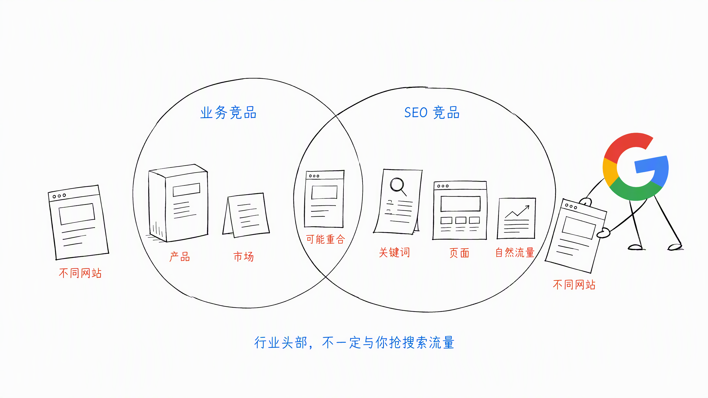
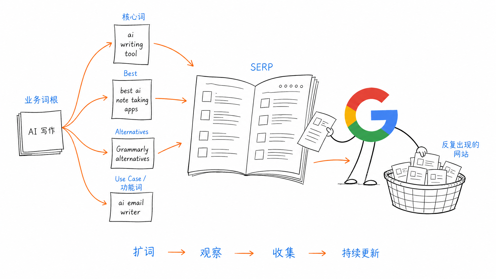
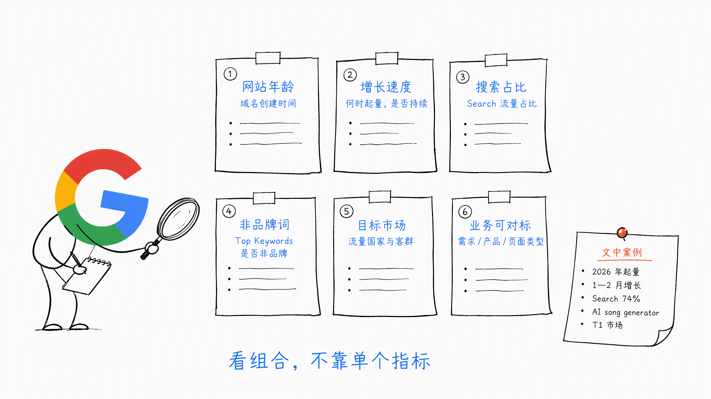
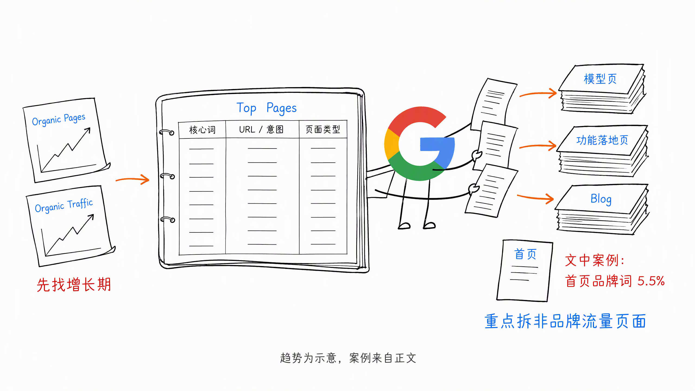
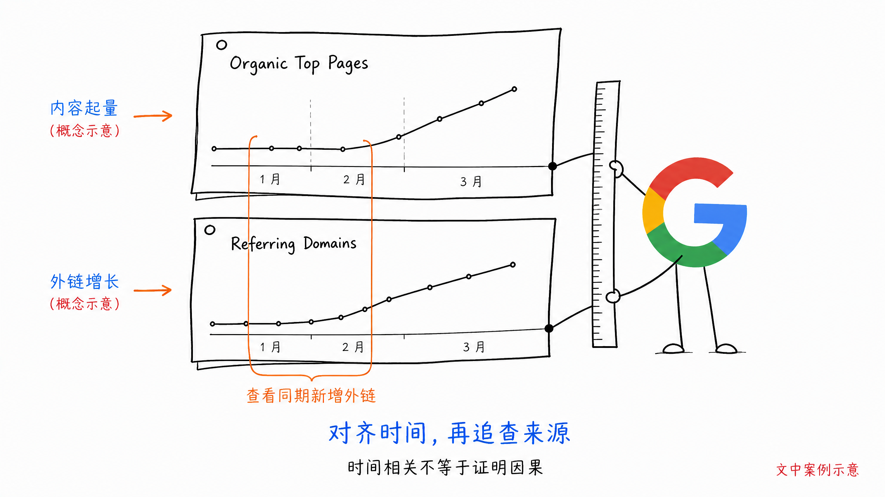
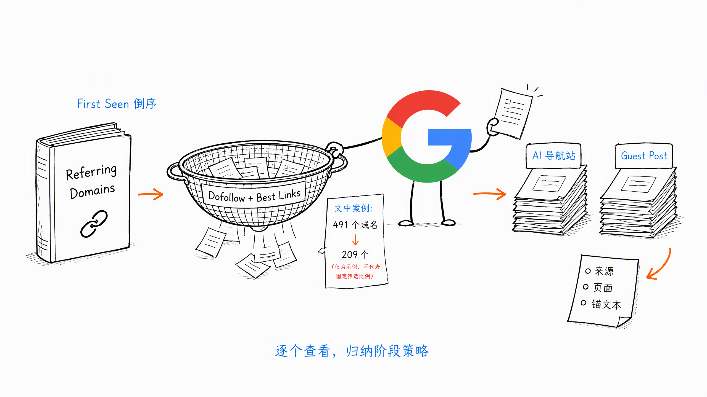
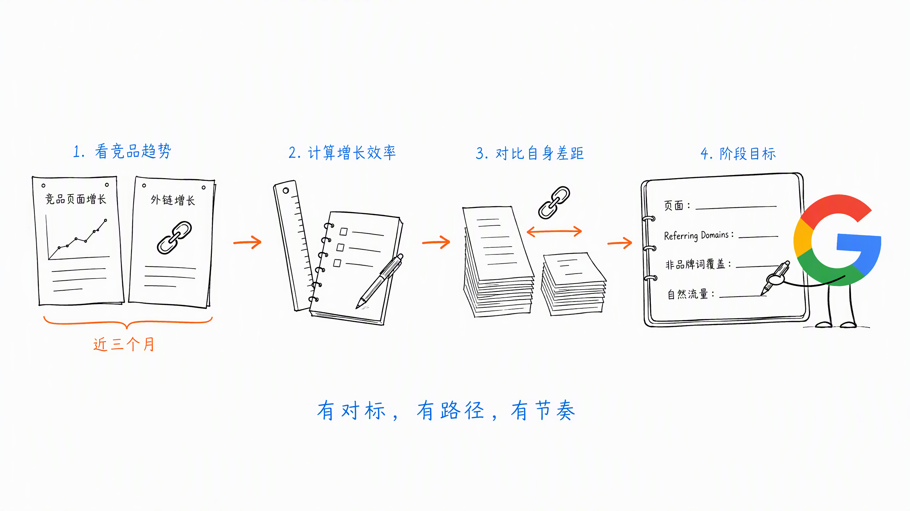

# 第 4 章 寻找并真正分析懂的 SEO 竞争对手

> ❤️ 这一章节内容，感谢《创业清单》某一章节给我的启发。

在规划和启动 SEO 时，先找到和分析 SEO 做得不错的竞争网站，是非常重要的。

一方面，你以为自己很懂客户，但可能并不清楚搜索用户在搜什么，以及关键词背后的搜索意图。

比如用户可能搜索：

- Best AI writing tools
- How to improve writing with AI

这两个词看起来都与 AI 写作有关，但用户需求和决策阶段完全不同。

分析 SEO 竞品，不只是看对手在做什么。还可以通过他们获得流量的关键词和页面，反过来理解用户正在搜索哪些问题。

另一方面，每个新站都应该做 SEO 竞争分析。最起码要先判断：

- SEO 这个流量渠道能不能做
- 现阶段该不该做
- 应该先从哪里切入

如果搜索结果里的竞争对手都是 DR 70+ 的老站，一个新站短期很难正面竞争。

但如果有不少新站正在快速起量，说明这个赛道还有机会。

## 一、真正的 SEO 竞争对手是谁

业务竞品，不一定是 SEO 竞品。

你平时熟悉的行业头部品牌，可能主要依赖品牌、广告、渠道或销售增长，并没有与你争夺大量非品牌自然搜索流量。

反过来，很多你从没听过的新站，却可能正在通过工具页、功能页、榜单页和替代页抢走搜索用户。

所以从 SEO 流量维度看竞争对手，不能只看头部那几家。

真正值得关注的，是这些网站：

- SEO 流量不错
- 非品牌词占比较高
- 网站比较新，但正在快速起量
- 产品方向、用户需求或目标客群与你接近

很多时候，真正跟你抢流量的不是行业老大，而是那些你没听说过、但 SEO 做得很猛的新站。

## 二、如何找到 SEO 竞争对手

寻找 SEO 竞争对手，不应该是一次性任务。

这类 SEO Marketing Research 可以每月做一次，帮助我们持续保持对 SEO × 所在行业的敏感度，及时发现正在起量的新公司、新网站和未知竞争对手。

### 1. 从业务词根开始找

先确定业务最核心的几个词根，然后去 Google 搜索。

比如 AI 写作方向，可以从这些词开始：

- `ai writing tool`
- `ai writing assistant`
- Grammarly 等竞品品牌词

就看 SERP 里出现哪些网站，去初筛。筛选时可以参考两个指标：

- 月访问量大于 100K
- Search 流量占比超过 40%

这里工具推荐：similarweb 、AITDK

这说明网站的流量主要来自搜索，值得继续拆。

指标只是帮助初筛，不是绝对门槛。我们的目标是找到一批：

**SEO 流量不错 × 新站正在起量 × 业务可以对标的网站。**

### 2. 围绕词根继续扩词

只搜索核心词，通常不够。可以把词根扩展，同样是 AI 写作方向，可以按如下几类查询：

- 核心词：比如 `ai writing tool`、`ai writing assistant`
- Best 类词：比如 `best ai note taking apps`
- Alternatives 类词：比如 `Grammarly alternatives`、`Otter alternatives`、`Notion AI alternatives`
- Use Case / 功能类词：比如 `linkedin post generator`、`ai email writer`、`ai writing assistant for marketers`

为什么用这些词？

因为擅长 SEO 的对标站，通常也会围绕这些方向建设页面。

不断扩词，就能不断发现新的 SEO 玩家。

### 3. 不要把竞品定义得太窄

世界很大，基本可以确定存在与你相近的 SEO 玩家和对标网站。

不要因为产品有一点差异，就认为自己没有竞争对手。

除了直接竞争者，还应该关注：

- 满足相同基础需求的网站
- 服务相同客群的网站
- 使用相同页面类型抢流量的网站
- 围绕相同关键词和话题建设内容的网站

尤其要关注域名创建时间较新、增速快、Search 流量占比高的网站。

比如一个 2026 年开始起量的新站案例：

- 起量时间在 1 月到 2 月
- Search 流量占比达到 74%
- Top Keywords 主要不是品牌词
- 排名词包括 `AI song generator` 和其他竞品词
- 流量国家主要是 T1 市场

这样的站，比一个已经发展十年的头部品牌更值得新站参考。

## 三、如何评估竞争对手

每次评估都是为了确定新的目标和策略，或者校对现有目标。

SEO 目标不能拍脑袋定绝对值。

分析竞品时，重点看两个维度：

1. 竞争对手的 SEO Top Pages
2. 竞争对手在 SEO 排名上升期的外链建设策略

前者帮助我们看懂内容策略，后者帮助我们看懂站外信任是怎么建立的。

### 1. 用 Top Pages 看内容策略

可以通过 Ahrefs 或 Semrush 查看竞争对手的 Top Pages。

第一步，看整体增长趋势。

重点观察：

- Organic Pages
- Organic Traffic
- SEO 页面增长最快的月份

先找到网站的 SEO 爆发期。

第二步，分析非品牌词页面。

重点看：

- 哪些页面带来最多非品牌流量
- 页面对应的核心关键词是什么
- URL Slug 体现了什么搜索意图
- 网站主要依靠哪种页面起量

比如如下图，某个站从去年 11 月开始爆发：

- 大量 SEO 页面排名上升
- 首页品牌词流量只占 5.5%
- 主要通过模型页、功能落地页获得流量
- 同时做了一部分传统 Blog

这些信息可以帮助我们判断：它的关键词从哪里挖，主要做什么页面，哪些内容方向正在起作用。

如果某个非品牌页面已经排名第一，还可以继续做一件事：

以搜索用户身份搜索这个词，进入页面，完整体验注册和转化流程。

让自己暂时成为竞争对手的新客户。

只有完整走一遍，才更容易看懂：

- 页面为什么能承接这个搜索词
- 用户进入页面后看到了什么
- 下一步 CTA 是什么
- SEO 流量如何被转化为产品用户

### 2. 把内容起量时间与外链增长时间对齐

分析外链时，可以通过 Ahrefs 的 Overview 和 Backlink Profile 查看增长曲线。

这里注意两个点。

第一，AI 工具行业可以优先研究 DR 50 以下的网站，重点看 DR 30 到 50 阶段的外链策略。

因为当网站 DR 已经很高、排名已经很靠前时，会产生很多自然外链，具体打法不容易复刻。

第二，重点看 Organic Top Pages 增长最快的几个月，对应的外链是如何建设的。

时间点要对得上，才能更接近真实因果关系。

比如如下图，一个网站 2 月份 SEO 开始起量，而 1 月到 2 月外链建设明显加速，就值得进一步查看这段时间新增了哪些 Referring Domains。

具体可以这样看：

1. 打开 Referring Domains
2. 按 First Seen 倒序排列
3. 优先筛选 Dofollow 和 Best Links
4. 逐个查看外链来源、页面和锚文本

比如一个站共有 491 个 Referring Domains，其中 209 个域名提供了 Dofollow Best Links。

逐个看下来，可能发现：

- 前期主要提交 AI 导航站
- 后面同步开展 Guest Post 客座博客

看多了以后，就能总结出这个网站在不同阶段的外链建设策略。

还可以用 Ahrefs 持续追踪竞品变化。

特别是在非品牌词页面整体起量时，观察对方上线了哪些新页面、增加了哪些外链，更容易看懂内容和外链之间的配合。

### 3. 与竞争对手的员工交流

还可以与竞争对手现在或过去的 SEO 员工交流。

通过交流、招聘等方式都可以，但大家交流策略就行。重点是了解：

- 网站在什么阶段开始起量
- 当时主要做了哪些页面
- 内容与外链如何配合
- 哪些策略对某个市场有效

还有一个小技巧：看竞争对手的招聘 JD。

JD 可能暴露他们下一阶段的策略。

比如招聘小语种 SEO 内容运营，可能说明：

- 小语种是接下来的增长方向
- 某个语言市场已经验证了转化
- 团队准备继续投入资源

## 四、如何根据竞品确定 SEO 目标

新站 SEO 的目标，不是直接定我要多少流量。

应该先找几个同类对标站，看它们近三个月的页面增长曲线和外链增长曲线，再反推出自己的阶段性追赶目标。

核心可以定两类指标：

- 流量与非品牌词占比
- Top Pages 数量与 Referring Domains 数量

更实战一点，就是先算出对标站的 SEO 增长效率，再拆自己的差距：

- 差多少页面
- 差多少外链
- 差多少非品牌词覆盖

然后把目标落到未来三个月：

- 要补多少页面
- Referring Domains 增长到什么水平
- 自然流量做到多少

这样定出来的目标，不是空口号，而是有对标、有路径、有节奏的增长计划。

## 五、小结

SEO 竞争分析不是一次性任务，而是持续的市场洞察。

找对标站、看增长曲线、拆解内容与外链策略，再反推自己的目标和路径。

记住，你的竞争对手不只是行业老大，更多是那些你不知道、但正在快速起量的新站。

> 本章节完毕，谢谢大家，欢迎随时讨论。
