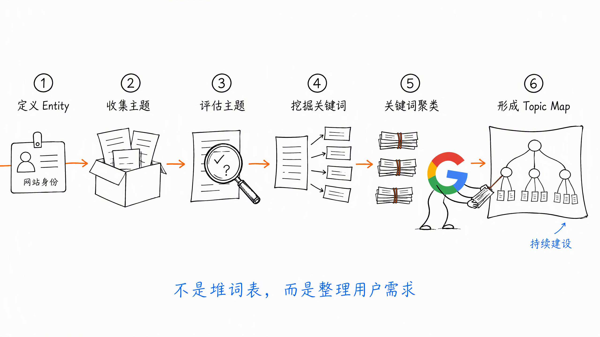
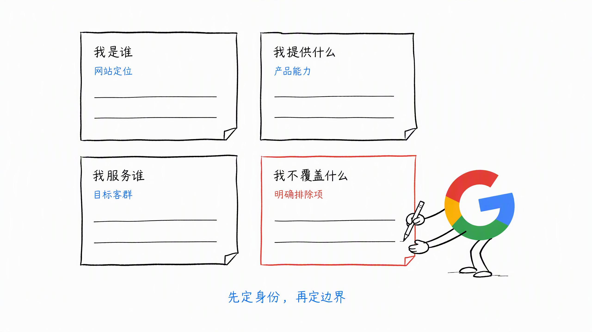
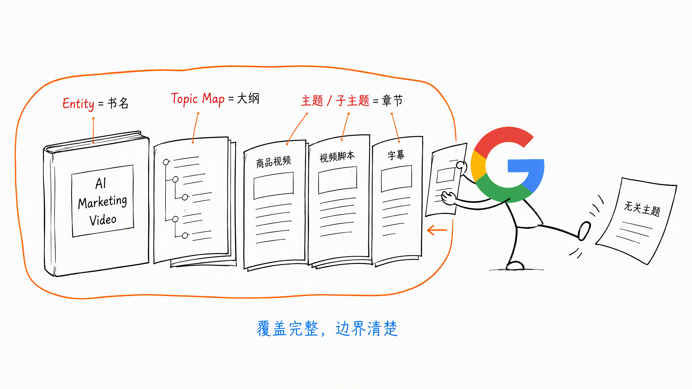
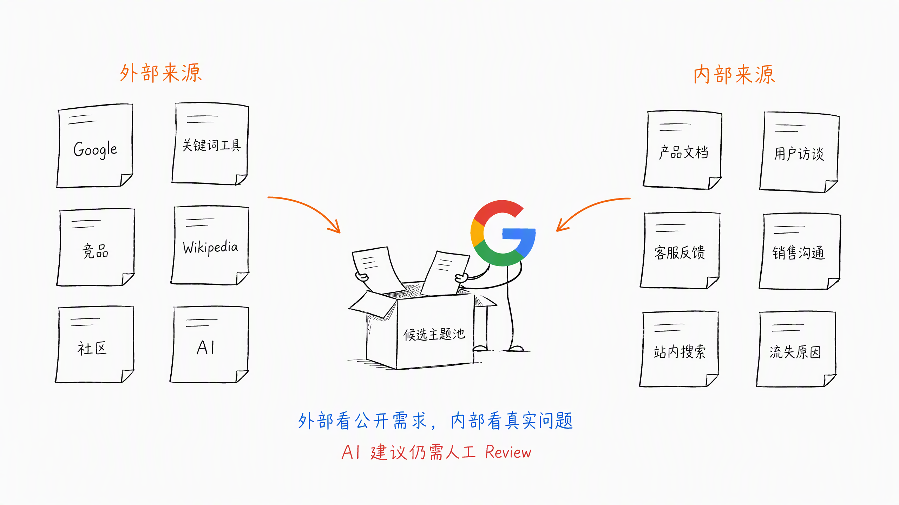
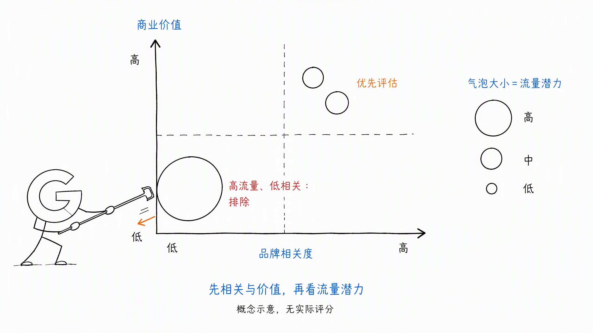
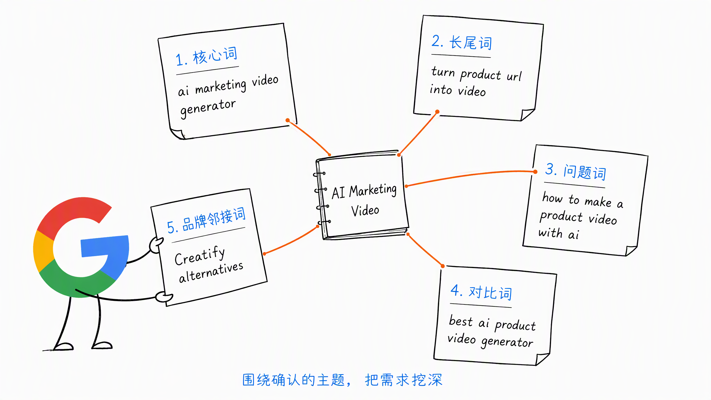
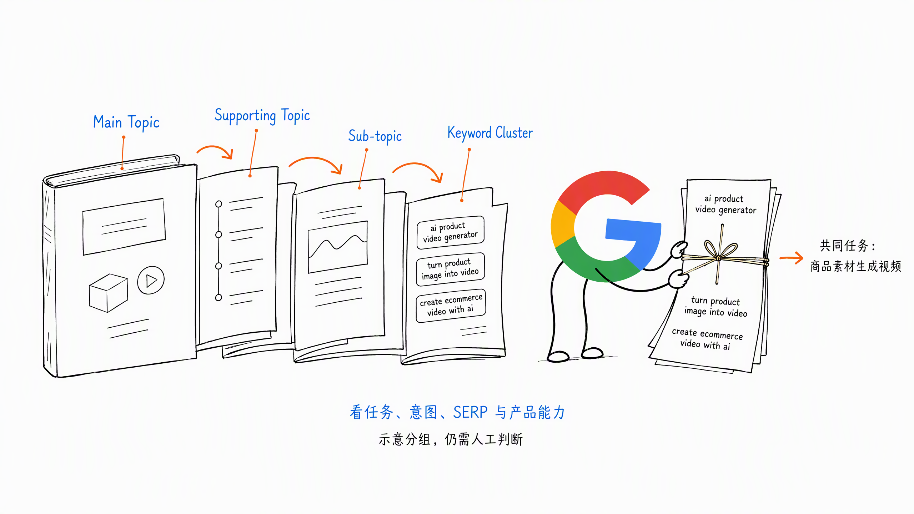
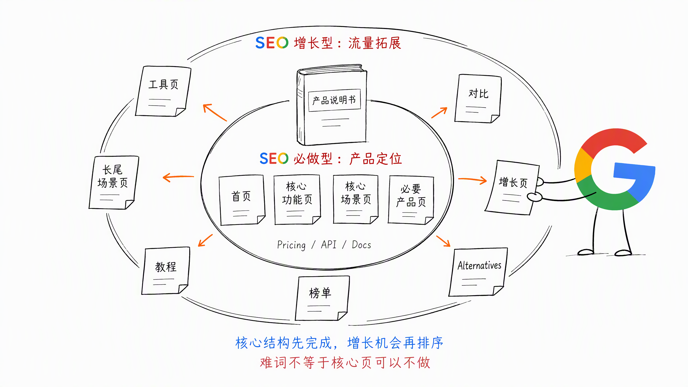
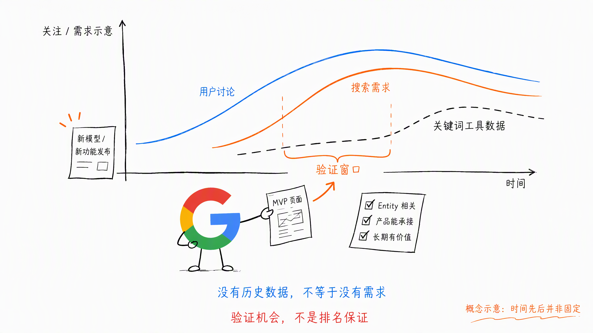

# 第 5 章 从关键词研究到 Topic Map

很多人第一次做关键词研究，会先打开 Ahrefs、Semrush 或其他关键词工具。

输入一个词，导出几千个关键词，再按照搜索量从高到低排序。

关键词表很快就有了，但接下来还是不知道：

- 哪些词与产品真正相关
- 哪些词应该先做
- 哪些词其实属于同一个需求
- 网站长期应该覆盖哪些主题

因为关键词研究不是找一堆词。

**它是在整理用户需求，并把这些需求变成一张可以持续建设的 Topic Map（主题地图）。**

这一章虽然叫从关键词研究到 Topic Map，但真正执行时，不建议从关键词工具开始。

更合适的顺序是：

**定义 Entity → 收集主题 → 评估主题 → 挖掘关键词 → 关键词聚类 → 形成 Topic Map。**

## 一、先说清楚网站的 Entity

Entity 可以先用一句大白话理解：**你这个网站到底是干什么的。**

我一直喜欢把网站比作一本书。

- Entity 是书名，决定这本书主要讲什么
- Topic Map 是大纲，决定要覆盖哪些主题和子主题
- 页面内容是章节，负责把每一个具体问题讲清楚

如果书名和主题都没想清楚，后面导出再多关键词，也很容易东写一点、西写一点。

比如你做一个 AI SaaS，不代表所有 AI 相关的流量都要做。

每次新模型发布，都可能出现一批新词。但这个模型与产品没有关系，用户也不是你的目标客户，就不要因为有流量硬蹭。

定义网站 Entity，可以先回答四个问题：

1. 我是谁
2. 我提供什么
3. 我服务谁
4. 我不覆盖什么

假设我们做的是一款 AI Marketing Video 工具，可以这样定义：

- 我是谁：帮助品牌制作营销视频的 AI 工具
- 我提供什么：把商品链接、图片或素材生成营销视频
- 我服务谁：电商品牌、广告投手和小型营销团队
- 我不做什么：电影级制作、通用专业剪辑、广告投放管理，以及与营销无关的视频创作

这里第四个问题很重要。很多网站只会写自己做什么，却没有想过自己不做什么。

但如果没有排除项，关键词研究很容易越做越宽。最后看起来什么都能写，实际上搜索引擎和用户都不知道你最擅长什么。

## 二、Topic Map 是网站的内容规划路线图

Entity 定义好以后，Topic Map 就有了基本边界，也就是给这本书画了一个圈，让内容不跑偏。

Topic Map 的核心作用，是按照主题和子主题的层次关系，规划网站长期应该覆盖什么内容。

比如上面的 AI Marketing Video 工具，主主题 & 子主题可以是：

- AI Marketing Video
  - Product URL to Video
  - Product Image to Video
  - Video Hook / Script Generator
  - AI Voiceover
  - Auto Subtitle
  - Social Media Ad Video

这些主题和子主题组合起来，就是这个网站的 Topic Map。

它不是一张漂亮的思维导图，也不是把所有相关关键词塞进去。

它要解决三个实际问题：

- 网站应该长期覆盖哪些主题（书的大纲）
- 每个主题下面还有哪些重要子主题（书的具体章节）
- 哪些看起来相关的方向不应该进入网站（不是这本书的内容）

Topic Map 也可以帮助我们理解主题权重。

当一个网站长期围绕明确的主主题，持续覆盖相关子主题，并建立清楚的内容关系，搜索引擎和 AI 会更容易理解这个网站擅长什么。

但主题权重不是靠文章数量堆出来的。

如果内容与 Entity 没有关系，即使发了很多，也只是让网站主题越来越散。

**主题覆盖要完整，但边界也要清楚。**

## 三、如何收集主题和子主题

确定主主题以后，下一步是 Research 更多相关主题。

主题来源可以分成外部和内部两部分。

### 1. 从外部找主题

常见的外部来源包括：

- Google 下拉框、Related Searches 和 People Also Ask
- Ahrefs、Semrush 等关键词工具
- SEO 竞争对手的 Top Pages 和站点目录
- Wikipedia 的目录、相关词条和概念关系
- Reddit、Quora 等真实用户讨论
- ChatGPT 等 AI 工具提供的主题建议

AI 可以帮助发散，但不能直接替我们决定 Topic Map。

它不知道你的真实产品能力、客户反馈和商业目标，最后还是需要人工 Review。

### 2. 从内部找主题

很多真正有价值的主题，不一定先出现在关键词工具里。

它们可能来自：

- 产品文档和帮助中心
- 用户访谈
- 客户反馈和客服工单
- 售前咨询与客户邮件
- 销售沟通和产品演示记录
- 站内搜索记录
- 用户社群讨论
- 退订、退款和流失原因
- 团队亲自做过的案例和踩过的坑

外部数据告诉我们用户正在公开搜索什么。

内部数据告诉我们用户真正关心什么、卡在哪里，以及为什么买或不买。

两个方向都要看。

## 四、先评估主题，再研究关键词

收集完主题，先不要急着全部写进 Topic Map。

不是所有相关主题都是你的菜。

可以先看三个维度：

1. 品牌相关度
2. 商业价值
3. 流量潜力

### 1. 品牌相关度

这个主题是否符合网站的 Entity？

它是不是产品希望建立的市场认知？是不是目标用户真正关心的问题？

比如 AI Marketing Video 工具去做商品视频、广告素材和视频 Hook，品牌相关度很高。

如果去写电影摄影器材或通用剪辑软件，虽然都与视频有关，但品牌相关度可能很低。

### 2. 商业价值

这个主题能不能自然连接到产品能力和业务结果？

用户看完或使用以后，有没有合理的下一步，比如生成视频、注册、试用或付费？

有流量，但无法承接，也没有任何合理转化路径的主题，优先级通常不会太高。

### 3. 流量潜力

流量潜力不能只看一个关键词的搜索量。

还要看：

- 这个主题下面有多少相关长尾词
- 整个关键词簇的总搜索需求
- 对标页面能获得多少自然流量
- SERP 中有没有新站可以进入

单个词的搜索量只是一个点，主题流量潜力才是一片需求。

可以先用品牌相关度和商业价值确定该不该做，再用流量潜力判断值不值得优先做。

## 五、围绕确认的主题挖掘关键词

主题确定以后，再进入关键词研究。

这样做的好处是，关键词工具只负责帮助我们把已经确认的需求挖深，而不是带着网站到处跑。

围绕一个主题，常见的关键词可以分成五类。

### 1. 核心词

直接描述产品品类或核心功能。

比如：

- `ai marketing video generator`
- `product video generator`

### 2. 长尾词

加入更具体的场景、用户、输入或输出。

比如：

- `ai product video generator for ecommerce`
- `turn product url into video`

### 3. 问题词

用户围绕任务提出的具体问题。

比如：

- `how to make a product video with ai`
- `how to turn product images into ads`

### 4. 对比词

用户正在比较产品或解决方案。

比如：

- `product video generator vs video editor`
- `best ai product video generator`

### 5. 品牌邻接词

用户已经知道某个产品，但还在寻找替代方案、对比或相关能力。

比如：

- `HeyGen alternatives`
- `Creatify alternatives`

这些关键词虽然表达不同，但可能属于同一个主题，也可能代表完全不同的搜索意图。

所以挖完词以后，还需要继续聚类。

## 六、关键词怎么聚类

关键词聚类，不是只看字面是否相似。

比如：

- `ai product video generator`
- `turn product image into video`
- `create ecommerce video with ai`

表达不同，但可能都在解决商品素材生成视频的任务。

反过来，两个关键词即使都包含 `AI video`，意图也可能不同：

- `ai video generator` 更接近直接使用工具
- `best ai video generator` 更接近产品比较和选择

聚类时，可以一起看四件事：

- 用户要完成的任务是否相同
- 搜索意图是否接近
- SERP 前排页面是否大量重合
- 产品能否用同一种能力承接

Ahrefs 的 Parent Topic 或关键词聚类功能可以帮助初步分组，但工具结果不是最终答案。

工具看的是关键词数据，最后还要结合产品和用户任务人工判断。

聚类完成以后，可以把结果放回 Topic Map：

- Main Topic
  - Supporting Topic
    - Sub-topic
      - Keyword Cluster

到这里，我们已经知道网站长期要覆盖什么，以及每个主题下面有哪些真实搜索需求。

但先不要急着给每个词分配 URL。

下一章 Keyword-to-Page，再决定一种搜索意图应该由哪个页面承接。

## 七、新站怎么确定优先级

Topic Map 是长期内容路线图，不代表所有主题都要同时做。

新站资源有限，还是要确定先后顺序。判断优先级时，可以一起看：

- 产品相关性
- 商业价值
- 搜索意图
- 主题流量潜力
- 关键词竞争难度
- 当前产品与内容的交付能力

不要只按搜索量排序。

> **Tips：关键词和页面，可以分成 SEO 必做型与 SEO 增长型。**
>
> SEO 必做型负责说清楚产品是什么、具备哪些核心能力、服务哪些用户和场景。即使关键词竞争很难，或者短期没有排名，也应该先把页面建出来并完成基础 SEO 匹配。
>
> SEO 增长型负责在核心产品结构之外继续获得自然流量。这部分才需要根据产品相关性、商业价值、搜索意图和竞争难度，决定先做哪个、后做哪个。

### SEO 必做型：产品定位页面

SEO 必做型页面不只有首页，通常包括：

- Homepage：首页承接核心品类词
- Feature Page：功能页承接产品已经具备的核心能力
- Solution / Use Case Page：场景页承接核心客群和主要使用场景
- Pricing、API、Docs 等页面：根据真实产品形态承接对应需求

比如一款 AI Marketing Video 产品：

- 首页需要匹配 `ai marketing video generator`
- 核心功能页需要承接 `product url to video`、`product image to video`
- 核心场景页需要承接 `ai video ads for ecommerce`

这些页面首先是产品官网应该具备的结构，其次才是 SEO 页面。

所以即使关键词很难，Homepage、Feature Page 和 Solution Page 的 Title、H1、核心介绍、产品能力和 CTA 也要匹配对应需求。

短期排不上去，不代表可以不做。它们属于产品定位，不是可选的 SEO 机会。

### SEO 增长型：流量拓展页面

把核心产品页面建好以后，再围绕相关需求拓展更多工具页、长尾场景页、教程、榜单、对比和 Alternatives 页面。

这些页面主要负责获得更多自然流量，可以根据机会决定先后顺序。

一个大词有很多流量，但产品接不住、竞争对手又很强，如果它不属于产品定位型关键词，短期投入可能没有结果。

相反，一个搜索量不大的长尾词，如果用户任务明确、产品能够直接解决、SERP 竞争也相对可进入，就更适合新站先做。

也就是前面提到的农村包围城市策略：

**蓝海词 → 中等词 → 大词。**

这个策略主要用来安排 SEO 增长型页面，不是让我们放弃首页、核心功能页和核心场景页。

这里的蓝海词，不只是搜索量小的长尾词。

还有一类更大的机会，是刚刚出现的新词。

AI 行业几乎每天都有新模型、新功能和新玩法。每次变化，都可能带来一批过去不存在的搜索需求。

比如 GPT-4o 图像生成能力发布后，很快出现了围绕 Ghibli（吉卜力）风格图片的新玩法。用户开始搜索：

- `gpt-4o image generator`
- `ghibli style image generator`
- `turn photo into ghibli style`

这些词刚出现时，Ahrefs、Semrush 等工具可能还没有搜索量数据，或者显示的搜索量很小。

但没有历史数据，不代表没有真实需求。

如果一个新词正在社交媒体、社区和 Google Trends 中快速升温，同时又与产品能力高度相关，它可能比已经竞争多年的大词更值得马上验证。

所以蓝海词可以分成两类：

- 已有长尾词：需求稳定存在，但竞争相对较小
- 新出现的词：需求刚刚形成，搜索量数据还没有及时跟上

面对新词，速度很重要，但也不能什么热点都追。

还是要回到三个问题：

- 它是否符合网站的 Entity 和 Topic Map
- 产品能不能真正承接这个新需求
- 热点过去以后，页面是否还有长期价值

如果三个问题都能回答清楚，就可以尽快上线 MVP 页面，再根据真实曝光、点击、使用和转化决定是否继续投入。

无论是已有长尾词还是新出现的词，至少应该满足：

- 需求明确
- 产品相关
- 可以真正交付结果
- 竞争相对可进入
- 有合理的转化价值

先通过一组具体需求验证页面和产品，再逐步进入更大的主题。

## 八、从关键词研究到 Topic Map 的执行步骤

实际执行时，可以按照下面的顺序：

1. 用四个问题定义网站 Entity
2. 确定主主题和内容边界
3. 从外部与内部收集候选主题
4. 评估品牌相关度、商业价值和流量潜力
5. 删除高流量但低相关的主题
6. 围绕保留的主题挖掘关键词
7. 按照用户任务、搜索意图和 SERP 结果聚类
8. 整理 Main Topic、Supporting Topic、Sub-topic 和 Keyword Cluster
9. 区分 SEO 必做型与 SEO 增长型关键词和页面
10. 单独标记新出现、还没有稳定搜索量数据的关键词
11. 根据产品相关性、商业价值和竞争难度确定优先级

最终可以先整理两张表。

第一张是 Topic List：

- Main Topic
- Supporting Topic
- Sub-topic
- Brand Relevance
- Business Value
- Traffic Potential
- Priority

第二张是 Keyword List：

- Keyword
- Keyword Cluster
- Keyword Type：SEO 必做型 / SEO 增长型
- Search Intent
- Search Volume
- Keyword Difficulty
- Product Relevance
- Keyword Status：稳定需求 / 新出现
- Priority

这一章先把网站的大纲和主题边界确定下来。

下一章再决定这些需求分别由什么页面承接。

## 九、本章执行清单

- [ ] 能不能用一句话说清网站是做什么的？
- [ ] 是否明确了我是谁、我提供什么、我服务谁和我不覆盖什么？
- [ ] 是否同时从外部数据和内部用户信息收集主题？
- [ ] 是否评估了主题的品牌相关度、商业价值和流量潜力？
- [ ] 是否删除了高流量但不符合 Entity 的方向？
- [ ] 是否围绕确认后的主题继续挖掘关键词？
- [ ] 关键词聚类是否基于用户任务、搜索意图和 SERP，而不只是字面相似？
- [ ] Topic Map 是否有主主题、支撑主题、子主题和关键词簇？
- [ ] 是否先完成了首页、核心功能页和核心场景页等 SEO 必做型页面？
- [ ] 是否把 SEO 增长型页面单独排序，而不是用难度决定核心产品页面做不做？
- [ ] 是否持续关注新模型、新功能和新玩法带来的新词？
- [ ] 新词是否同时符合 Entity、产品能力和长期价值？
- [ ] 新站是否优先选择了产品可以承接的蓝海需求？

## 十、小结

关键词研究不是先导出一张大表，再从搜索量最高的词开始写。

先定义 Entity，确定网站是谁、服务谁、解决什么问题，以及不覆盖什么。

然后收集主题、评估边界，再通过关键词研究验证真实搜索需求，最终整理成 Topic Map。

如果压缩成一句话：

**Entity 是书名，Topic Map 是大纲，关键词是读者留下的需求线索。**

先把书名和大纲想清楚，再决定每个章节怎么写。

> 本章节完毕，谢谢大家，欢迎随时讨论。
