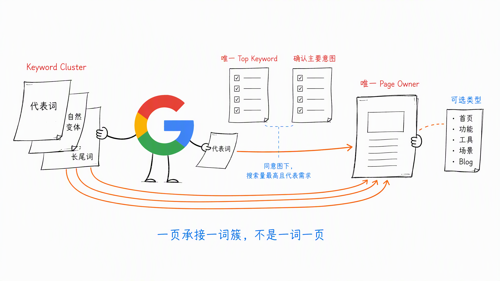
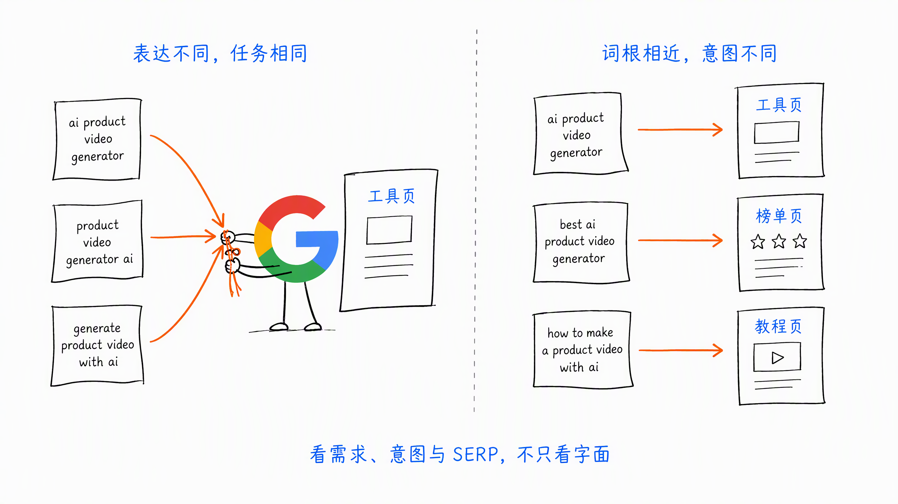
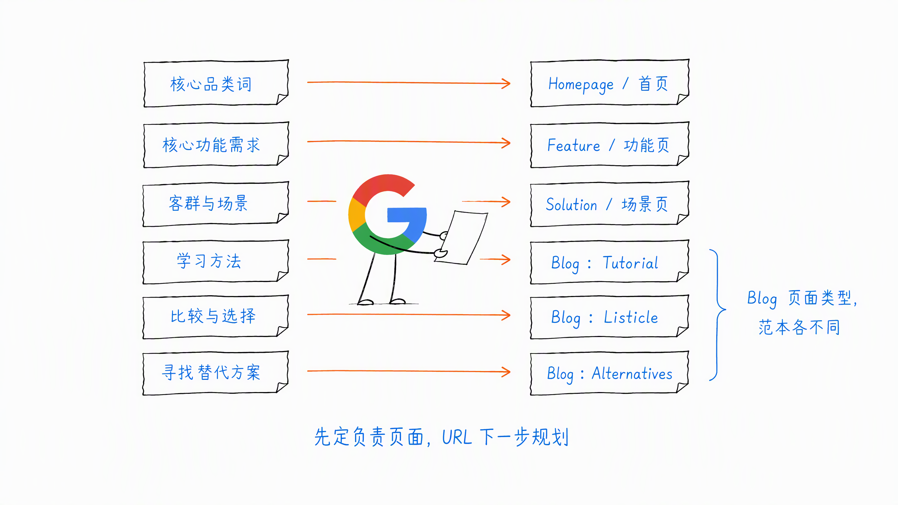
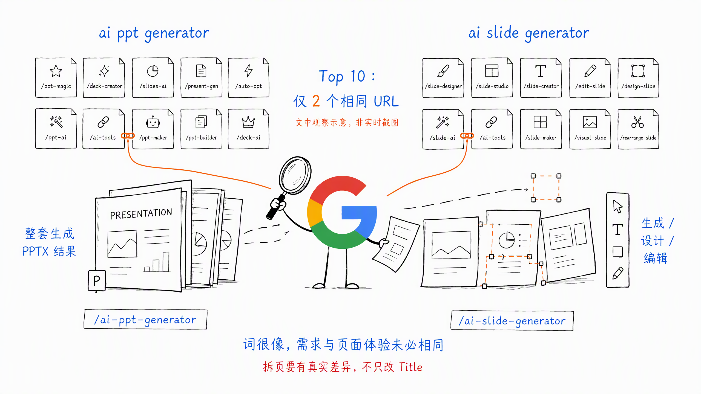
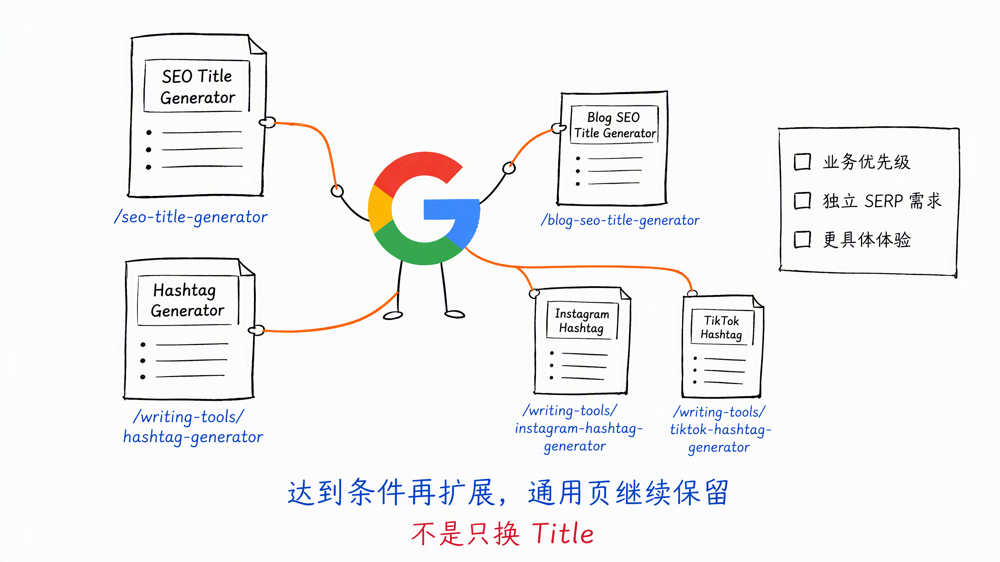
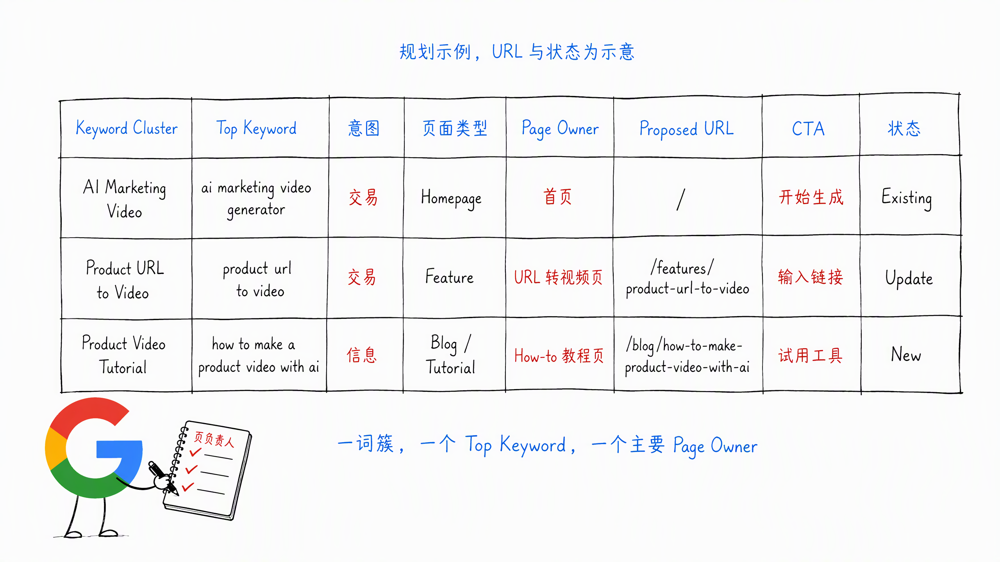
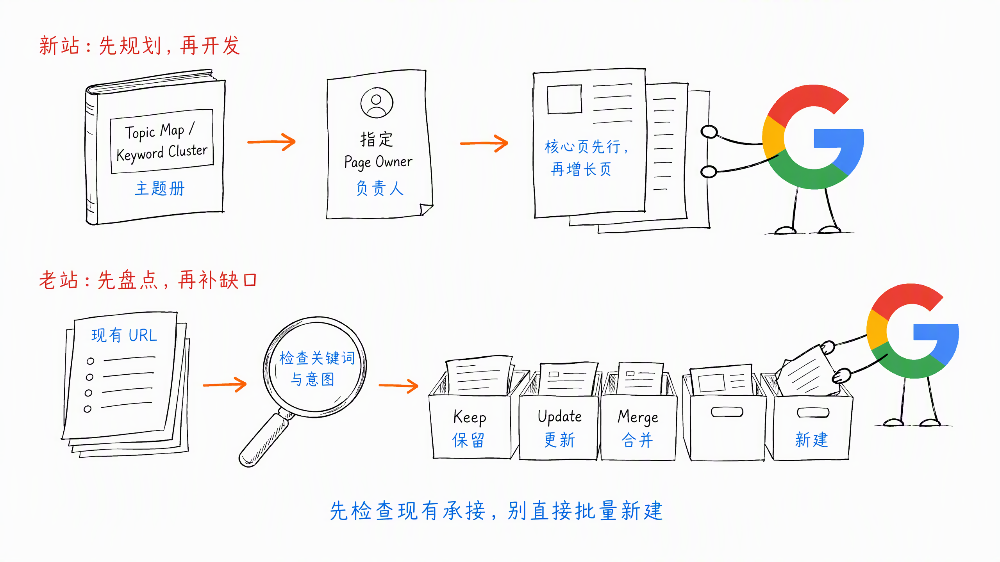

# 第 6 章 Keyword-to-Page：每个意图由谁承接

> ❤️ 这一章节内容，感谢 Joker 的交流

上一章，我们把零散关键词整理成了 Topic Map 和 Keyword Cluster。

接下来要解决一个更实际的问题：

**这些关键词，最终应该由哪个页面负责？**

很多网站做完关键词研究，就直接把词分给编辑。

一个词写一篇，几百个词就准备做几百个页面。

结果通常是：

- 同一个需求被拆成很多相似页面
- 几个页面同时竞争一个关键词
- 应该做工具页的词，被写成了 Blog
- 应该由首页或功能页承接的词，又新建了一个落地页
- 页面越来越多，Google 和用户反而不知道该看哪一个

所以，关键词研究结束以后，还需要做 Keyword-to-Page。

我更愿意把它理解成给每个 Keyword Cluster 确定 Page Owner（页面负责人）。

这里的 Owner 不是具体员工，而是负责承接这个词簇的唯一主要页面。

核心原则可以写成一个公式：

**一个页面 = 一个 Keyword Cluster + 一个 Top Keyword + 一个主要搜索意图。**

一个 Keyword Cluster 里可以有多个关键词，但只能确定一个 Top Keyword。

Top Keyword 通常是词簇中搜索量最高、同时最能代表这组需求的词。其他关键词是同义表达、自然变体或长尾词，由同一个页面一起承接。

如果搜索量最高的词与其他词不是同一种搜索意图，说明它们本来就不应该放在同一个 Keyword Cluster 里。

## 一、不是一词一页，而是一词簇一页

关键词长得不一样，不代表一定要拆成不同页面。

比如：

- `ai product video generator`
- `product video generator ai`
- `generate product video with ai`

三个词的表达不同，但用户很可能想完成同一件事：用 AI 生成商品视频。

如果 SERP 前排结果也高度相似，就没有必要为每个词单独建一页。

可以选择词簇中搜索量最高的词作为 Top Keyword，再把其他词作为自然变体和次要关键词，由同一个页面承接。

反过来，关键词看起来很像，搜索意图也可能完全不同。

比如：

- `ai product video generator`：用户想直接使用工具
- `best ai product video generator`：用户想比较不同产品
- `how to make a product video with ai`：用户想学习具体方法

它们都包含 `ai product video generator`，但分别更适合：

- 工具页或功能页
- 榜单或测评页
- 教程页

所以不能只根据关键词的字面相似度决定合并或拆分。

还要看具体需求、搜索意图和 Google 当前展示的页面形态。

## 二、先确定 Page Owner

一个页面可以覆盖一个 Keyword Cluster 中的多个相关关键词，但只能有一个 Top Keyword，也应该有一个明确的主要搜索意图。

在 Keyword-to-Page 表里，可以先为每个关键词簇确定五件事：

1. 这个 Keyword Cluster 包含哪些词
2. 哪个词是搜索量最高的 Top Keyword
3. 主要搜索意图是什么
4. 应该用什么页面类型承接
5. 哪一个页面是 Page Owner

比如一款 AI Marketing Video 产品：

| Keyword Cluster | Top Keyword | 页面类型 | Page Owner |
| --- | --- | --- | --- |
| AI Marketing Video | `ai marketing video generator` | Homepage | 首页 |
| Product URL to Video | `product url to video` | Feature Page | Product URL to Video 页面  |
| Ecommerce Video Ads | `ai video ads for ecommerce` | Solution Page | Ecommerce Video Ads 页面 |
| Small Business Video | `ai marketing video for small business` | Solution Page | Small Business Marketing Video 页面 |
| Product Video Tutorial | `how to make a product video with ai` | Blog / Tutorial | How-to 教程页 |
| Best Product Video Tools | `best ai product video generator` | Blog / Listicle | Best 榜单页 |
| HeyGen Alternatives | `HeyGen alternatives` | Blog / Alternatives | HeyGen Alternatives 文章 |

这里的 Blog 是页面类型，Tutorial、Listicle、Review、Comparison 和 Alternatives 是不同的内容范本。

它们都可以放在 Blog 目录下，但内容结构和写法不一样。

这张表不是最终 URL Structure。

它先确定谁负责承接需求。具体放在哪个目录、URL 怎么命名，下一章再统一规划。

## 三、怎么判断是不是同一个 Keyword Cluster

我认为主要看三个判断依据。

### 1. 搜索需求是否相同

用户搜索几个词以后，想得到的结果是不是一样？

如果最终都想上传同一种素材、使用同一个功能、得到同一种结果，通常可以先考虑合并。

### 2. 搜索意图是否相同

不要只看它们都属于信息型、商业型或交易型，还要看背后的具体需求是否一致。

如果一个想直接使用工具，另一个想比较产品，即使词根相同，也不适合硬塞进同一个页面。

### 3. SERP 结果是否大量重合

分别搜索这些词，看 Google 前排是否反复出现同一批 URL 和同一种页面类型。

如果大部分结果相同，说明 Google 很可能把它们理解为接近的需求。

如果结果明显不同，就要谨慎合并。

把关键词放进同一个 Cluster，不是为了少做页面。

而是避免把一个完整需求切得太碎。

### 一个有意思的案例：AI PPT Generator 和 AI Slide Generator

这两个词看起来很像，但 Google Top 10 里只有 2 个相同 URL，Google 下拉提示也不一样。

区别用大白话讲：

- `ai ppt generator` 已经限定了 PPT 格式，更偏整套生成和直接拿结果，比如生成大纲、完整 PPT 和导出 PPTX
- `ai slide generator` 没有限定必须是 PPT，更偏幻灯片的制作、设计和编辑，结果里也更常出现 AI Presentation Maker

`AI PPT Generator` 明确指向 PowerPoint 演示文稿和 PPTX 结果；`AI Slide Generator` 更偏单张或多张 Slide 的生成、设计和编辑，输出形式也更宽。

所以我会拆成两个页面：

- `/ai-ppt-generator`：主攻从主题、文本或文档生成完整 PowerPoint
- `/ai-slide-generator`：主攻生成单张或多张幻灯片、自定义版式和重新设计已有 Slide

**词很像，不代表属于同一个 Keyword Cluster。SERP 重合少，用户想拿到的结果也不同，就应该拆开。**

但拆成两个页面以后，产品体验和内容模块也要真的不同。如果只是改了 Title 和文案，背后还是同一个生成器、同一套功能，那就容易变成两个重复页面。

## 四、什么时候从大词继续扩展子页面

同一个 Keyword Cluster，应该由一个页面承接，不能为了多做页面硬拆。

但大词下面的某个细分需求，也可能已经值得单独做成一个 Keyword Cluster。

比如一开始可以先做：

- `seo title generator`

这个通用页面可以覆盖 Blog、产品页和其他场景的 SEO Title 生成需求。

当 `blog seo title generator` 的搜索量和业务优先级足够高，而且 Blog 标题有更具体的生成要求，就可以再增加一个独立页面：

- `/seo-title-generator`：继续承接通用的 SEO Title 生成需求
- `/blog-seo-title-generator`：专门承接 Blog 标题生成需求

这不是把原来的同一组关键词硬拆开。

而是一个细分词已经形成了更明确的需求，值得拥有自己的 Top Keyword、Keyword Cluster 和 Page Owner。

Ahrefs 的 Writing Tools 就是一个很直观的案例。

它既有通用的 Hashtag Generator，也为具体平台做了独立页面：

- `/writing-tools/hashtag-generator`
- `/writing-tools/instagram-hashtag-generator`
- `/writing-tools/tiktok-hashtag-generator`

通用页继续承接 Social Media Hashtag 的大需求，Instagram 和 TikTok 页面分别承接平台相关的细分需求。

这些页面的底层能力可能接近，但用户输入、平台语境、页面说明和最终结果可以做得更具体。

所以要不要继续扩展子页面，可以看三个条件：

1. 细分词的搜索量和业务优先级是否值得单独投入
2. SERP 是否已经把它当成相对独立的搜索需求
3. 新页面能否提供更具体的产品体验和内容，而不是只换 Title

如果还不满足，就先由大词页面一起承接。

满足以后，再增加子页面。原来的大词页面继续保留，不需要二选一。

## 五、建立 Page Owner 表

Keyword-to-Page 最终应该沉淀成一张可以持续维护的 Page Owner 表。

我建议至少保留这些字段：

| 字段 | 作用 |
| --- | --- |
| Topic | 所属主题 |
| Keyword Cluster | 关键词簇 |
| Top Keyword | 词簇中搜索量最高的代表词，一个词簇只保留一个 |
| Secondary Keywords | 同一意图下的相关词和自然变体 |
| Search Intent | 主要搜索意图 |
| Page Type | Homepage、Feature、Solution、Tool、Blog 等 |
| Page Owner | 负责承接需求的页面 |
| Proposed URL | 暂定 URL，下一章统一确认 |
| CTA | 页面希望用户完成的下一步 |
| Status | Existing、Update、New、Merge |
| Priority | 制作或优化优先级 |

这张表最重要的不是字段多完整，而是每个 Keyword Cluster 都有唯一的 Top Keyword、主要搜索意图和 Page Owner。

以后发现新关键词时，不要马上新建页面。

先回到 Page Owner 表里检查：

- 现有页面能不能承接
- 是补充现有页面，还是需要新建页面
- 新页面会不会与已有页面争夺同一个意图

这样可以从源头减少重复页面。

> **Tips：**同一个关键词出现在多个页面里很正常。真正要避免的是，把同一个 Keyword Cluster 分给多个页面。新站提前分清页面归属即可，老站发现重复页面后再决定保留、更新或合并。

## 六、新站和老站怎么做

### 1. 新站先规划，再开发

新站可以直接从 Topic Map 和 Keyword Cluster 开始，为每个主要意图指定 Page Owner。

先把首页、核心功能页、核心场景页等 SEO 必做型页面确定下来，再规划 SEO 增长型页面。

这样开发、设计和内容团队一开始就知道网站需要哪些页面，不用上线以后再反复拆改。

### 2. 老站先盘点，再补缺口

老站不要直接拿关键词表批量新建页面。

先导出现有 URL，检查每个页面当前承接什么关键词和搜索意图。

然后分成四类：

- Keep：页面定位清楚，继续保留
- Update：方向正确，但内容或意图匹配需要加强
- Merge：与其他页面重复，准备合并
- New：现有页面无法承接，需要新建

这一步做完，才知道网站真正缺的是页面，还是只是现有页面没有做好。

## 七、Keyword-to-Page 的执行步骤

实际执行时，可以按照下面的顺序：

1. 从 Topic Map 中取出一组相关关键词
2. 根据搜索意图和 SERP 结果整理 Keyword Cluster
3. 选择搜索量最高的 Top Keyword，并记录 Secondary Keywords
4. 检查现有网站是否已经有页面承接
5. 判断细分需求是否值得建立独立页面
6. 为每个 Keyword Cluster 指定唯一的 Page Owner 和页面类型
7. 标记 Existing、Update、New 或 Merge，并确定优先级
8. 检查是否有多个页面被分配到同一个 Keyword Cluster

这一步先确定页面归属。

下一章再把这些页面放进 `/features`、`/tools`、`/blog`、`/compare` 等目录，形成完整的 URL Structure。

## 八、本章执行清单

- [ ] 每个 Keyword Cluster 是否只保留了一个搜索量最高的 Top Keyword？
- [ ] 每个 Keyword Cluster 是否有唯一的 Page Owner？
- [ ] 是否避免了机械地一词一页？
- [ ] 同一个 Keyword Cluster 是否避免建立多个重复页面？
- [ ] 细分需求达到优先级后，是否建立了独立的 Keyword Cluster 和 Page Owner？
- [ ] 页面类型是否符合 Google 当前展示的主流形态？
- [ ] SEO 必做型页面是否优先确定？
- [ ] 新建页面前，是否检查了现有页面能不能承接？
- [ ] Page Owner 表是否记录了页面状态和下一步动作？

## 九、小结

Keyword-to-Page 不是把每个关键词机械地分配给一个新页面。

它要做的是：把同一搜索意图下的关键词聚在一起，再指定一个主要页面负责承接。

同一个 Keyword Cluster 先由一个页面负责，不要机械拆页。

当大词下面的细分需求形成了更明确的任务，搜索量和业务优先级也值得投入时，再增加新的子页面。通用的大词页面继续保留，各自承接不同层级的需求。

如果压缩成一句话：

**不是一词一页，而是一个 Keyword Cluster，选择一个 Top Keyword，再由一个 Page Owner 负责到底。**

> 本章节完毕，谢谢大家，欢迎随时讨论。
