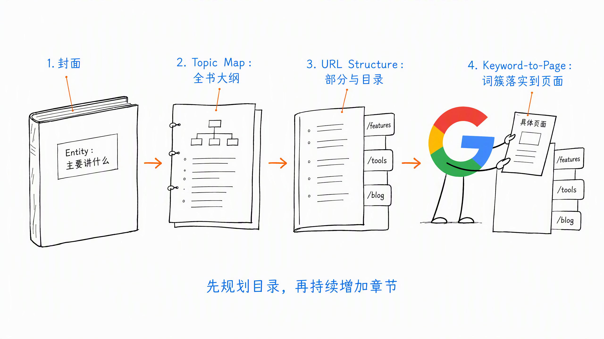
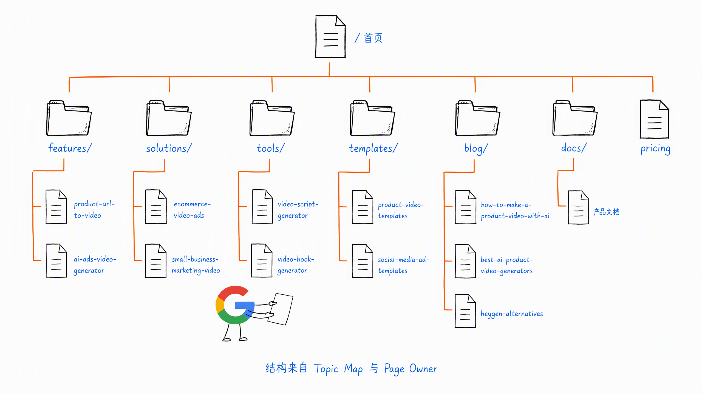
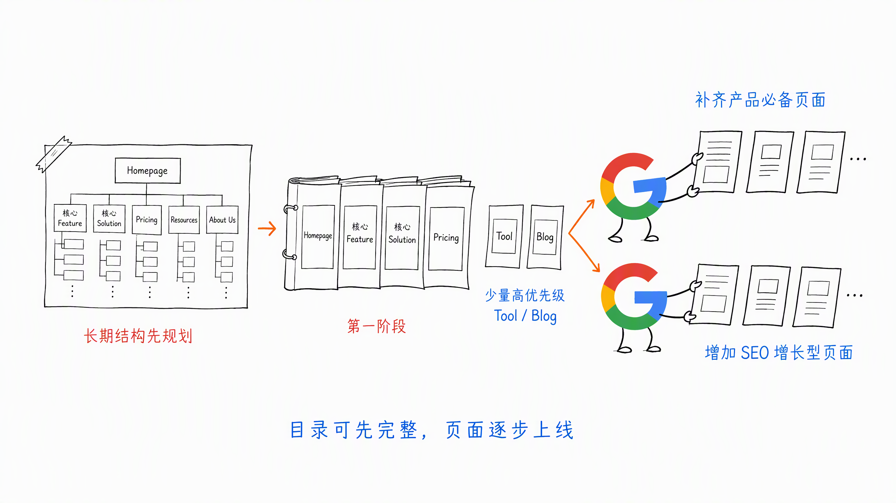
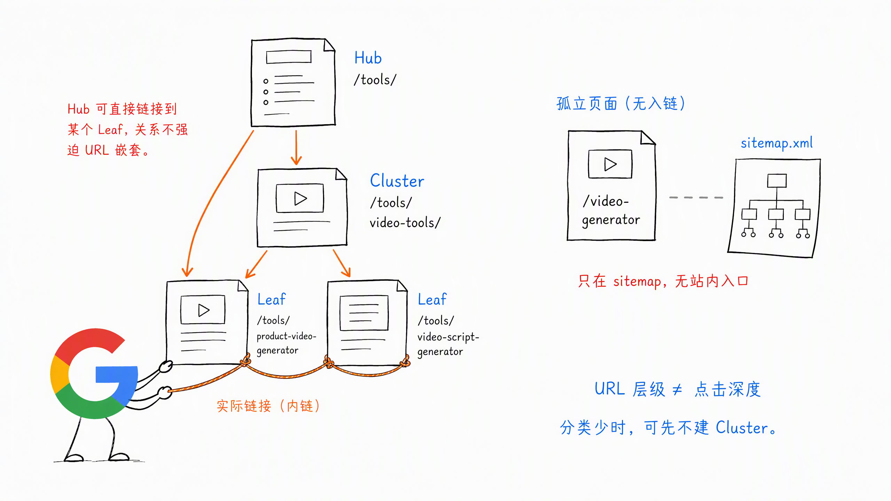
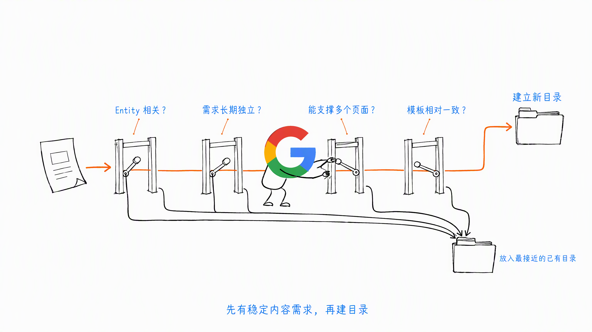
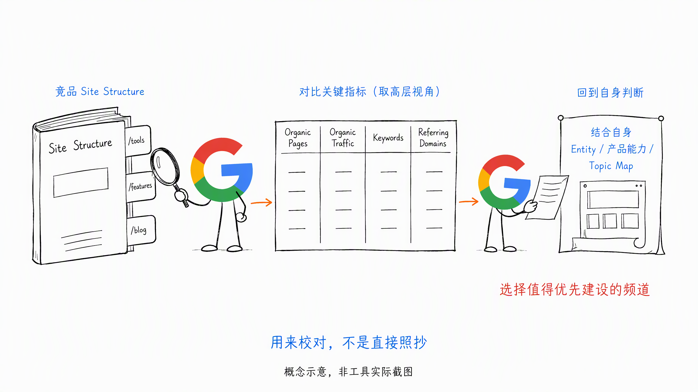
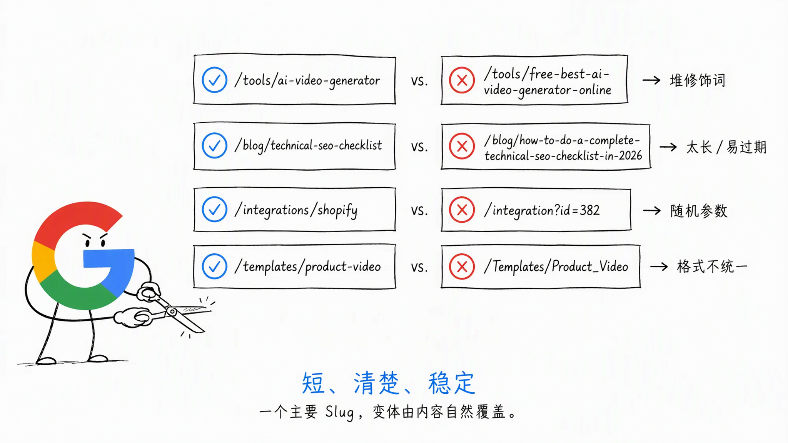
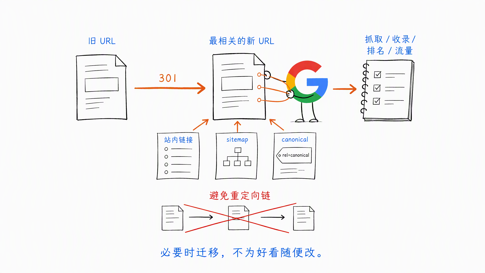
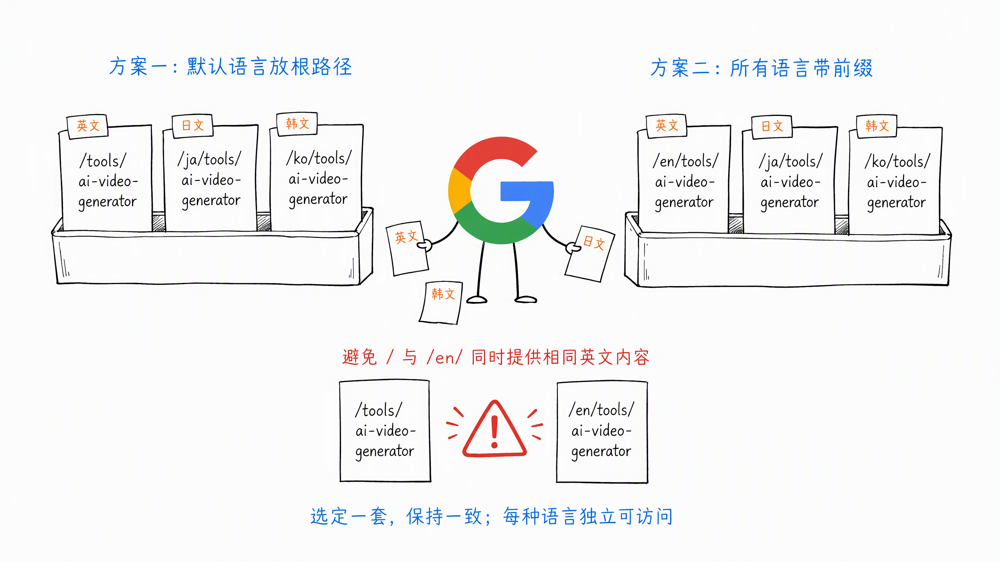

# 第 7 章 URL Structure：把网站规划成一本书

前面三章，我们已经做了三件事：

- 用 Topic Map 确定网站长期要覆盖什么
- 用 Keyword Cluster 整理具体的搜索需求
- 用 Keyword-to-Page 确定每组需求由哪个页面承接

下一步，就是把这些页面放进网站。

哪些页面放在 `/tools`，哪些放在 `/features`，哪些进入 `/blog`？

目录应该分几层？URL Slug 怎么写？多语言页面又应该放在哪里？

这些问题合在一起，就是 URL Structure。

我还是喜欢用一本书来理解：

- Entity 是这本书主要讲什么
- Topic Map 是全书大纲
- URL Structure 是按照大纲划分全书的部分和目录
- Keyword-to-Page 负责把每个关键词簇落实到具体页面，也就是目录下面的一篇具体章节

**URL Structure 不是给页面随便起个地址，而是把网站内容规划成一套可以长期扩展的结构。**



## 一、URL Structure 不只是 URL Slug

很多人说 URL Structure，想到的只是 `/ai-video-generator` 应该怎么写。

但一个完整的网站结构，至少包含三层：

1. 网站有哪些主要目录
2. 每个目录负责放什么页面
3. 每个页面的 URL Slug 怎么命名

比如下面两个地址：

- `/tools/ai-video-generator`
- `/blog/best-ai-video-generators`

它们不只是 Slug 不同。

`/tools` 代表可以直接使用的在线工具，`/blog` 代表教程、榜单、对比和其他文章内容。

目录先告诉用户和团队这是什么页面，再由具体 Slug 说明这一页讲什么。

如果一开始没有规划，网站很容易出现这些情况：

- 所有页面都堆在根目录
- 同一种页面被分散在多个目录
- Feature、Tool 和 Blog 的边界不清楚
- 一个目录只有一页，另一个目录塞了几百页
- URL 上线后反复修改

所以 URL Structure 的第一步不是起名字，而是先确定每个目录负责什么。

## 二、先按页面类型划分目录

目录不是越多越专业。

更实用的做法，是先看已经确认的 Page Owner 分别属于什么页面类型，再把相同类型的页面放到一起。

AI 工具站和 SaaS 官网常见的目录有：

| 目录 | 主要用途 | 常见页面 |
| --- | --- | --- |
| `/features/` | 展示产品已经具备的核心能力 | Product URL to Video、AI Ads Generator |
| `/tools/` | 让用户直接完成一个具体任务 | Script Generator、Hook Generator |
| `/solutions/` | 面向特定客群、行业或场景提供方案 | Ecommerce Video Ads、Video Ads for Small Business |
| `/templates/` | 提供可以复用的模板与素材 | Product Video Templates、Social Ad Templates |
| `/blog/` | 承载教程、榜单、对比和 Alternatives | How-to、Best List、A vs B、A Alternatives |
| `/docs/` | 产品使用和开发文档 | API Reference、Quick Start |
| `/integrations/` | 展示产品与其他平台的连接能力 | Shopify、Zapier、WordPress |

这不是所有网站必须照抄的标准答案。

比如一个产品没有在线小工具，就不需要为了 SEO 硬建 `/tools`。没有稳定的模板内容，也不用先放一个空的 `/templates`。

`/compare` 和 `/alternatives` 也不一定要独立成目录。如果只是偶尔写几篇对比和替代文章，放在 `/blog` 就够了，也可以把 Comparison 和 Alternatives 作为 Blog 里的文章分类。只有当这类页面数量很多、模板稳定，而且确实是重要的商业流量方向时，再考虑单独建频道。

**先有稳定的内容需求，再建立目录，不要先建目录等内容来填。**

### 子目录还是子域名

如果这些内容仍然属于同一个产品和 Entity，我一般优先放在子目录里，比如：

- `example.com/blog/`
- `example.com/tools/`

子域名更适合边界确实独立的产品、系统或团队，比如单独部署的开发者平台。

不是说子域名一定做不了 SEO，而是对大部分新站来说，子目录的结构、数据和日常维护更简单。

不要为了显得业务很多，把 Blog、Tools 和 Docs 全部拆成不同子域名。

## 三、一个 AI Marketing Video 网站怎么规划

继续用前两章的 AI Marketing Video 产品举例。

根据已经确认的 Page Owner，第一版网站结构可以是：

```text
/
├── features/
│   ├── product-url-to-video
│   └── ai-ads-video-generator
├── solutions/
│   ├── ecommerce-video-ads
│   └── small-business-marketing-video
├── tools/
│   ├── video-script-generator
│   └── video-hook-generator
├── templates/
│   ├── product-video-templates
│   └── social-media-ad-templates
├── blog/
│   ├── how-to-make-a-product-video-with-ai
│   ├── best-ai-product-video-generators
│   └── heygen-alternatives
├── docs/
└── pricing
```



这棵目录树不是根据行业习惯拍脑袋画出来的。

每一个目录，都应该能在前面的 Topic Map 和 Page Owner 表里找到依据。

目录看起来多，不用怕，也不代表第一版网站就要一次全部做完。

可以先把长期结构规划清楚，再按照优先级分阶段执行。第一阶段先完成首页、核心 Feature、核心 Solution、Pricing 等 SEO 必做型页面，同时选择少量优先级高的 Tool 或 Blog，作为 SEO 增长型页面验证流量。

后面再用两条线同步推进：一条继续补齐产品必备页面，另一条根据关键词机会持续增加 SEO 增长型页面。

**目录可以先规划完整，页面按优先级逐步上线。**



首页承接核心产品定位。Feature 页面讲产品能力，Solution 页面讲谁在什么场景下使用，Tool 页面让用户直接完成任务，Blog 负责教程和决策类内容。

它们各有分工，但最后都围绕同一个 Entity 服务。

## 四、Hub、Cluster、Leaf 三层结构

当一个目录里的页面越来越多，就需要继续分层。

可以用 Hub、Cluster、Leaf 来理解：

- Hub：频道入口，负责汇总一个大方向
- Cluster：频道里的主题集合
- Leaf：真正承接具体需求的页面

比如一个工具频道：

```text
/tools/                         Hub
/tools/video-tools/             Cluster
/tools/product-video-generator  Leaf
/tools/video-script-generator   Leaf
```

但不要机械地套三层。

如果网站现在只有 3 个工具页，直接放在 `/tools/` 下面更简单。等工具数量变多，确实出现视频工具、图片工具、音频工具等稳定分类以后，再增加 Cluster 页面。这里就是可以先不做 /tools/video-tools/ 这个 Cluster 页面。

一个分类只有一页，通常没有必要单独建一层目录。

还要注意，URL 层级和网站内链层级不是一回事。

页面的 URL 可以比较短，但仍然要通过导航、频道页、面包屑和内链告诉 Google 页面之间是什么关系。

不要为了追求扁平结构，把所有页面都扔到根目录。也不要为了结构看起来完整，给 URL 套很多没有意义的层级。

**层级够表达关系就行，不需要为了 SEO 故意做深或做浅。**

这里真正值得关注的是点击深度。

核心页面应该能从首页、主导航或重要频道页比较容易地进入。Leaf 页面至少要从对应的 Hub 或 Cluster 获得正常链接，不能只出现在 sitemap 里。

URL 看起来只有一层，但全站没有任何页面链接过去，它仍然是一张孤立页面。



## 五、什么内容值得单独建一个目录

Topic Map 里有一个主题，不代表它就应该成为一级目录。

我认为至少要看四件事：

1. 是否符合网站的 Entity 和产品方向
2. 是否代表一个相对独立、长期存在的需求
3. 是否能支撑多个页面，而不是只有一篇内容
4. 这些页面是否可以使用相对一致的页面模板

比如一个 AI Marketing Video 产品，长期会提供几十个在线工具，那么 `/tools` 很有必要。

如果产品只有一个 API 页面，就没有必要单独规划一套复杂的 `/api` 目录。保留一个清楚的 API 页面，或者放进 `/docs`，可能更合适。

目录也有优先级。

原稿里提到一个很实用的判断：AI 工具站的 `/tools` 往往比 `/blog` 更接近使用和转化，因此规划和开发优先级可能更高。

但这不是说所有网站都应该先做 Tools。

还是要看产品能交付什么，以及前面已经确认的 SEO 必做型页面和 SEO 增长型页面。

我自己的执行习惯是：

- 月维度竞品 Research 分析，顺便规划和 Review 网站结构，判断下一阶段重点建设哪个频道
- 周维度在已经确认的频道里做关键词研究和页面优先级

不要每发现一个新词，就临时增加一个目录。目录是相对稳定的，目录下的页面才会持续增加。



### 用竞品的 Site Structure 校对

目录初步规划好以后，可以再看一遍 SEO 竞品的网站结构。

在 Ahrefs Site Explorer 的 Site Structure 里展开对方目录，重点看：

- 哪些目录贡献了主要自然流量
- 每个目录有多少 Organic Pages
- 哪些目录获得了更多 Referring Domains
- `/tools`、`/features`、`/blog` 等频道的流量效率有什么差别
- 最近增长最快的是哪个目录

比如一个竞品的 `/tools` 页面不多，却贡献了很高的非品牌流量和外链，这个频道就值得继续拆解。

但竞品结构只能用来校对，不能直接照抄。

最后还是要回到自己的 Entity、产品能力和 Topic Map，判断这个目录适不适合自己。



## 六、URL Slug 怎么写

目录确定以后，再给具体页面命名。

我的建议很简单：**短、清楚、稳定。**

具体可以遵守下面几条：

- 使用小写英文
- 单词之间用连字符 `-`
- 尽量使用能看懂的单词，不要使用随机 ID
- 删除逗号、冒号和括号等不必要的特殊字符
- 自然包含页面的 Top Keyword，不要堆关键词
- 不要把完整文章标题直接塞进 URL
- 常青内容尽量不要带年份、数量和容易变化的版本号
- 避免目录和 Slug 重复出现同一个关键词
- URL 上线后尽量不要修改

几个例子：

| 推荐 | 不推荐 | 问题 |
| --- | --- | --- |
| `/tools/ai-video-generator` | `/tools/free-best-ai-video-generator-online` | 堆了太多修饰词 |
| `/blog/technical-seo-checklist` | `/blog/how-to-do-a-complete-technical-seo-checklist-in-2026` | 太长，而且年份会过期 |
| `/integrations/shopify` | `/integration?id=382` | 用户和搜索引擎都看不懂 |
| `/templates/product-video` | `/Templates/Product_Video` | 大小写和分隔方式不统一 |
| `/tools/video-generator` | `/tools/video-tools/ai-video-generator-tool` | 目录和 Slug 重复堆词 |

这里还有一个容易踩的坑。

Slug 不需要为了匹配关键词，把所有变体都写进去。一个页面只有一个主要 Slug，其他相关词由页面内容自然覆盖。



## 七、URL 一旦上线，不要为了好看随便改

新站可以从头规划，老站不能看到结构不顺眼就全部重做。

一个已经获得收录、排名、外链和流量的 URL，本身就是资产。

如果只是觉得旧 URL 不够漂亮，但页面表现正常，通常没有必要改。

确实需要修改时，比如目录迁移、页面合并或产品改名，至少要同步处理：

- 旧 URL 通过 301 跳转到最相关的新 URL
- 更新站内链接，不要一直经过重定向
- 更新 sitemap 中的 URL
- 检查 canonical 是否指向新地址
- 避免多次迁移形成重定向链
- 上线后观察抓取、收录、排名和流量变化



具体的 301、canonical 和 sitemap 配置，后面的 Technical SEO 章节会继续讲。

这一章先记住一个原则：**能在上线前规划好的 URL，不要留到上线后反复修改。**

## 八、多语言 URL 怎么选

多语言网站常见两种目录方式。

第一种，默认语言放在根路径：

```text
/tools/ai-video-generator
/ja/tools/ai-video-generator
/ko/tools/ai-video-generator
```

第二种，所有语言都带前缀：

```text
/en/tools/ai-video-generator
/ja/tools/ai-video-generator
/ko/tools/ai-video-generator
```

两种都可以，重点是从一开始选定并保持一致。

我自己更常用第一种。默认英文放在根路径，其他语言使用 `/ja/`、`/ko/` 等独立目录，结构清楚，维护也相对简单。

最需要避免的是：

- `/` 和 `/en/` 同时提供完全相同的英文内容
- 只靠前端按钮切换语言，但 URL 不变
- 有些语言放子目录，有些语言用参数
- 同一种语言的路径规则到处变化

每种语言都应该有独立、可以访问和索引的 URL。

至于 Slug 是否也要翻译，可以根据团队能力选择。

小团队为了维护一致，可以保留英文 Slug，只使用语言目录区分。真正准备长期经营某个语言市场时，也可以使用当地用户更容易理解的 Slug。

但不要一部分翻译、一部分不翻译，又没有任何规则。

`hreflang`、canonical 和多语言 sitemap 的具体配置，会在国际化 SEO 章节展开。



## 九、最后沉淀成一张 URL Structure 表

URL Structure 不应该只存在于脑子里，也不只是画一棵好看的树。

最后可以整理成一张表，交给产品、设计、开发和内容团队一起使用。

| Directory / Path | 目录用途 | Page Type | Topic / Keyword Cluster | Slug 示例 | 页面规模 | 优先级 |
| --- | --- | --- | --- | --- | --- | --- |
| `/` | 承接核心产品定位 | Homepage | AI Marketing Video | `/` | 1 | 必做 |
| `/features/` | 展示核心产品能力 | Feature | Product URL to Video | `/features/product-url-to-video` | 按核心能力规划 | 必做 |
| `/solutions/` | 承接行业和场景需求 | Solution | Ecommerce Video Ads | `/solutions/ecommerce-video-ads` | 按核心客群和场景规划 | 必做 |
| `/tools/` | 提供可直接使用的工具 | Tool | Video Script Generator | `/tools/video-script-generator` | 按已验证的工具需求规划 | 增长 |
| `/templates/` | 提供可复用模板 | Template | Product Video Templates | `/templates/product-video` | 按模板类型规划 | 增长 |
| `/blog/` | 承载教程和决策内容 | Blog | How-to、Best、Alternatives | `/blog/heygen-alternatives` | 按关键词机会持续增加 | 持续 |

页面规模只是规划值，不是为了凑数量。

真正做关键词研究和页面规划以后，可以继续调整。

这张表主要解决三件事：

- 网站第一版要有哪些目录
- 每个目录分别负责什么
- 后续新增页面应该放到哪里

## 十、URL Structure 的执行步骤

实际执行时，可以按照下面的顺序：

1. 确认网站的 Entity 和 Topic Map
2. 整理已经确定的 Keyword Cluster 和 Page Owner
3. 按 Feature、Tool、Solution、Blog 等页面类型分组
4. 判断哪些页面组值得建立独立目录
5. 用竞品 Site Structure 校对频道机会和优先级
6. 规划 Hub、Cluster 和 Leaf 的层级与入口
7. 为每种页面确定统一的 Slug 规则
8. 确认多语言 URL 方案
9. 老站补充旧 URL 到新 URL 的迁移关系
10. 输出 URL Structure 表，交给产品、设计和开发 Review

URL Structure 确认以后，网站大纲才算真正落地。

后面开发新页面时，不需要每次重新讨论它属于哪个频道、URL 应该怎么起。

## 十一、本章执行清单

- [ ] 每个目录是否有明确用途？
- [ ] 每个目录是否能支撑多个同类型页面？
- [ ] Homepage、Feature 和 Solution 等 SEO 必做型页面是否已经放好？
- [ ] Tool、Template 和 Blog 等增长型页面是否按优先级规划？
- [ ] `/compare`、`/alternatives` 等目录是否真的有足够页面支撑？
- [ ] Hub、Cluster 和 Leaf 是否清楚，但没有机械增加层级？
- [ ] 核心页面是否有清楚入口，没有只出现在 sitemap 里？
- [ ] 是否用竞品的目录流量、页面量和外链做过校对？
- [ ] URL 是否使用小写英文和连字符？
- [ ] Slug 是否短、清楚、稳定，没有特殊字符和关键词堆砌？
- [ ] 多语言 URL 是否使用统一规则？
- [ ] 老站是否避免为了美化 URL 进行无必要迁移？
- [ ] URL Structure 是否已经交给产品、设计、开发和内容团队 Review？

## 十二、小结

URL Structure 不是给页面起名字。

它是把 Topic Map 和 Page Owner 真正放进网站，让每种页面都有清楚的位置和长期扩展空间。

如果压缩成一句话：

**Topic Map 决定网站写什么，Keyword-to-Page 决定谁来承接，URL Structure 决定这些页面放在哪里。**

先把整本书的目录规划好，再开始持续增加章节。

> 本章节完毕，谢谢大家，欢迎随时讨论。
