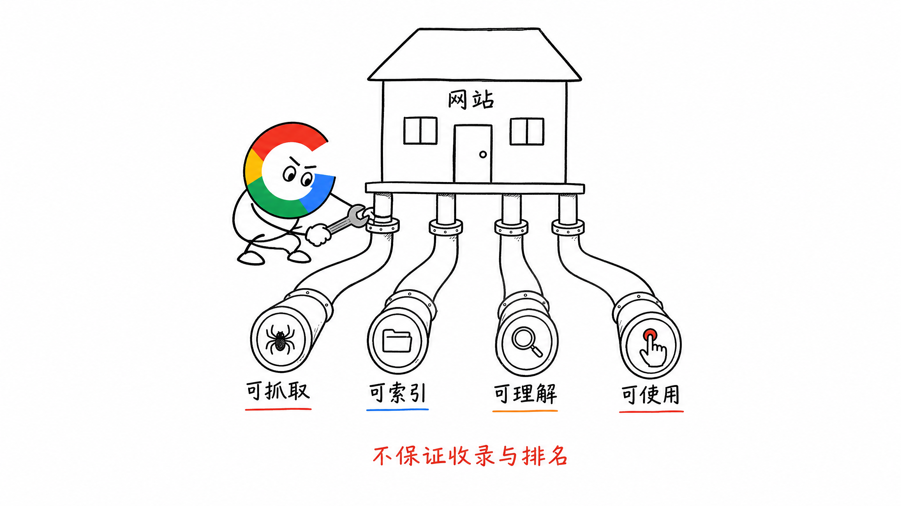
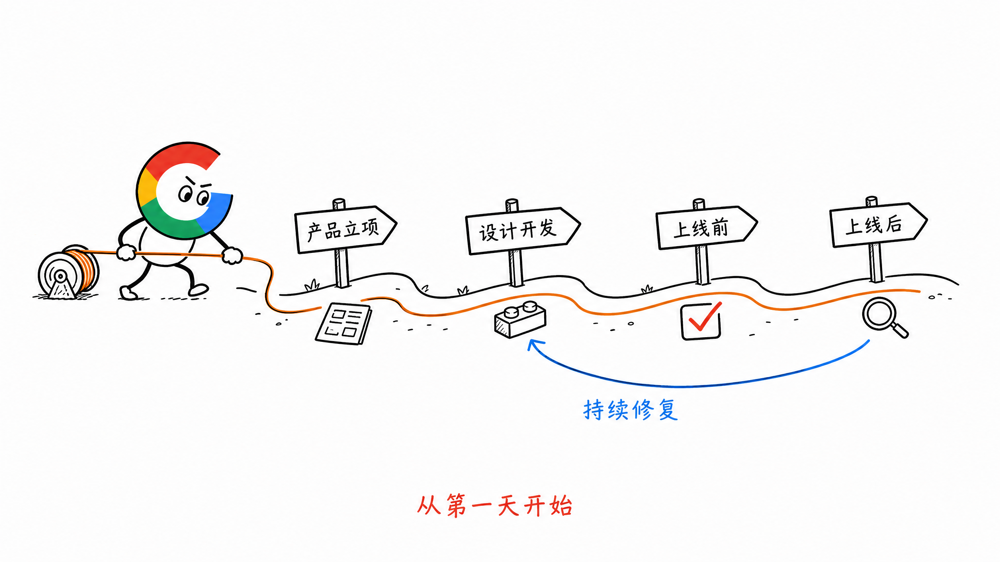
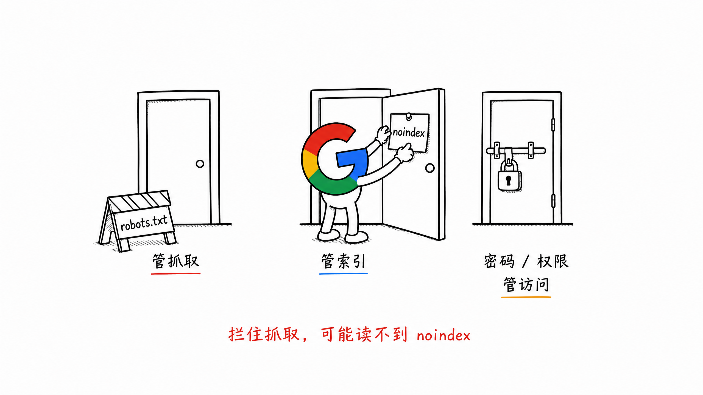
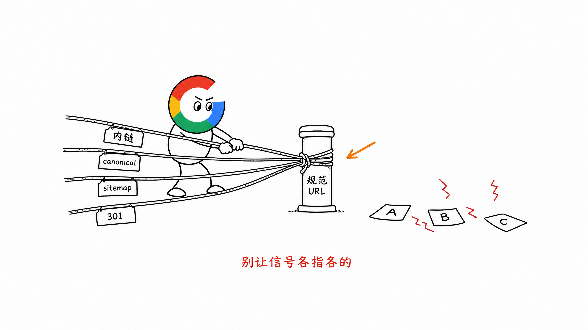
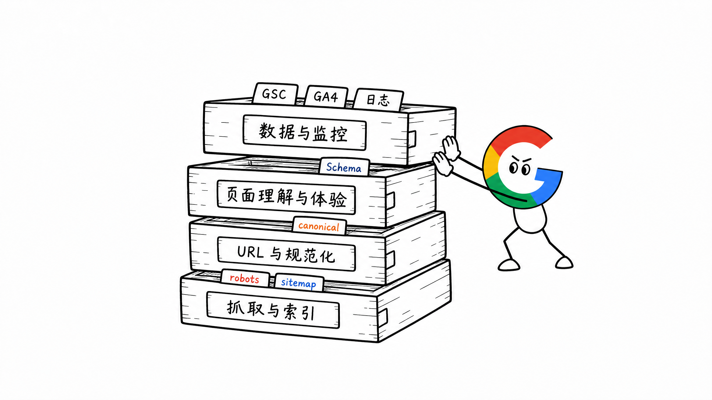
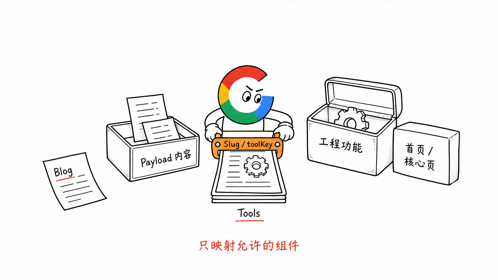
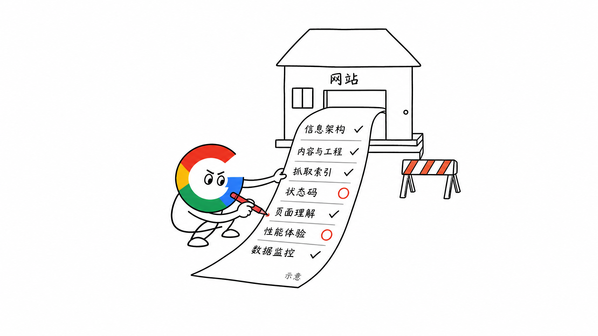

# 第 8 章 SEO 基建：从第一天搭好地基

> ❤️ 这一章节内容，感谢阿彪师傅 @ Pollo.ai 的交流。

前面几章，我们已经把网站的大纲、目录和页面规划清楚了。

接下来要做的，是把这本书真正装订好，让 Google 找得到、翻得开、看得懂，用户也能顺畅使用。

这就是 SEO 基建。

很多人把 SEO 基建理解成上线以后再做一次技术检查。

但我认为，只要确定网站中期会做 SEO，就应该从第一天开始搭。

**SEO 基建不是网站上线后的补丁，而是产品开发的一部分。**

这一章主要回答四个问题：

- What：SEO 基建到底是什么
- Why：为什么要从第一天开始做
- When：应该在哪个阶段介入
- How：第一版网站至少要搭好哪些东西

## 一、什么是网站的 SEO 基建

如果把网站当成一本书，SEO 基建就是这本书使用的纸张、油墨、印刷和装订。

内容写得再好，如果纸张破损、文字模糊、章节缺页，读者很难正常阅读，搜索引擎也很难整理。

也可以把网站理解成一栋房子。

SEO 基建就是房子的地基与水电，包括：

- Technical SEO
- URL 与信息架构
- `robots.txt`
- `sitemap.xml`
- canonical
- 状态码与重定向
- 多语言与 `hreflang`
- Schema 结构化数据
- 页面性能与移动端体验
- GSC、GA4 与日志监控

这些工作最后要让网站达到四个状态：

1. 可抓取：Googlebot 能进入并获取页面
2. 可索引：页面具备 Google 进入索引的条件
3. 可理解：Google 能判断页面讲什么、哪个 URL 才是规范版本
4. 可使用：用户能正常打开、阅读和使用页面功能

这里要注意，具备收录条件不等于一定会被收录。

页面即使返回 `200`，也没有屏蔽 Googlebot，还需要有真正可以索引的内容。Sitemap 和 GSC 提交也只是帮助 Google 发现页面，不是收录保证。

所以 SEO 基建解决的是参与搜索竞争的资格，不是直接保证排名。



## 二、为什么要从第一天开始做

新站一开始页面少，很多技术问题看起来不严重。

一个 canonical 配错、一个目录结构不合理，似乎也不影响产品上线。

但等网站有几百、几千个页面，再去修改路由、模板、数据结构和多语言规则，就会牵一发而动全身。

这就是技术债。

比如：

- 上线后才发现同一个页面有多个 URL
- 批量做多语言以后，才发现默认英文和 `/en/` 重复
- 发布几千个页面以后，才发现 sitemap 漏页
- 准备做 pSEO 时，才发现模板没有 canonical 和 Schema
- 已经获得排名以后，才开始大规模调整 URL

这些问题不是不能修。

只是越晚修，涉及的页面越多，重定向、收录和流量风险也越大。

所以只要 SEO 是网站确定要做的增长渠道，就应该在产品立项、路由设计和页面模板阶段介入。

**能在模板层一次解决的问题，不要等上线后逐页打补丁。**


## 三、SEO 基建不是只给 Google 做的

SEO 基建一方面要让 Google 的搜索系统看懂，另一方面也要让用户用得顺。

举个比较极端的例子。

如果一个网站视觉和动效做到 100 分，但 Google 的可见性和可理解性只有 60 分，页面很炫，却抓不到核心内容，也很难获得搜索流量。

与其这样，不如先做到：

**用户体验 80 分 × 搜索引擎可见性 80 分。**

整体 ROI 可能更高。

当然，这不是让大家为了 SEO 做一个难看的网站。

而是在产品体验、视觉效果和机器可读性之间做平衡。

比如：

- 重要文字不能只放在图片里
- 核心内容不能必须登录后才能看到
- 页面动效不能让首屏一直加载不出来
- JavaScript 不能让 Google 抓到一张空壳
- 语言切换不能只有前端状态，却没有独立 URL

SEO Friendly 的网站，应该是用户能用，机器也能读。


## 四、什么时候开始做 SEO 基建

答案很简单：越早越好。

但越早，不是让 SEO 一开始就写几十页技术需求。

不同阶段做不同粒度的事情就行。

### 1. 产品立项阶段

先确定：

- 主域名与默认语言
- 网站主要目录
- 哪些页面需要被索引
- 哪些页面不应该公开或进入搜索结果
- 产品未来是否会做多语言、pSEO 或大量工具页

这个阶段重点是不要把后面的路堵死。

### 2. 设计与开发阶段

把 SEO 要求放进页面模板和组件：

- Title、Description、H1 的字段
- canonical 与 `hreflang`
- 面包屑和内链模块
- Schema 的生成规则
- 图片 Alt 的填写入口
- 状态码与重定向规则
- 页面性能与移动端适配

### 3. 上线前

对生产环境做一次完整验收。

重点确认测试环境没有被收录，生产环境也没有误带 `noindex` 或错误的 robots 规则。

### 4. 上线后

通过 GSC、GA4 和服务端日志持续观察：

- Google 有没有发现和抓取页面
- 页面有没有进入索引
- Google 选择的 canonical 是否正确
- 用户进入页面后有没有正常使用和转化
- 404、5xx 和重定向是否异常增加

SEO 基建不是上线前检查一次就结束。

第一次把规则搭好以后，后面主要做监控、巡检和模板级修复。



## 五、第一版网站要搭好的四层基建

不用一开始就把 Technical SEO 做得特别复杂。

第一版先守住四层。

### 1. 抓取与索引层

先保证 Google 能找到应该出现的页面，也不会把不该出现的页面当成核心内容。

需要检查：

- `robots.txt` 是否误拦截正式页面
- 测试环境、后台和私有页面是否正确限制访问
- `sitemap.xml` 是否只包含希望收录的规范 URL
- sitemap 是否自动更新，并使用真实的 `lastmod`
- 核心页面是否有正常的站内链接
- 页面是否返回正确的 `200`、`301`、`404` 或 `410`
- 页面是否意外存在 `noindex`

这里最容易混淆的是 `robots.txt` 和 `noindex`。

`robots.txt` 主要管理抓取，不适合拿来保证某个网页不出现在搜索结果里。如果页面包含隐私内容，应该使用登录权限或密码保护；如果公开页面不希望被索引，可以使用 `noindex`，同时允许 Google 抓取并读取这条规则。



### 2. URL 与规范化层

同一份内容最好只有一个主要 URL。

需要检查：

- HTTP 是否统一跳转到 HTTPS
- `www` 与非 `www` 是否统一
- 带参数和不带参数的页面如何处理
- 尾斜杠规则是否一致
- 每页 canonical 是否指向正确的规范 URL
- 页面合并或迁移后是否配置 301
- 多语言页面是否使用正确的 `lang` 与 `hreflang`

canonical、重定向和 sitemap 不是三套互相独立的规则。

如果某个 URL 是规范版本，站内链接、canonical 和 sitemap 最好都指向它，不要一边提交 A，一边 canonical 到 B。



### 3. 页面理解与体验层

Google 抓到页面以后，还要能看懂页面，用户也要能正常使用。

需要检查：

- 页面是否有清楚的 Title、Description 和唯一 H1
- H2、H3 是否能表达内容层级
- 图片是否有合适的 Alt
- 重要内容是否能在渲染后的 HTML 中看到
- 是否根据页面类型配置合适的 Schema
- 移动端是否能正常阅读和操作
- 核心功能是否稳定
- 页面加载、交互响应和视觉稳定性是否合格

Schema 不是有就一定能获得富媒体结果。

它的作用是帮助搜索引擎理解页面内容，而且标记必须与用户实际看到的内容一致。

Core Web Vitals 的具体优化会在第 11 章展开。这一章先把性能检查放进上线门槛，不要等用户和 Google 都遇到问题后再处理。

### 4. 数据与监控层

没有监控，就不知道基建到底有没有生效。

第一版至少应该接入：

- Google Search Console：看抓取、索引、搜索词、曝光和点击
- Google Analytics 4：看落地页、用户行为和转化事件
- 服务端或 CDN 日志：看 Googlebot 是否真实访问、状态码和抓取频率
- 错误监控：及时发现 404、5xx、接口失败和页面不可用

GSC 看到的是 Google 处理后的搜索数据，GA4 看到的是进入网站后的用户行为，日志看到的是服务器真实收到的请求。

三者解决的问题不同，不能互相替代。



## 六、新站怎么把 SEO 基建落到工程里

现在很多新站就是一个全栈开发者，甚至一个独立开发者完成。

不用硬拆 SEO、产品、设计和开发分别负责什么。

更实际的问题是：**什么应该写在代码工程里，什么应该放进 CMS，内容与真实功能怎么组合。**

我建议新站先按三类页面处理。

| 页面类型 | 主要放在哪里 | 原因 |
| --- | --- | --- |
| Homepage、核心 Feature / Solution | 代码工程 | 页面少、结构稳定、交互与产品强相关 |
| `/blog` | Headless CMS | 文章会持续增加，需要方便编辑、发布和更新 |
| `/tools` | CMS 内容 + 工程功能 | 内容需要规模化管理，功能区需要真实代码运行 |

### 1. 首页和核心产品页放在代码工程

首页通常不会规模化增长。

它承担产品定位、核心品类词和主要转化，页面结构、视觉和交互也比较特殊，直接放在代码工程里更合适。

核心 Feature、Solution、Pricing 等 SEO 必做型页面，也可以先使用工程里的固定模板和组件。

至少把这些能力做进页面框架：

- Title、Description、H1 和 canonical
- OG Image 与社交分享字段
- Breadcrumb 与基础 Schema
- 清楚的导航和内链入口
- Sitemap 自动收录规则

这些页面数量不多，不需要为了看起来灵活，一开始就全部 CMS 化。

### 2. `/blog` 用 Headless CMS 管理

Blog 会随着关键词和内容规划持续增长，也会频繁修改、更新和多人编辑。

这类内容不适合每发一篇文章都改代码、重新手写页面。

我会推荐使用 Payload 这类 Headless CMS。它可以直接加入现有 Next.js 工程，通过 Collection 管理文章，通过 Blocks 组合正文、图片、表格、FAQ 和 CTA 等内容模块。

一篇 Blog 至少可以有这些字段：

- `title`
- `slug`
- `metaTitle`
- `metaDescription`
- `content`
- `author`
- `publishedAt` 与 `updatedAt`
- `language`
- `canonical`
- `featuredImage` 与图片 Alt

发布文章以后，系统应该自动生成对应 URL，同时更新 sitemap、Article Schema、面包屑和相关文章内链。

这样 Blog 的日常增长主要发生在 CMS，不需要反复改页面代码。

### 3. `/tools` 使用内容与功能分离的模块化结构

`/tools` 要不要做、做多少，还是看前面的 Topic Map、Keyword-to-Page 和产品规划。

但只要准备把 Tools 当成 SEO 增长频道，最好从第一天就做模块化设计。

一个复杂工具页，可以拆成两部分：

- 内容段放在 Payload：Title、Description、介绍、使用步骤、案例、FAQ、相关工具和 SEO 字段
- 功能区放在代码工程：上传、输入、生成、API 调用、结果展示、下载和错误处理

然后通过 URL Slug 对应一个确定的功能模块。

比如 Payload 里有一条 Tool 数据：

```text
slug: background-remover
toolKey: background-remover
```

代码工程里维护一个明确的功能映射：

```text
background-remover → BackgroundRemoverTool
video-script-generator → VideoScriptGeneratorTool
```

用户访问 `/tools/background-remover` 时，页面先根据 Slug 读取 Payload 里的内容，再通过 `toolKey` 加载工程里的 `BackgroundRemoverTool` 功能区。

这里不要让 CMS 直接执行任意组件名称。

工程里应该维护一份允许使用的功能映射，CMS 只能选择已经存在的 `toolKey`。这样结构更稳定，也更安全。

如果几个简单工具共用同一套能力，可以复用一个通用组件，通过配置改变输入和输出。

如果是功能差异很大的复杂工具，就让 AI Coding 或开发者在工程里实现独立功能组件，再把它接到对应的 Slug。

**CMS 负责内容增长，代码工程负责真实功能，Slug 负责把两边接起来。**

以后新增 Tool，不需要复制整个页面。先判断是复用已有功能模块，还是开发新的功能组件，再补齐 Payload 里的内容和 SEO 字段。



## 七、上线前 SEO 基建 Checklist

下面这份清单可以直接放进新站或重大改版的上线流程。

### 信息架构与 URL

- [ ] Homepage、Feature、Solution、Tool、Blog 等目录是否符合规划？
- [ ] URL 是否使用统一的小写、连字符和尾斜杠规则？
- [ ] 每个 Keyword Cluster 是否有唯一的 Page Owner？
- [ ] 核心页面是否能从导航、频道页或内链进入？

### 内容与工程

- [ ] 首页和核心产品页是否在工程里具备完整 SEO 字段？
- [ ] Blog 是否通过 CMS 管理 Slug、正文、作者、时间和 SEO 字段？
- [ ] Tool 内容与功能代码是否分开管理？
- [ ] Tool 的 Slug / `toolKey` 是否只能映射到工程里允许使用的功能组件？
- [ ] 新页面发布后是否会自动更新 sitemap、Schema 和内链入口？

### 抓取与索引

- [ ] 正式页面是否没有被 `robots.txt` 误拦截？
- [ ] 测试环境和私有页面是否限制访问？
- [ ] 页面是否误带 `noindex`？
- [ ] sitemap 是否包含全部规范页面，并排除无效 URL？
- [ ] `lastmod` 是否随页面真实更新，而不是每次构建全部改写？
- [ ] canonical 是否与实际 URL、内链和 sitemap 保持一致？

### 状态码与重定向

- [ ] 正常页面是否返回 `200`？
- [ ] 永久迁移是否使用 `301`？
- [ ] 不存在的页面是否返回真实 `404` 或 `410`？
- [ ] 是否存在重定向链、循环或错误跳转？
- [ ] HTTP、HTTPS、`www` 与非 `www` 是否已统一？

### 页面理解与多语言

- [ ] 每页是否有独立的 Title、Description 和 H1？
- [ ] 页面内容是否能被正常渲染和读取？
- [ ] Schema 是否与页面类型和可见内容一致？
- [ ] 是否使用 Rich Results Test 验证结构化数据？
- [ ] 多语言页面是否有独立 URL？
- [ ] `lang`、`hreflang` 和 canonical 是否配置正确？

### 性能与体验

- [ ] 页面是否能在移动端正常查看和操作？
- [ ] 图片、字体和 JavaScript 是否经过基础优化？
- [ ] 核心功能是否能正常使用？
- [ ] 是否使用 PageSpeed Insights 检查页面性能？

### 数据与监控

- [ ] 是否验证 Google Search Console？
- [ ] 是否提交 sitemap？
- [ ] 是否接入 GA4，并配置核心转化事件？
- [ ] 是否能查看服务端或 CDN 日志？
- [ ] 是否有 404、5xx 和服务异常监控？
- [ ] 是否用 URL Inspection 检查核心页面？



## 八、让 Agent 做第一轮检查

现在也可以让 AI Coding Agent 帮忙做第一轮检查。

如果使用的 Agent 支持 Skills，我推荐直接安装开源的 `seo-audit-skill`：

https://github.com/JeffLi1993/seo-audit-skill

```bash
npx skills add JeffLi1993/seo-audit-skill
```

安装以后，直接把页面地址交给 Agent：

```text
audit this page: https://example.com
```

它会检查 `robots.txt`、sitemap、canonical、Schema、Title、H1、内链等项目，并生成一份可以继续交给 Agent 修改的 HTML 报告。

日常单页检查先用 `seo-audit`。需要进一步检查 PageSpeed、Sitemap URL 清单、测试环境和 GSC 数据时，再使用 `seo-audit-full`。

如果暂时不安装 Skill，也可以直接使用下面这段 Prompt。

但不要只说帮我优化 SEO。

最好给它明确的页面、目标关键词和检查范围，比如：

```text
请检查 {{PAGE_URL}} 的 SEO 基建，并以 {{PRIMARY_KEYWORD}} 作为页面的 Top Keyword。

检查以下内容：
1. robots、sitemap、canonical、hreflang、状态码与重定向
2. 移动端、页面性能与核心功能可用性
3. Title、Description、H1、页面结构与内链
4. 与页面类型匹配的 Schema
5. GSC、GA4 与错误监控是否具备验证条件

输出：
- 当前问题
- 修改建议或代码差异
- 验证方法
- 仍需人工确认的内容

不要修改品牌、价格和核心产品设计。
```

Agent 可以帮大家发现问题、改模板和补测试。

但最终还是要在真实生产环境里验证状态码、渲染结果、结构化数据、抓取情况和转化事件。

## 九、这一章先做到什么程度

第 8 章不是让大家一次学完所有 Technical SEO。

这一阶段的目标是建立一套最低可用的 SEO 基建，让网站上线时不会出现明显的系统性问题。

后面几章会继续拆开：

- 第 9 章讲单个页面如何做好 On-Page SEO
- 第 10 章讲 Technical SEO 的真实踩坑与修复
- 第 11 章讲页面体验与 Core Web Vitals

遇到问题时，优先回到模板、组件和发布流程解决。

不要上线 1000 个页面以后，再让运营逐页修改同一个错误。

## 十、小结

只要确定中期会做 SEO，就从第一天把基建搭好。

它不是为了讨好搜索引擎，也不只是开发团队的一次性任务。

它要让网站同时做到：

- 机器能发现、抓取、理解和索引
- 用户能打开、阅读、使用和转化
- 团队能监控、定位和修复问题

如果压缩成一句话：

**SEO 基建，是机器可理解 × 人类可转化的交集，也是后续 pSEO、国际化、内容和外链能够生效的前置条件。**

> 本章节完毕，谢谢大家，欢迎随时讨论。
