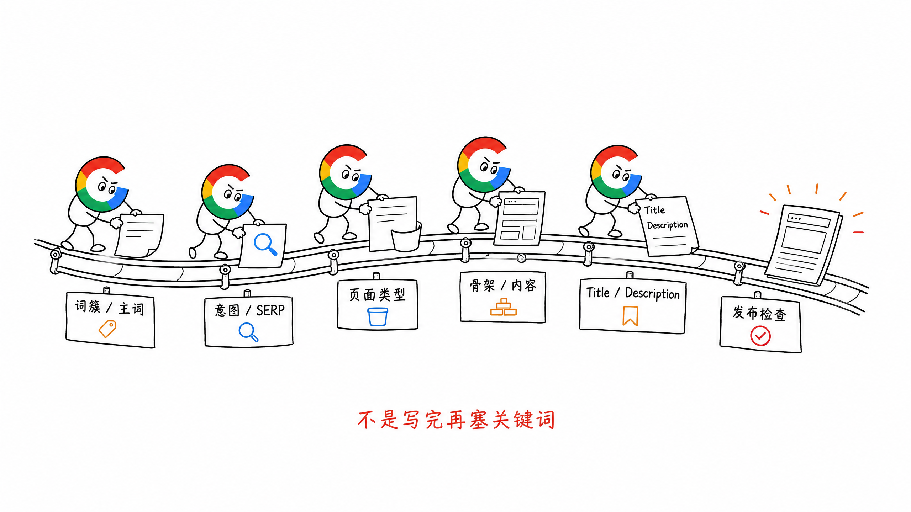
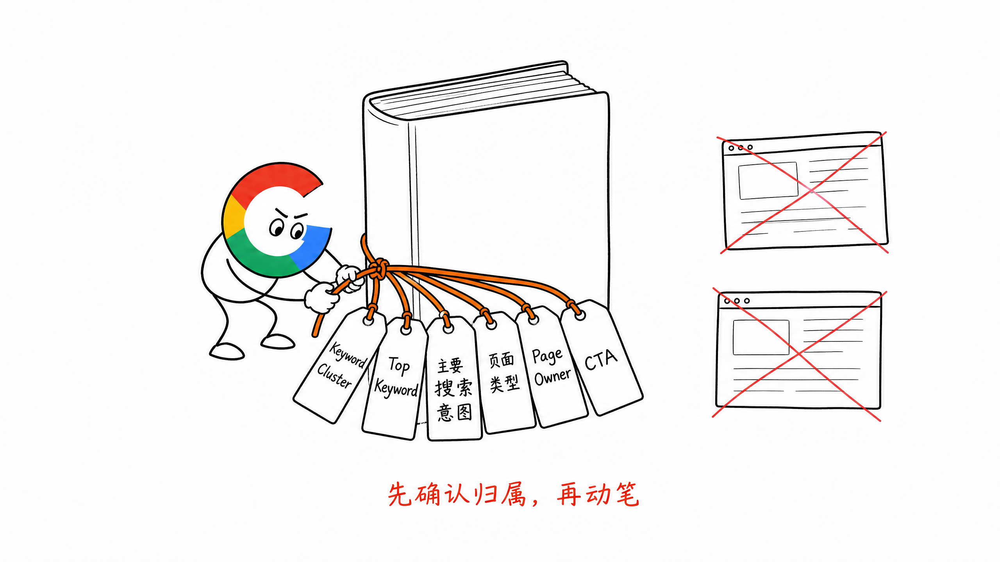
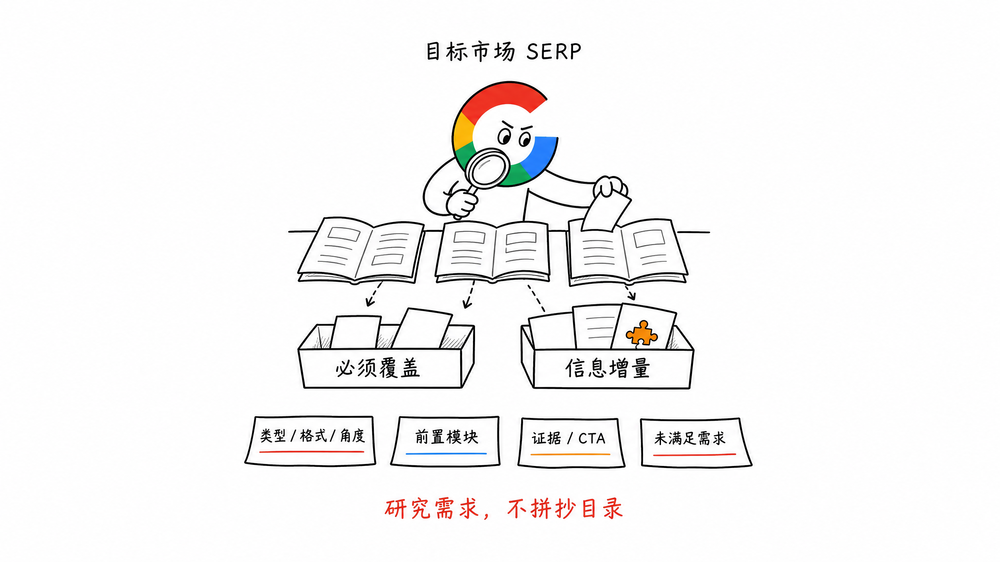
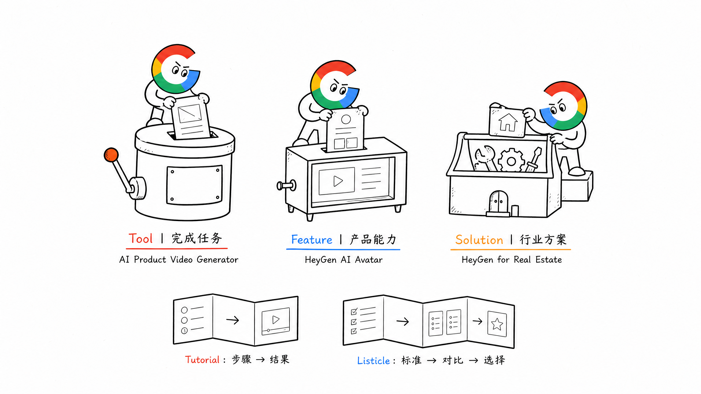
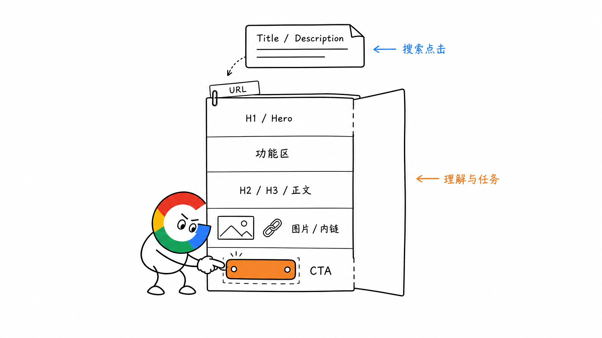
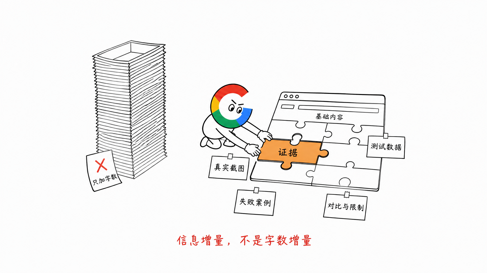
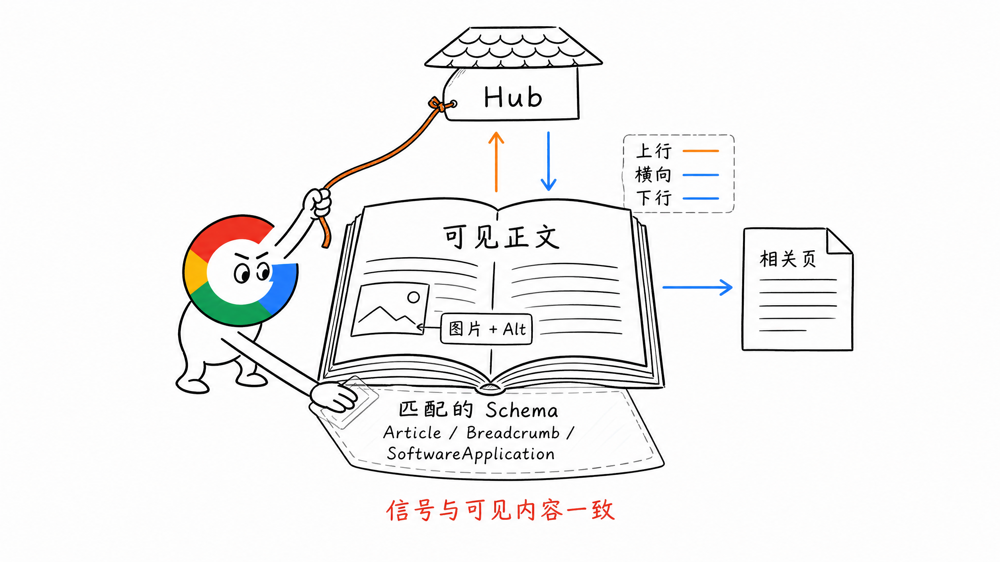
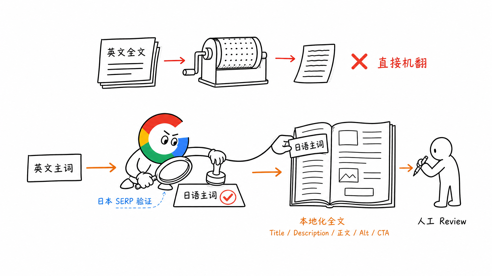

# 第 9 章 On-Page SEO：从主关键词到发布检查

做一个页面前，先别急着写。

很多 On-Page SEO 的工作顺序是反的。

先写完文章，再把关键词塞进 Title、H1、首段和 FAQ，最后加几个内链，就说页面已经完成 SEO 优化。

这样做的问题是，页面从一开始就可能选错了搜索意图、页面类型和内容结构。

我认为正确顺序应该是：

**Keyword Cluster → Top Keyword → 搜索意图 → SERP → 页面类型 → 页面骨架 → 内容模块 → Title / Description → 发布检查。**

On-Page SEO 不是在页面写完以后做修饰。

它是从页面立项到发布复盘的完整执行流程。



## 一、第一步不是写，而是确认 Page Owner

第 6 章已经讲过：

**一个页面 = 一个 Keyword Cluster + 一个 Top Keyword + 一个主要搜索意图。**

所以开始做页面前，先回到 Page Owner 表，确认这组需求应该由谁承接。

至少要明确六件事：

1. Keyword Cluster 里有哪些词
2. 哪个词是搜索量最高的 Top Keyword
3. 用户想完成什么任务
4. 主要搜索意图是什么
5. 应该使用什么页面类型
6. 现有网站有没有页面负责承接

比如下面三个词看起来很像：

| Top Keyword | 用户任务 | 页面类型 | Page Owner |
| --- | --- | --- | --- |
| `ai product video generator` | 直接生成商品视频 | Tool Page | 商品视频生成器页面 |
| `best ai product video generator` | 比较和选择工具 | Blog / Listicle | Best 榜单文章 |
| `how to make a product video with ai` | 学习制作方法 | Blog / Tutorial | How-to 教程文章 |

如果 Page Owner 已经存在，优先更新现有页面。

不要每看到一个新词，就重新建立一个差不多的 URL。

这个阶段还要确定页面的主要 CTA。

工具页可能是开始生成，Feature 页面可能是免费试用，教程文章可能是进入对应工具。

搜索意图和 CTA 对不上，页面即使有流量，也很难产生结果。



## 二、第二步，逐条看 SERP

不要自己脑补页面结构。

先打开目标市场的 Google，搜索 Top Keyword，把前排结果一个一个点开看。

如果主要做美国市场，就看美国 SERP；如果做日语、韩语或其他市场，就切换到对应的地区和语言环境。

建议至少记录下面这些信息：

- 页面类型：Tool、Feature、Solution、Blog、Listicle、UGC 等
- 内容格式：教程、清单、表格、测评、对比、模板等
- 内容角度：免费、最新、批量、在线、无需登录等
- 页面前半部分放了什么
- H2、H3 覆盖了哪些核心问题
- 是否有工具区、案例、截图、数据、视频或对比表
- 用户进入页面后的主要 CTA
- 哪些问题大家都没有讲透

不要只看标题和 H2。

最好真的进入页面，完整体验一次。

如果是工具页，就试着完成一次输入、生成和下载；如果是榜单页，就看它有没有真实评测方法、截图和限制说明。

还要记录 SERP 里的其他结果形态：

- AI Overview
- 图片与视频
- Reddit 等 UGC
- People Also Ask
- 产品卡片或其他垂直结果

这些结果可以帮助我们判断，用户只需要一个简短答案，还是需要继续点击网页完成任务。

**SERP 共同出现的核心内容，是页面的基础要求；SERP 没讲透的地方，才是我们可以增加的价值。**

但不要把前 10 名的目录拼起来，就当成自己的页面骨架。

SERP Research 是理解 Google 当前如何满足需求，不是抄竞品。



## 三、第三步，确定页面类型和内容范本

页面类型确定以后，才能决定内容怎么装。

同一个关键词，不同页面类型的写法完全不同。

### 1. Tool Page

用户想直接完成任务，功能区应该前置。

常见骨架：

1. H1 与一句话结果说明
2. 可以直接操作的工具区
3. 输入示例与结果示例
4. How It Works
5. 适用场景和真实限制
6. FAQ
7. 相关工具与下一步 CTA

不要让用户先读完 2000 字，才能找到上传按钮。

### 2. Feature Page

用户想判断产品有没有某项能力。

比如 HeyGen 的 AI Avatar，是产品中的一项核心功能，更适合用 Feature Page 介绍能力、效果和使用场景，而不是包装成一个独立在线工具。

常见骨架：

1. 能力与结果
2. 产品截图或 Demo
3. 主要使用场景
4. How It Works
5. 效果、案例或数据证明
6. 与其他能力的配合
7. 免费试用或注册 CTA

### 3. Solution Page

用户通常带着具体行业、角色或场景问题。

比如 HeyGen for Real Estate，面向房地产行业讲清楚如何用 AI Avatar 和视频生成能力制作房源介绍、营销视频等内容。这类页面卖的不是某一个功能，而是一套适合特定行业的解决方案。

常见骨架：

1. 谁遇到了什么问题
2. 产品如何完成这套工作流
3. 对应能力和使用步骤
4. 真实案例或结果
5. 为什么适合这个场景
6. CTA

Solution 页面不能只是把 Feature 页面换一个行业词。

### 4. Blog / Tutorial

用户想学会一件事。

常见骨架：

1. 直接回答问题
2. 准备条件
3. 分步骤操作
4. 每一步的截图或结果
5. 常见失败情况与解决方法
6. 最终结果
7. 对应工具或下一步

### 5. Blog / Listicle、Comparison、Alternatives

用户正在比较和做决定。

常见骨架：

1. 选择标准与评测方法
2. 快速对比表
3. 每个产品的适合人群
4. 真实体验、截图和结果
5. 优点、限制与价格信息
6. 最终选择建议

没有评测方法和真实证据的 Best List，只是产品名字的集合。



## 四、第四步，先搭页面骨架，再写 TDK

页面骨架确认以后，再写 Title、Description、H1、正文、图片和 Schema。

不要先想一个很 SEO 的标题，再逼着正文去配合它。

这里先说明一下 TDK。

国内 SEO 习惯把 Title、Description 和 Keywords 合称为 TDK，但 Google Search 不使用 `meta keywords` 参与网页索引和排名。

所以实际执行时，重点是 Title、Description，以及用户真正能看到的页面内容，不需要再维护一串 `meta keywords`。

### 1. URL Slug

URL 应该在 Keyword-to-Page 和 URL Structure 阶段基本确定。

保持小写、简短、可读，并使用连字符连接单词。

比如：

```text
/tools/ai-video-generator
```

不要为了覆盖更多关键词，把免费、最好、在线、无需注册等修饰词全部塞进 URL。

页面上线后尽量不要修改 URL。必须调整时，做好 301、内链、canonical 和 sitemap 的同步更新。

### 2. Title

Title 要准确说明这一页是什么，并让用户知道为什么值得点击。

我自己的做法是：

- 自然包含 Top Keyword
- Top Keyword 尽量靠前，但不要为了靠前写得不通顺
- 每个页面使用独立 Title
- 去掉没有信息量的 Best、Ultimate、Amazing 等词
- 品牌名放在结尾还是开头，根据页面类型决定
- 发布前在桌面端和移动端预览是否容易读懂

Title 没有一个必须遵守的固定字符数。

Google 会根据设备宽度截断，也可能结合 H1、页面内容和链接文字重新生成 Title Link。

所以重点不是刚好写到 60 个字符，而是清楚、简洁、与页面内容一致。

### 3. Meta Description

Description 用一到两句话讲清楚：

- 页面能提供什么
- 用户能得到什么结果
- 有什么值得点击的具体信息

同样不需要死守固定字符数。

Google 主要会从页面正文生成搜索摘要，也可能在 Description 更适合当前查询时采用它。

所以 Description 要准确描述页面，不要写成关键词列表，也不要承诺页面里没有的结果。

### 4. H1

页面最好有一个清楚的主 H1。

H1 可以包含 Top Keyword 或自然变体，让用户进入页面后马上确认自己来对了地方。

Title 与 H1 不需要逐字相同。

Title 更偏搜索结果点击，H1 更偏进入页面后的理解和承接。

### 5. 首段与 Hero

不要为了满足前 100 个单词出现关键词，写一段很长的铺垫。

开头应该尽快回答：

- 这是什么
- 适合谁
- 可以解决什么问题
- 用户最终能得到什么

Top Keyword 只要自然出现就行。

工具页和 Feature 页面还要尽快展示产品结果、功能入口或 Demo，不要只放一段抽象的品牌文案。

### 6. H2、H3 与正文

H2、H3 负责把用户完成任务需要的内容分清楚。

它们应该围绕步骤、问题、场景、判断标准和重要子话题展开，而不是把关键词变体逐个写成小标题。

段落保持短、清楚、容易扫读。

没有必要机械规定一句话多少单词、一段最多几行。读者能不能快速找到答案，比形式规则更重要。



## 五、字数不是目标，信息增量才是

原稿里提到过，可以参考 SERP 前排页面的平均字数。

这个方法可以用来判断一个主题大概需要讲多深，但不能变成前 10 平均 2000 字，我就写 2200 字。

Google 不会因为文章多出 10%，就认为内容更好。

真正要问的是：

- 页面有没有完成用户任务
- SERP 共同需要的核心内容有没有覆盖
- 有没有比现有结果多提供一点真实价值
- 多出来的内容是否真的与当前页面有关

信息增量可以是：

- 自己跑出来的数据
- 真实产品截图
- 输入与输出结果
- 具体操作步骤
- 不同方案的效果对比
- 失败案例和解决方法
- 适合谁与不适合谁
- 竞品没有说清楚的限制

比如一个 AI 去背景工具页，与其再补 1000 字什么是 AI 去背景，不如增加：

- 三种复杂背景的真实处理结果
- 毛发、透明物体和低清图片的失败情况
- 批量处理的格式与数量限制
- 处理前后可以放大查看的对比图

这些内容既帮助用户做决定，也能让页面真正区别于同类结果。



## 六、内链、图片和 Schema 怎么处理

正文写完以后，还要补齐帮助理解和发现的信号。

### 1. 内链

内链不是页面底部随便放几篇相关文章。

可以从三个方向检查：

- 上行：链接到所属 Hub、频道或核心产品页
- 横向：链接到同一主题下的相关页面
- 下行：从 Hub 或核心页链接到这篇新页面

锚文本要具体、自然，让用户在点击前知道会去哪里。

不要全部写成 Learn More、Click Here，也不要每条链接都强行使用完全匹配的关键词。

每个重要页面至少应该从网站里的另一个可抓取页面获得入口。

### 2. 图片与 Alt

图片应该放在它要解释或证明的内容附近。

重要截图最好配一句说明，让读者知道这张图要看什么。

Alt 主要描述图片内容和用途，也能帮助搜索引擎理解图片。

比如：

```text
AI background remover result on an image with detailed hair
```

不要写成：

```text
AI background remover, free background remover, best background remover
```

纯装饰图片可以使用空 Alt，不需要为了 SEO 强行填关键词。

### 3. Schema

Schema 要根据页面真实内容和 Google 当前支持的搜索展示类型选择。

常见选择包括：

- Blog 文章：`Article`
- 网站层级：`BreadcrumbList`
- 软件或工具：符合条件时使用 `SoftwareApplication`
- 产品销售页：符合条件时使用 `Product`
- 官网与品牌信息：`Organization`、`WebSite`

不要为了看起来完整，把所有 Schema 都塞进页面。

标记内容必须和用户实际看到的页面一致，并使用 Rich Results Test 验证。

以前很多 SEO Checklist 会默认推荐 `FAQPage` 和 `HowTo`。

但截至本书当前版本，Google 已经停止展示 HowTo 富媒体结果，FAQ 富媒体结果也已经退出 Google Search。页面当然仍然可以保留对用户有价值的 FAQ 和操作步骤，只是不需要为了获得这两类富媒体结果机械添加对应 Schema。



## 七、多语言页面不是翻译完就结束

多语言 On-Page SEO 不能只把英文正文翻译一遍。

还要一起本地化：

- Top Keyword 与 Secondary Keywords
- Title 与 Description
- H1、H2 和正文表达
- 图片中的文字与 Alt
- 案例、货币、日期和使用场景
- CTA 与产品界面文案
- Schema 中的名称、URL 和语言信息

同一个英文关键词，直译成另一种语言，不一定是当地用户真正使用的搜索词。

所以每种语言都应该重新看本地 SERP，确认搜索意图、页面类型和常用表达。

### 一个更实战的做法：先映射主词，再翻译全文

假设英文页面的 Top Keyword 已经确定，做日语版本时，不要直接把整篇英文机器翻译成日语。

可以按下面的顺序执行：

1. 先把英文 Top Keyword 映射到日语关键词候选
2. 查看日本 SERP 和关键词数据，确认当地用户真正使用的日语 Top Keyword
3. 保持原页面的搜索意图、信息结构和事实内容不变
4. 把英文原文与确认后的日语 Top Keyword 一起交给 AI
5. 要求 AI 围绕日语 Top Keyword 本地化全文，而不是逐句直译
6. 最后人工 Review 专有名词、语气、案例、CTA 和产品界面文案

也就是：

**英文 Top Keyword → 日语 Top Keyword → 围绕日语主词本地化全文。**

这样生成的日语内容，通常比先机器翻译、再往里面塞关键词自然得多，也更接近当地用户的搜索表达。



可以直接把下面这段要求交给 AI：

```text
请把下面的英文页面本地化为日语页面。

英文 Top Keyword：{{ENGLISH_TOP_KEYWORD}}
日语 Top Keyword：{{JAPANESE_TOP_KEYWORD}}

要求：
1. 保留原文的搜索意图、事实、页面结构和核心信息
2. 围绕日语 Top Keyword 自然重写 Title、Description、H1、H2 和正文
3. 不要逐句直译，使用日本用户自然使用的表达
4. 同步本地化案例、货币、日期、CTA、图片 Alt 和产品界面文案
5. 不要添加原文没有的产品能力、价格和数据
```

`hreflang`、canonical 和多语言 URL 的技术配置，会在国际化 SEO 章节继续展开。

## 八、On-Page SEO 发布前 Checklist

页面完成以后，可以按下面这张表做一次发布前检查。

| 检查项 | 执行要点 |
| --- | --- |
| Page Owner | 一个 Keyword Cluster 有明确的 Top Keyword、主要搜索意图和唯一 Page Owner |
| 页面类型 | 页面类型符合 SERP 主流结果，也符合用户要完成的任务 |
| URL | 短、清楚、稳定，使用小写和连字符，上线后尽量不改 |
| Title | 独立、准确、容易读懂，自然包含 Top Keyword，不堆词 |
| Description | 具体说明页面内容和用户结果，不使用关键词列表 |
| H1 | 页面有一个清楚的主标题，与 Title 和搜索意图一致 |
| Hero / 首段 | 尽快讲清这是什么、适合谁、解决什么、得到什么 |
| H2 / H3 | 覆盖完成任务需要的步骤、问题和子话题，不堆关键词变体 |
| 页面主体 | Tool、Feature、Solution、Tutorial 等页面使用对应内容范本 |
| 信息增量 | 有真实截图、案例、数据、对比、失败情况或明确限制 |
| 内链 | 有上行、横向和下行入口，锚文本具体、自然 |
| 图片 | 重要图片靠近对应文字，有合适 Alt 和必要说明 |
| Schema | 类型符合页面内容，通过 Rich Results Test，且与可见内容一致 |
| 多语言 | Title、正文、图片、CTA、Schema 和关键词完成本地化 |
| 技术检查 | 返回 `200`，canonical 正确，没有误带 `noindex`，移动端可用 |
| 数据检查 | GA4 与核心转化事件正常，页面进入 sitemap |

这张表不是为了发布前机械打勾。

任何一项回答不清楚，都要回到页面任务重新判断。

## 九、On-Page SEO 的执行步骤

实际执行时，可以按下面的顺序：

1. 从 Page Owner 表取出 Keyword Cluster、Top Keyword 和主要搜索意图
2. 检查现有页面能否承接，避免重复建页
3. 逐条查看目标市场 SERP 前排页面
4. 确定页面类型、内容格式和内容角度
5. 先搭页面骨架，再确认必须内容和信息增量
6. 编写 URL、Title、Description、H1 和正文
7. 加入真实截图、案例、数据、限制和失败情况
8. 补齐内链、图片 Alt 和合适的 Schema
9. 完成技术、移动端和数据埋点检查
10. 发布后根据 GSC 的真实查询词和页面转化情况继续回补

## 十、小结

On-Page SEO 的核心不是把关键词塞进页面。

它是让一个页面准确承接一个 Keyword Cluster 和主要搜索意图，再用正确的页面形态，把用户的任务真正完成。

如果压缩成一句话：

**先确定做什么页面，再决定页面写什么，最后通过真实搜索数据继续改。**

页面结构让 Google 看得懂，信息增量让用户觉得值得，发布后的数据则告诉我们原来的判断对不对。

> 本章节完毕，谢谢大家，欢迎随时讨论。
