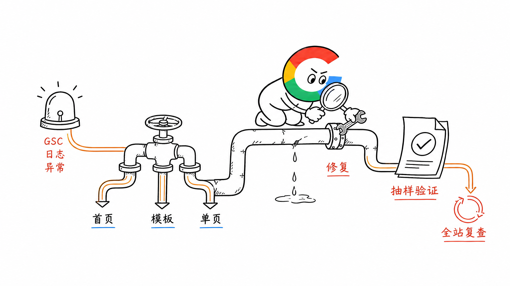
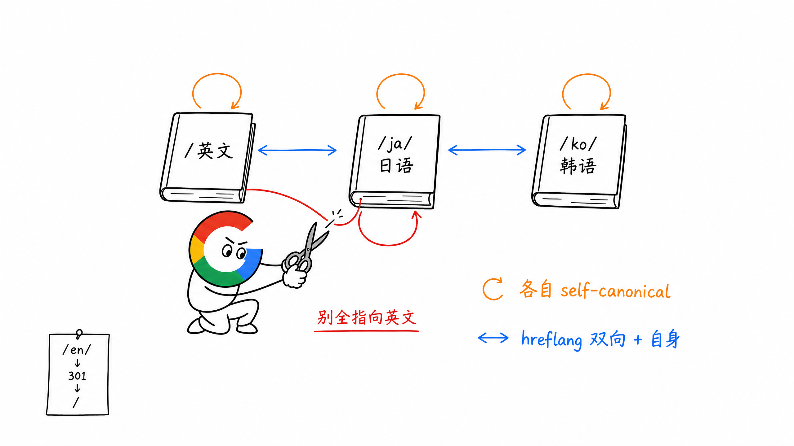
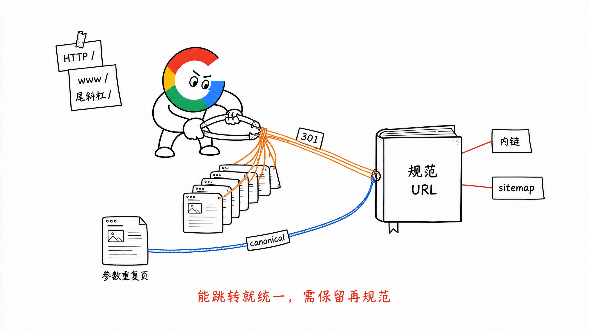
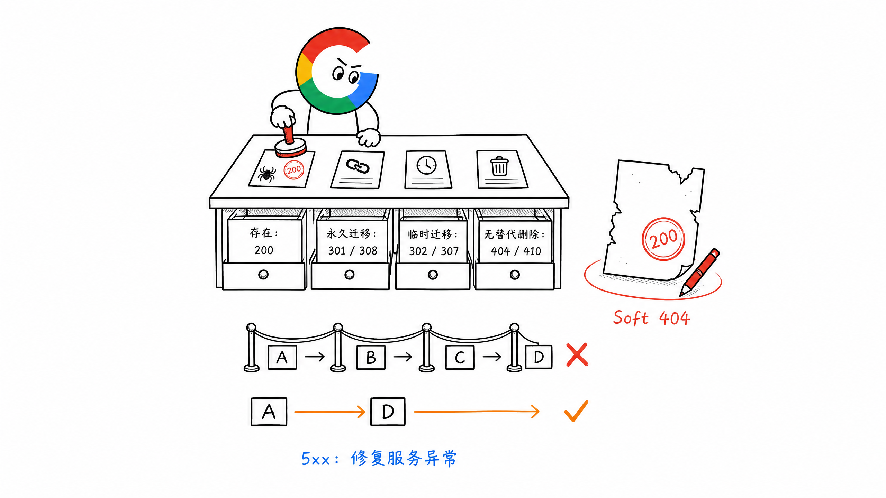
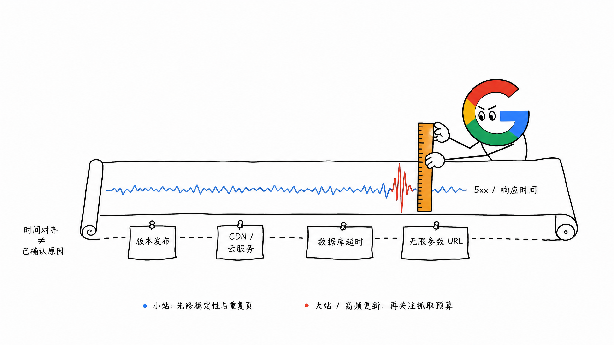
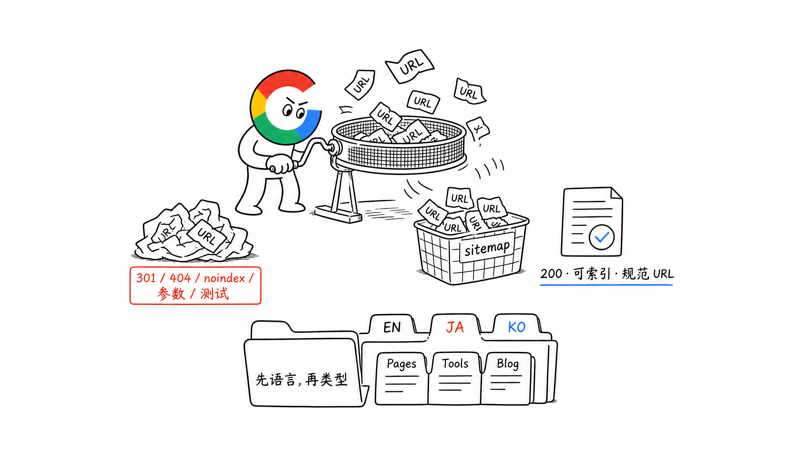
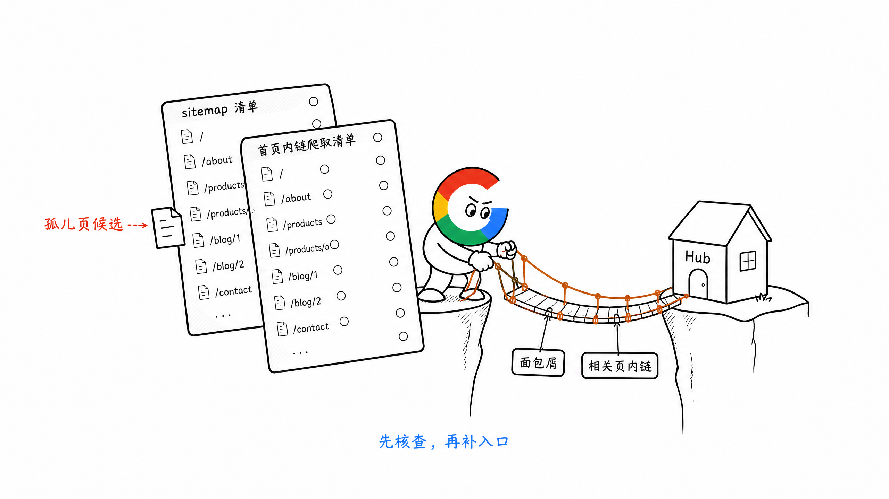
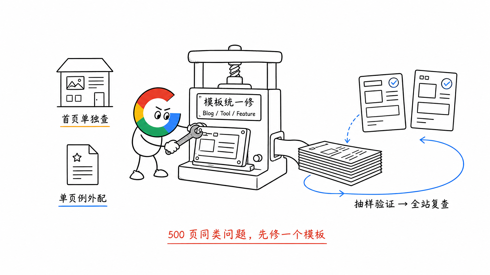

# 第 10 章 Technical SEO：真实踩坑与修复思路

> ❤️ 这一章节来自我实际检查网站时遇到的 Technical SEO 问题。

第 8 章讲的是新站应该从第一天搭好哪些 SEO 基建。

这一章换个角度，直接看网站上线后最常见的错误。

一句话说清 Technical SEO 要解决什么：

**让网站具备被 Google 抓取、理解、收录和正常访问的基础能力。**

它不直接保证排名。

但页面打不开、URL 重复、状态码错误、sitemap 漏页，内容和外链做得再好也可能无法正常生效。

Technical SEO 还有一个特点：**错误往往不是一页出错，而是一个模板带着几百个页面一起出错。**

所以发现问题以后，不要急着逐页修改。

先判断它属于首页、页面模板，还是少数页面的特殊问题。



## 一、测试环境被 Google 收录

很多团队会把正式站复制一份，部署在：

```text
test.example.com
staging.example.com
```

测试方便了，但如果任何人都能访问，Google 也可能发现它。

最后正式站和测试站同时出现一套几乎相同的页面。

### 怎么发现

- 搜索 `site:staging.example.com`
- 在 GSC 中检查是否出现测试域名
- 查看服务器日志里有没有 Googlebot
- 检查测试域名是否能在未登录状态正常访问

### 怎么处理

最稳妥的方式，是给测试环境加登录或访问密码，让未授权用户和爬虫都进不去。

如果测试环境必须公开访问，可以临时使用 `noindex`，并确保 Googlebot 能抓到这条规则。

这里有个很容易踩的坑：

**只在 `robots.txt` 里写 `Disallow`，不能保证 URL 不出现在搜索结果里。**

因为 robots 主要控制抓取。Google 如果从其他链接发现这个 URL，仍然可能只收录地址。并且页面被 robots 阻止以后，Google 也读不到页面里的 `noindex`。

所以测试环境的优先级是：

1. 密码或登录保护
2. 确实需要公开时使用 `noindex`
3. `robots.txt` 只作为抓取管理，不把它当成保密或禁止收录工具

如果测试站已经被收录，先修访问权限或 `noindex`，再通过 GSC 的移除工具临时隐藏结果。


## 二、产品上了多语言，SEO 却没跟上

最常见的情况是：

```text
https://example.com/
https://example.com/en/
```

两个地址都能打开，内容还是同一份英文。

这不是多语言，只是同一份内容有两个 URL。

我的建议是，从一开始就选定一种规则。

比如默认英文放在根路径：

```text
https://example.com/
https://example.com/ja/
https://example.com/ko/
```

那么 `/en/` 就不要再同时提供同样的英文页面。已经存在时，可以统一 301 到不带 `/en/` 的版本。

然后检查三件事：

1. 每种语言有独立、可索引的 URL
2. 每个语言页面使用自己的 self-canonical
3. `hreflang` 双向对应，并包含当前页面自身

不要把所有日语、韩语页面都 canonical 到英文页。

那相当于一边告诉 Google 这是日语页面，一边又说英文页面才是规范版本。

另外，`lang` 属性应该正确填写，对浏览器和辅助技术有帮助。但 Google 判断页面语言时，主要看页面可见内容，不是单靠 `lang` 或 `hreflang`。

多语言刚开始做时，可以优先检查：

- 首页
- 核心 Feature 页面
- 核心 Solution 页面
- 主要 Tool 页面
- 已经获得流量的 Blog

先把核心页面的语言关系做对，再扩展长尾页面。



## 三、同一个页面有多个可访问 URL

同一份页面可能同时存在：

```text
http://example.com/page
https://example.com/page
https://www.example.com/page
https://example.com/page/
https://example.com/page?utm_source=test
```

如果这些地址都返回 `200`，就会产生多个重复 URL。

先确定唯一的规范版本，然后让信号保持一致：

- HTTP 301 到 HTTPS
- `www` 与非 `www` 二选一
- 尾斜杠规则保持一致
- 无用参数不要生成新的可索引页面
- canonical 指向规范 URL
- 站内链接全部使用规范 URL
- sitemap 只提交规范 URL

canonical 不是修复一切的万能胶。

能通过 301 统一的 URL，就直接跳转。canonical 更适合页面仍需访问，但内容重复或高度相似的情况。

可以先用下面的命令看真实响应：

```bash
curl -I https://example.com/page
```

重点检查状态码、`location` 和 canonical 最终是否指向同一个地址。



## 四、状态码与重定向用错

状态码看起来是开发问题，但它会直接影响 Google 怎么处理 URL。

最常见的几种情况如下：

| 页面情况 | 应该怎么处理 |
| --- | --- |
| 页面正常存在 | 返回 `200` |
| 页面永久迁移 | 301 或 308 到最相关的新 URL |
| 页面临时迁移 | 302 或 307 |
| 页面永久删除，且没有替代内容 | 返回 `404` 或 `410` |
| 服务暂时异常 | 返回正确的 `5xx`，修复后恢复 `200` |

### 1. Soft 404

页面明明不存在，却返回 `200`，或者把所有失效 URL 都跳转到首页。

这就是常见的 Soft 404。

正确做法是：有明确替代页面才做 301；没有替代页面，就返回真实 `404` 或 `410`。

### 2. 5xx 持续增加

短暂的服务波动不一定是大问题。

但如果大量 URL 持续返回 `500`、`502` 或 `503`，Google 会降低抓取速度，时间太久，已收录页面也可能受到影响。

### 3. 重定向链

比如：

```text
A → B → C → D
```

既然最终目标是 D，就让 A 直接跳到 D。

同时更新站内链接，不要让用户和 Google 每次都走一串历史路径。



## 五、GSC 抓取状态突然异常

在 GSC 的 Crawl Stats 抓取统计里，可以重点看：

- Host availability
- 按响应码分组的请求
- 平均响应时间
- 抓取最多的文件类型和目录
- Googlebot Smartphone 的请求变化

如果某一天 `5xx` 或平均响应时间突然出现尖刺，可以回头对齐：

- 当天是否发布了新版本
- Cloudflare、AWS 或其他基础服务是否异常
- 数据库或生成接口是否超时
- 是否上线了大量参数 URL
- 是否有模板进入死循环，生成了接近无限的地址

这里再说一下抓取预算。

不是所有新站都需要把它当成核心问题。

如果网站只有几百、几千个页面，而且新页面能在合理时间内被抓取，保持 sitemap 更新并查看 Page Indexing 就够了。

抓取预算主要是大型或高频更新网站需要重点关注的问题，比如：

- 页面达到几十万、上百万
- 有一万以上页面，并且每天大量更新
- GSC 中长期出现大量 `Discovered - currently not indexed`

小站真正应该先解决的是服务器不稳定、重复 URL、错误状态码和页面质量。

不要一看到 404，就说浪费抓取预算。先看这些错误是否成规模、是否持续发生，以及重要页面是否真的没有被抓取。



## 六、sitemap.xml 不完整，或者太脏

sitemap 是提交给 Google 的规范 URL 清单。

常见问题不只是漏页，还有把不该提交的 URL 全放进去。

一份干净的 sitemap，原则上只应该包含：

- 返回 `200` 的页面
- 允许索引的页面
- canonical 指向自身或预期规范版本的页面
- 真正希望出现在 Google 搜索结果里的页面

不应该长期包含：

- `404`、`5xx` 页面
- 301 后的旧 URL
- `noindex` 页面
- 参数重复页
- canonical 指向其他地址的页面
- 测试环境 URL

多语言网站还要检查是否漏掉某些语言版本。

页面很多时，不要把所有 URL 挤进一个文件。

单个 sitemap 不应该超过 50,000 个 URL 或未压缩 50MB。超过以后使用 sitemap index 分片。

多语言网站，我更建议优先按语言拆分：

```text
sitemap.xml
├── sitemap-en.xml
├── sitemap-ja.xml
└── sitemap-ko.xml
```

这样可以在 GSC 里分别看英文、日语和韩语页面的发现、抓取与收录情况。

如果某一个语言版本的页面很多，再继续按页面类型细分：

```text
sitemap.xml
├── sitemap-en-pages.xml
├── sitemap-en-tools.xml
├── sitemap-en-blog.xml
├── sitemap-ja-pages.xml
├── sitemap-ja-tools.xml
└── sitemap-ja-blog.xml
```

不要像 `pages / tools / blog / ja / ko` 这样把页面类型和语言两个维度混在同一层，后面很难判断一条 URL 到底应该进入哪个 sitemap。

单语言网站则可以直接按页面类型拆分，比如 Pages、Tools 和 Blog。

`lastmod` 也不要每次部署都把全站日期改成今天。只有页面主要内容真正更新时，才更新对应时间。

检查时可以把 CMS 或数据库里的已发布页面数，与 sitemap URL 数量做一次对比，再抽样检查各模板。



## 七、Schema 写了，但 Google 读不懂

Schema 常见的问题有三类。

### 1. 字段错误或缺失

JSON-LD 能解析，不代表已经符合某种搜索展示的要求。

应该根据页面类型查看 Google 当前支持的结构化数据，并用 Rich Results Test 检查。

### 2. Schema 与页面可见内容不一致

页面里没有评分，却在 Schema 里写了五星评价。

页面里没有价格，却在结构化数据里随便填一个数字。

这种写法不是优化，而是在制造风险。

#### 一个常见案例：自己给产品打五星

有些产品站没有评价系统，也没有真实用户评分，却直接在 Schema 里写：

```text
ratingValue: 4.9
ratingCount: 1280
```

这两个数字在页面上找不到，也没有真实评价可以对应。

如果产品在 Chrome Web Store、G2 等平台已经有真实评价，可以在页面上展示评分、评价数量和来源，作为用户判断产品的证据。

但不要把外部平台的聚合分数直接复制成自己网站的 `aggregateRating`。站内评分 Schema 应该来自真实用户在站内留下的评价，而且评分、评价数量和评价内容也要在页面上看得到。

如果暂时没有真实评分，就不要设置评分 Schema。真实分数不高，也不要自己填一个更高的分数。

### 3. 多语言页面共用一份 Schema

日语页面里的名称、描述、URL、货币和语言信息，也应该对应日语版本。

不要让所有语言页面继续输出英文 URL 和英文文案。

Schema 最适合在模板层生成：

- Blog 模板生成 `Article` 与 `BreadcrumbList`
- Tool 模板按真实内容生成合适的软件或工具信息
- Product 页面按真实价格与可见信息生成 `Product`

模板生成以后，至少抽查首页、Blog、Tool、Feature 和多语言页面各一条。


## 八、页面只在 sitemap 里，站内没有入口

页面进入 sitemap，不代表网站结构已经完成。

如果全站没有任何页面链接到它，它就是 Orphan Page，也就是孤儿页。

Google 可能通过 sitemap 发现它，但很难理解它在网站里的位置、重要程度和主题关系，用户也基本找不到。

新页面上线时，至少检查：

- 是否进入对应 Hub 或频道页
- 是否有面包屑
- 是否从相关 Feature、Tool 或 Blog 获得内链
- 是否能链接回更核心的页面
- 锚文本是否能说明目标页面内容

一个很实用的检查方式，是分别拿两份 URL：

1. sitemap 里的 URL
2. 从首页开始爬取得到的 URL

出现在 sitemap、却无法通过站内链接爬到的页面，就是需要优先检查的孤儿页候选。



## 九、Blog URL 又长又乱

检查老站时，经常会看到 Blog URL 直接使用完整文章标题，最后变成一长串 Slug。

问题不在 AI，而是 CMS 和页面模板没有统一 URL 生成规则。

常见问题包括：

- 把完整标题直接变成超长 Slug
- 大小写、下划线和连字符混用
- 同一个标题生成重复 Slug
- 修改标题时顺便修改已经上线的 URL
- URL 中出现随机字符或不必要的日期

URL 的基本规范，第 7 章已经讲过。这里重点说怎么修。

对于还没有发布的新页面，直接在 CMS 和模板里限制规则：

- CMS 创建页面时自动生成小写、连字符 Slug
- 发布前检查 Slug 是否重复
- URL 规则在 Blog、Tools 和其他模板中保持一致

对于已经收录、获得排名或外链的旧 URL，不要因为看着不漂亮就批量修改。

页面发布后，修改标题也不要自动修改 URL。确实需要迁移时，记录旧地址并 301 到对应的新地址，同时更新内链、canonical 和 sitemap。

不要只把 URL 规范写在文档里，然后让每个人凭记忆执行。

能在 CMS 和代码里限制的，就直接限制。

## 十、修 Technical SEO，不要逐页手改

这是这一章最重要的执行思路。

我会把问题分成三层。

### 1. 首页单独处理

首页结构最特殊，通常也不会规模化复用。

单独检查 canonical、语言入口、Schema、导航、性能和主要转化即可。

### 2. 页面模板统一修复

把其他页面按模板归类：

- `/blog` 与 Blog Detail
- `/tools` 与 Tool Detail
- `/features` 与 Feature Detail
- `/solutions` 与 Solution Detail

如果 500 篇 Blog 都缺 canonical，不是创建 500 个修改任务，而是修 Blog 模板。

如果所有 Tool 页面 Schema 都错了，就修 Tool 模板的生成逻辑。

### 3. 少数特殊页面单独处理

有些问题只出现在一两个页面，不需要修改整个模板。

比如某个 Tool 页面需要单独增加一种 Schema，或者某个活动页需要使用不同的 canonical，就给这个页面增加单独配置。

不要为了一个特殊页面，改动所有同类型页面的通用规则。

完整流程可以是：

1. 抓取全站并整理问题清单
2. 按首页、模板和单页问题归类
3. 按影响页面数和业务优先级排序
4. 先修模板，再处理少数例外
5. 每种模板抽样验证
6. 重新抓取全站，确认问题数量是否归零



## 十一、顺手检查一个容易漏掉的项

这不完全属于 Technical SEO，但我检查新站时也会一起看。

网站有没有这些基础页面：

- About
- Pricing
- Privacy Policy
- Terms of Service
- Contact

它们不是加上以后排名就会提高的按钮。

但一个连公司是谁、怎么联系、如何收费、如何处理用户数据都说不清的网站，很难让用户建立信任。

页面做出来以后，也要从 Footer 或合适的位置正常链接，不要只生成 URL。

## 十二、Technical SEO 自查清单

- [ ] 测试环境是否有密码或登录保护？
- [ ] `/` 与 `/en/` 是否出现默认语言重复？
- [ ] 每个语言版本是否 self-canonical，并正确配置 `hreflang`？
- [ ] HTTP、HTTPS、`www`、尾斜杠和参数 URL 是否统一？
- [ ] 不存在的页面是否返回真实 `404` 或 `410`？
- [ ] 永久迁移是否直接 301 到最终地址，没有重定向链？
- [ ] GSC Crawl Stats 是否出现持续的 `5xx` 或响应时间尖刺？
- [ ] 是否真的达到需要关注抓取预算的页面规模？
- [ ] sitemap 是否只包含 `200`、可索引的规范 URL？
- [ ] sitemap 是否漏掉页面类型或多语言版本？
- [ ] Schema 是否与页面可见内容和当前语言一致？
- [ ] 是否存在只在 sitemap、没有站内入口的孤儿页？
- [ ] CMS 是否限制 Slug 规则，并避免发布后自动修改 URL？
- [ ] 同类问题是否优先在模板层统一修复？
- [ ] 修复后是否重新抓取全站，而不是只检查一个页面？

## 十三、小结

Technical SEO 的很多问题都很确定。

URL 是否唯一、状态码是否正确、测试站是否公开、sitemap 是否干净，都能检查，也都能修。

难点不是知道多少术语，而是发现问题以后，能不能找到真正产生错误的模板和规则。

如果压缩成一句话：

**先保证网站能被正常抓取、理解和收录，再让内容与外链参与竞争；发现批量问题，优先回到模板层一次修复。**

页面性能与 Core Web Vitals 会在下一章继续讲。

> 本章节完毕，谢谢大家，欢迎随时讨论。
