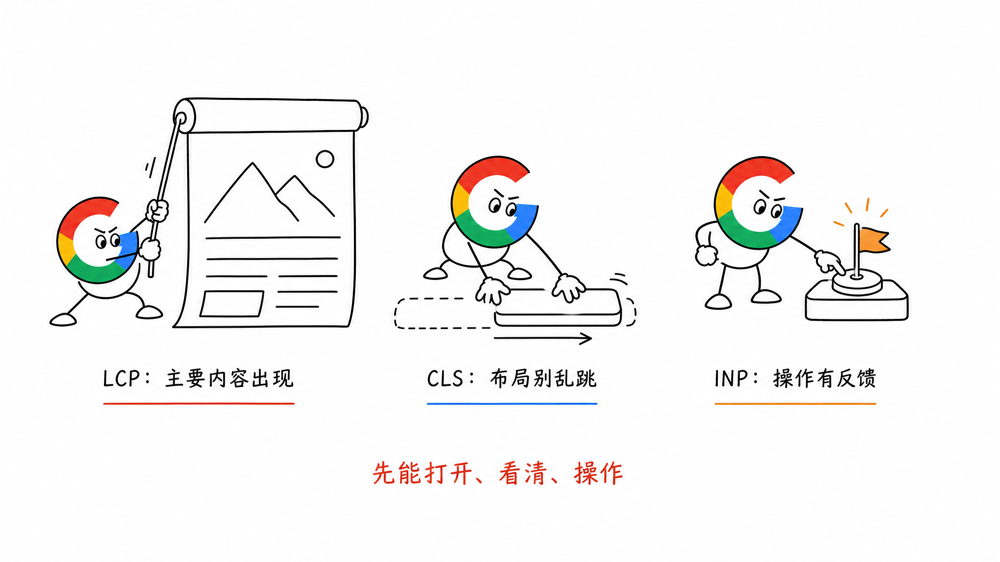
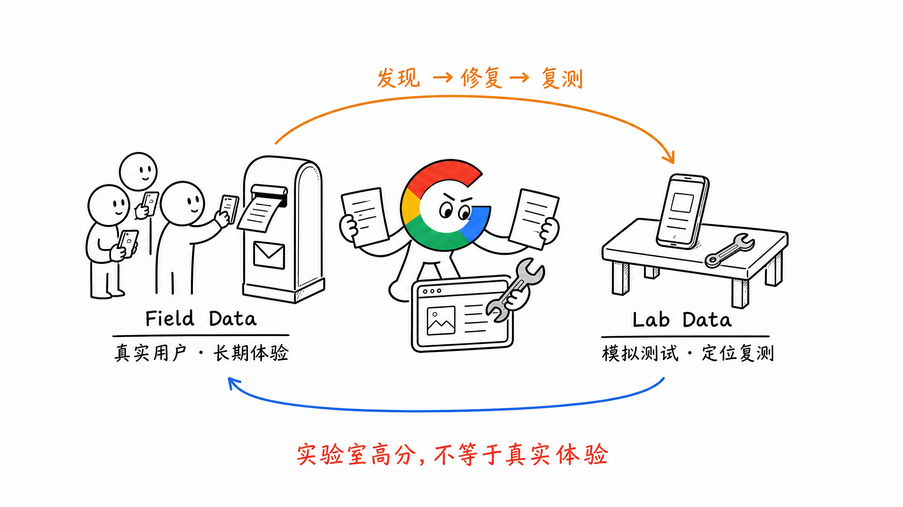
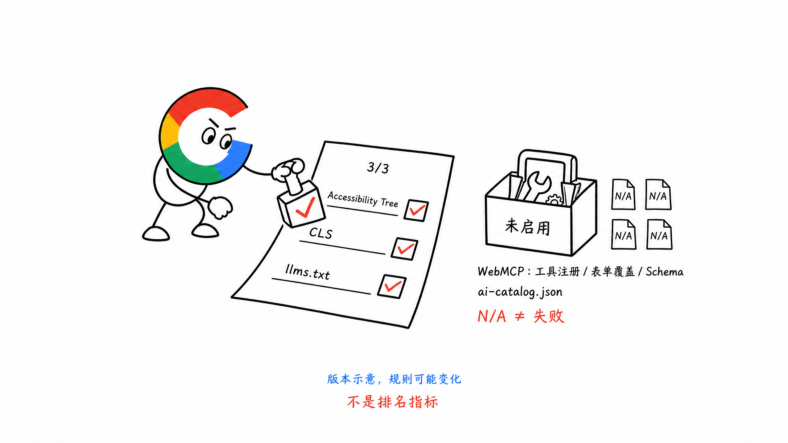
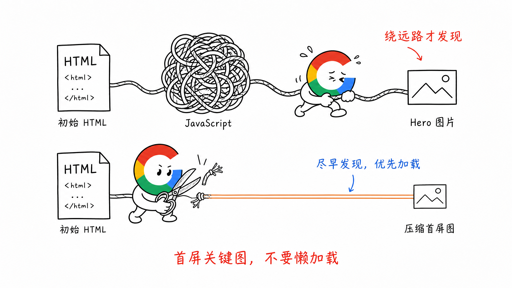
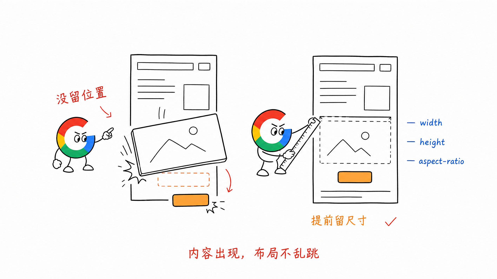
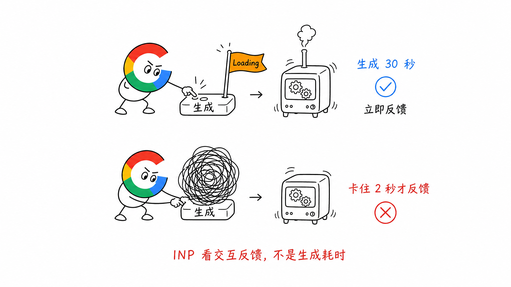
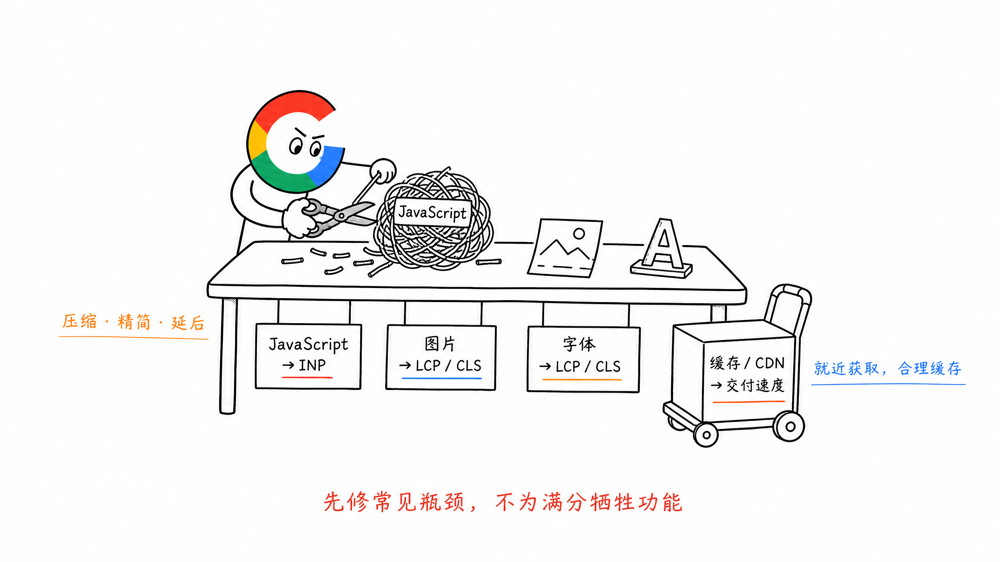

# 第 11 章 页面体验与 Core Web Vitals

页面性能不只是一个 SEO 分数。

用户打开 Tool 页面，首屏半天出不来；刚准备点击生成按钮，页面突然跳动；输入 Prompt 后，按钮按了两秒才响应。

这些问题最终影响的是使用和转化。

Core Web Vitals（核心网页指标）主要看三件事：

- LCP：主要内容出来得快不快
- CLS：页面会不会突然乱跳
- INP：用户操作以后，页面响应得快不快

**先让用户正常打开、看清和操作，再谈 PageSpeed 分数。**

## 一、LCP、CLS、INP 分别在看什么

| 指标 | 大白话理解 | 良好标准 | AI 工具站常见问题 |
| --- | --- | --- | --- |
| LCP | 首屏最重要的内容多久出现 | 不高于 2.5 秒 | Hero 大图、视频、字体或服务端响应太慢 |
| CLS | 页面加载时会不会突然移位 | 不高于 0.1 | 图片没预留尺寸、弹窗和字体把内容顶开 |
| INP | 点击、输入后多久看到响应 | 不高于 200 毫秒 | JavaScript 太重、主线程被占用、第三方脚本太多 |

这些标准不是只测一次首页。

Google 看的是一组真实用户访问数据，通常以第 75 百分位判断移动端和桌面端表现。

大白话讲，就是不能只保证网速最快的那批用户体验正常。

## 二、PageSpeed 分数不等于真实用户体验

PageSpeed Insights 里有两类数据。

测试地址：

https://pagespeed.web.dev/

### 1. 真实用户数据

来自真实 Chrome 用户访问页面后的数据，也叫 Field Data。

它更接近用户实际体验，但需要页面有足够访问量，数据也不会立刻反映今天刚做的修改。

### 2. 实验室数据

Lighthouse 在模拟设备和网络环境下跑出来的测试，也叫 Lab Data。

它适合定位问题和验证修改，但同一个页面连续测试几次，分数可能会变化。

### 3. 新增的 Agentic Browsing

PageSpeed 现在还增加了一个 Agentic Browsing 检查，用来判断 AI Agent 能不能稳定地看懂和操作网页。

报告里的 `3/3` 不是三个新的性能参数，而是当前参与计数的三项检查都通过了：

- Accessibility Tree：按钮、表单和页面结构能不能被机器正确识别
- Cumulative Layout Shift：页面元素会不会突然移动，导致 Agent 点错位置
- `llms.txt`：如果网站提供了这个文件，格式和访问是否正常

`Not applicable` 也不等于失败。常见的 4 项是 WebMCP 的工具注册、表单覆盖和 Schema 校验，以及新版加入的 `ai-catalog.json` 检查。网站没有接入这些实验能力时，显示 N/A 很正常。

现阶段先把语义化 HTML、表单标签、按钮名称和 CLS 做好。如果确实希望 AI Agent 在网站内执行搜索、填写表单或调用工具，再研究 WebMCP。不要为了拿到 `3/3` 或消灭 N/A，给普通内容站硬加一套暂时用不到的能力。

这个分类仍在开发中，规则也可能继续调整。可以把它当成网站是否方便 AI Agent 使用的检查，不要当成 Google 排名指标。

所以我的判断顺序是：

1. 先看 GSC Core Web Vitals 是否有真实用户问题
2. 再用 PageSpeed Insights 定位单个页面
3. 修改后用 Lighthouse 或本地工具复测
4. 最后等待真实用户数据验证

不要只截一张 100 分的测试结果，就说网站性能已经没有问题。

## 三、LCP 慢，先找首屏最大的东西

LCP 元素通常是首屏里的大图、大段文字或视频封面。

AI 工具站最常见的是 Hero 图片。

页面打开以后，浏览器先下载一堆 JavaScript，执行完才知道首屏图片在哪里，LCP 自然会变慢。

可以按这个顺序检查：

1. PageSpeed 或 DevTools 识别出的 LCP 元素是什么
2. 服务器是不是很久才返回第一段 HTML
3. LCP 图片是否过大
4. 图片是否需要等 JavaScript 执行后才出现
5. 图片是否被错误设置为懒加载
6. 首屏文字是否被字体文件卡住

常见修法：

- Hero 图片使用 WebP 或 AVIF，并提供合适尺寸
- 不要对首屏 LCP 图片使用懒加载
- 让首屏图片在初始 HTML 中就能被发现
- 只预加载真正关键的图片或字体
- 减少阻塞首屏的 CSS 和 JavaScript
- 缩短后端响应时间，并合理使用 CDN 缓存

不要看到 Preload 有用，就一次预加载十几个资源。

所有资源都变成最高优先级，等于谁都没有优先级。

## 四、CLS 高，通常是页面没有提前留位置

CLS 最直观的表现，就是页面突然乱跳。

比如用户正准备点击上传按钮，顶部 Banner 加载出来，把按钮向下顶了一截，最后点到了别的地方。

常见原因包括：

- 图片和视频没有设置宽高
- 广告、Iframe 或 Demo 加载前没有预留空间
- Cookie Banner 或活动条突然插入页面
- 字体切换后文字宽度变化太大
- 骨架屏和真实内容尺寸不一致

修法也很直接：

- 图片和视频设置明确的 `width`、`height` 或 `aspect-ratio`
- Tool 功能区、视频和第三方组件提前预留空间
- Banner 尽量覆盖显示，不要突然把整页内容往下推
- 给 Web Font 选择尺寸接近的备用字体
- 骨架屏尽量接近最终内容高度

CLS 不能只看页面刚打开的几秒。

用户滚动、打开弹窗或加载更多内容时发生的意外位移，也应该一起检查。

## 五、INP 差，问题通常出在 JavaScript 太忙

INP 看的是用户操作以后，页面多久给出下一帧反馈。

它不是接口生成结果需要多久。

比如 AI 视频生成本身需要 30 秒，这不代表 INP 一定差。用户点击生成后，按钮能马上进入 Loading 状态，页面没有卡死，交互响应仍然可以很好。

真正的问题是：用户点击以后，浏览器主线程被大量 JavaScript 占住，连按钮状态都无法及时更新。

常见原因包括：

- 首屏加载太多 JavaScript
- 一个点击事件里同时做大量计算
- 输入框每输入一个字符，就触发复杂处理
- Analytics、客服、热图等第三方脚本过多
- 一次渲染很长的列表或大量 DOM

常见修法：

- 删除没用的 JavaScript 和第三方脚本
- 非关键代码延后加载
- 把长任务拆成更小的任务
- 搜索、校验等高频操作增加 Debounce
- 大列表使用分页、虚拟列表或分批渲染
- 点击后先更新按钮状态，再执行后续任务

对于 Tool 页面，最后一条很重要。

用户可以接受生成需要时间，但不能接受点击以后不知道有没有生效。

## 六、图片、字体、JavaScript、缓存和 CDN 怎么处理

不用一上来做很复杂的性能工程。

先抓最常见的几个问题。

### 1. 图片

- 使用 WebP 或 AVIF
- 根据设备输出合适尺寸，不要手机也下载桌面大图
- 首屏关键图不懒加载，首屏外图片再懒加载
- 设置宽高，避免 CLS
- 图片走 CDN，并设置缓存

### 2. 字体

- 不要一次加载太多字体和字重
- 优先使用 WOFF2
- 只预加载首屏真正使用的字体
- 设置合适的 `font-display`
- 如果品牌要求不高，可以考虑系统字体

### 3. JavaScript

- 删除没用的依赖和第三方脚本
- 按页面加载需要的代码，不要全站一次打包
- 非核心组件延后加载
- 避免把核心正文完全交给客户端 JavaScript 后生成

### 4. 缓存与 CDN

- 图片、字体和静态资源使用长期缓存
- 文件更新时通过文件名 Hash 更新缓存
- 尽量让用户从距离更近的 CDN 节点获取静态资源
- HTML 和接口缓存要根据内容更新频率设置，不能一刀切

## 七、移动端优先检查

很多网站在开发电脑上打开很快，上线后移动端却很差。

原因很简单：开发电脑性能高、网络快，和真实用户不是一个环境。

至少检查下面这些页面：

- 首页
- 核心 Feature 和 Solution 页面
- 主要 Tool 页面
- Blog 详情页
- 登录、注册和付费路径

Tool 页面不能只测是否能打开，还要实际走完整流程：

1. 输入或上传
2. 点击生成
3. 查看 Loading 与错误提示
4. 查看结果
5. 下载或进入下一步

还要检查弹窗、键盘弹起、横竖屏切换，以及小屏幕下按钮是否能正常点击。

响应式不是把桌面页面缩小，而是保证用户在移动端能把事情做完。

## 八、我的 PageSpeed 验收标准

原稿里，我给首页定过一个比较直接的标准：

- PC 端 Performance 尽量达到 90 分以上
- 移动端 Performance 尽量达到 80 分以上
- Accessibility、Best Practices 和 SEO 中能明确修复的问题尽量解决

这个标准可以作为上线验收线，但不是 Google 的排名门槛。

PageSpeed 也不是越接近 100，投入就一定越值得。

比如为了从 95 分提高到 100 分，删掉真实用户需要的产品 Demo 或转化模块，通常得不偿失。

我会按这个顺序排优先级：

1. 页面打不开、核心功能不能用
2. Core Web Vitals 明确不通过
3. 移动端严重卡顿或错位
4. 影响大量页面的模板问题
5. 只影响少数用户的细节优化

**性能优化的目标是让用户更顺畅地完成任务，不是为了拿一张满分截图。**

## 九、页面体验检查清单

- [ ] GSC Core Web Vitals 是否存在 Poor URL？
- [ ] 是否分别检查了移动端和桌面端？
- [ ] LCP 是否不高于 2.5 秒？
- [ ] CLS 是否不高于 0.1？
- [ ] INP 是否不高于 200 毫秒？
- [ ] 是否先看真实用户数据，再用 Lab Data 定位问题？
- [ ] 首屏 Hero 图片是否压缩，并避免错误懒加载？
- [ ] 图片、视频和第三方组件是否预留尺寸？
- [ ] 用户点击生成后，页面是否立即给出反馈？
- [ ] 是否删除了无用 JavaScript 和第三方脚本？
- [ ] 字体数量、字重和加载方式是否合理？
- [ ] 静态资源是否使用缓存和 CDN？
- [ ] 是否完整测试了 Tool 页面的输入、生成、结果和下载流程？
- [ ] 是否避免为了 PageSpeed 满分牺牲产品体验？

## 十、小结

Core Web Vitals 不复杂。

- LCP 看主要内容出来得快不快
- CLS 看页面会不会突然乱跳
- INP 看用户操作以后能不能及时响应

先看真实用户数据，再用 PageSpeed 和 Lighthouse 定位问题。

如果压缩成一句话：

**性能优化不是追求 100 分，而是让用户在不同设备和网络环境下，都能顺畅地打开页面并完成任务。**

> 本章节完毕，谢谢大家，欢迎随时讨论。
