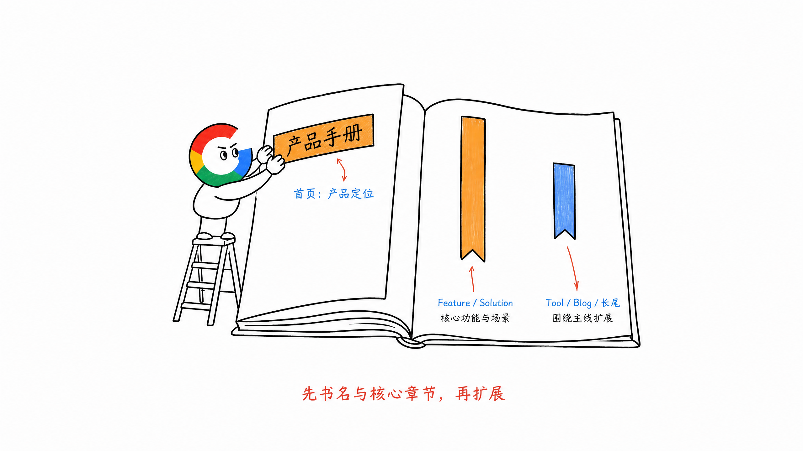
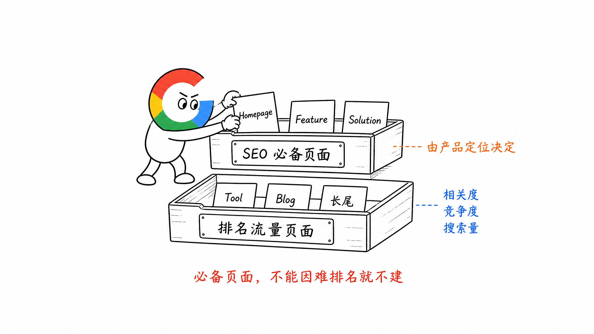
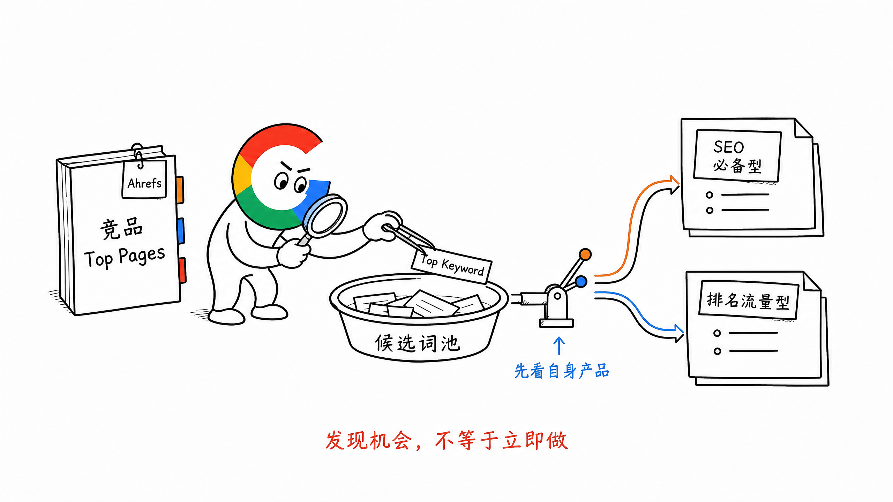
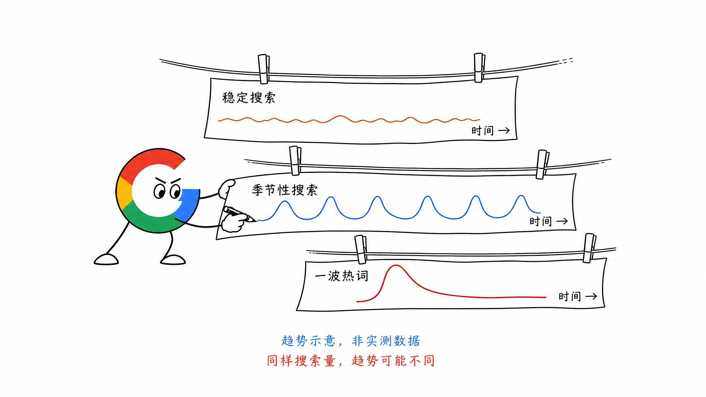
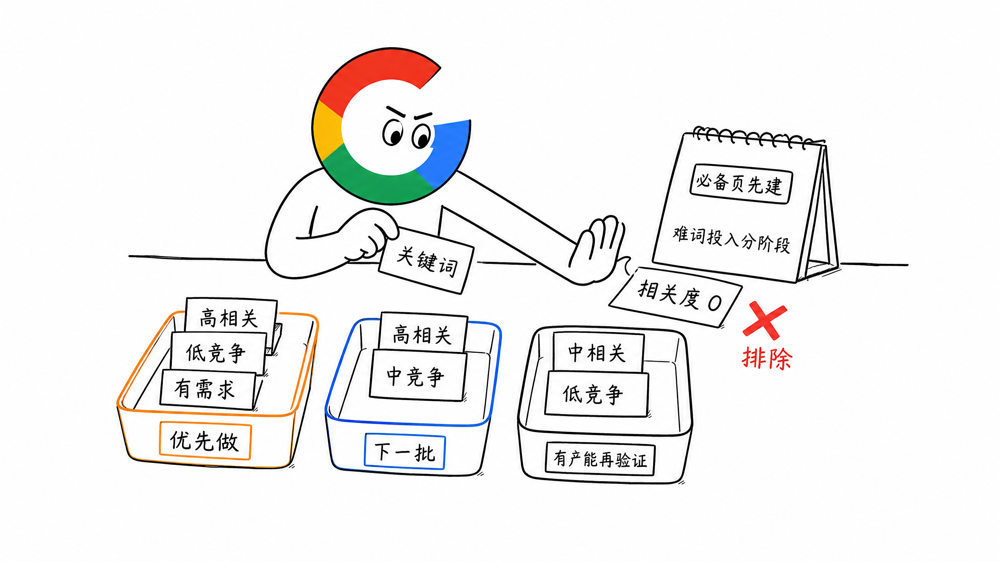
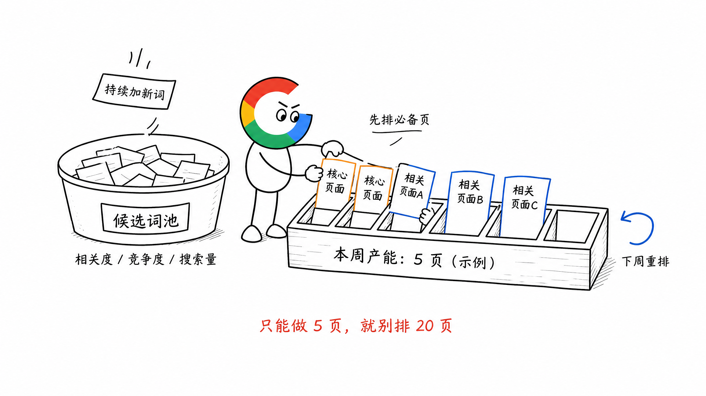

# 第 12 章 关键词优先级：先做什么，后做什么

做完关键词 Research，表格里可能已经有几百、几千个词。

但每周的产能有限，不可能一起做。

所以关键词研究结束以后，还要回答一个更现实的问题：

**这周先做什么，下周再做什么？**

关键词优先级，不是从表格里挑一个搜索量最大的词。

它是先确定哪些页面必须有，再从剩下的关键词里，选择现阶段最值得投入的机会。

## 一、为什么关键词需要优先级

我还是喜欢用一本书来理解。

一本书的书名，以及最重要的几个章节，本身都对应着这本书最重要的关键词。

书名告诉读者整本书讲什么，核心章节告诉读者这本书重点讲什么。

网站也是一样。

首页、核心 Feature 和 Solution 页面，先负责说清楚网站是谁、提供什么、最想让用户记住什么。

这些属于整本书的书名和核心章节。

其他 Tool、Blog 和长尾页面，更像围绕主线继续增加的章节。

所以优先级的第一步，不是比较所有关键词的搜索量和难度，而是先分清楚：

- 哪些关键词属于产品定位，页面必须先有
- 哪些关键词主要为了获得排名和自然流量，可以继续排序

## 二、优先级先分成两大层

### 1. SEO 必备页面对应的关键词

第一层，是产品官网本来就应该具备的页面。

常见的包括：

- Homepage：首页承接核心产品定位
- Feature Page：承接产品最想表达的核心功能亮点
- Solution Page：承接最重要的用户和使用场景
- Pricing、API、Docs：根据真实产品形态承接对应需求

这一层的优先级其实很简单。

先做产品最需要表达的页面。

比如 Feature 页面，不是哪个词容易排名就先做哪个，而是产品最核心、最想让用户知道的功能先做。

这类关键词即使竞争度很高，短期排不上去，页面也应该先建出来。

因为它们首先属于产品定位，其次才属于 SEO。

### 2. SEO 排名流量页面对应的关键词

第二层，是为了继续获得自然排名和流量而增加的页面。

比如围绕已有产品方向继续扩展的 Tool、Blog 和其他长尾页面。

这类页面不是全部必须马上做，可以根据机会安排先后顺序。

这里才需要重点比较：

- 搜索量
- SEO 排名竞争度
- 产品相关度

## 三、关键词机会从哪里来

Research 关键词时，一个常用方法，是通过 Ahrefs 查看竞争对手的 Top Pages，再看每个页面对应的 Top Keyword。

这样可以快速看到：

- 哪些页面正在获得自然流量
- 每个页面主要依靠什么关键词
- 对方重点做的是 Feature、Tool，还是 Blog
- 哪些方向可能也符合自己的产品

这些关键词先进入候选词表，不代表马上就要做。

接下来还是要回到自己的网站，判断它属于 SEO 必备型，还是排名流量型。

如果属于排名流量型，再进入下一步排序。

## 四、排名流量型关键词看三个维度

### 1. 搜索量

搜索量主要看两件事：大概有多少人搜，以及搜索趋势怎么变化。

除了看 Ahrefs 或其他工具给出的月搜索量，还要看这个词属于哪一种趋势：

- 稳定搜索：长期都有人搜，需求相对稳定
- 季节性搜索：只在特定月份、节日或活动前后明显增长
- 一波热词：因为新模型、新产品或热点突然爆发，后面可能快速下降

它很重要，但不能单独决定优先级。

搜索量很大，但产品接不住，流量也没有意义。

还要看搜索量来自哪些国家。有些词的总搜索量很大，但主要来自产品暂时不服务、语言没有覆盖或无法正常付费的市场，这部分流量的实际价值也不高。

搜索量不算特别大，但需求明确、离产品很近，反而可能更值得先做。

### 2. SEO 排名竞争度

竞争度决定现阶段有没有机会进入搜索结果。

我会把关键词分成三类：

- 难度大的大词
- 竞争中等的词
- 更具体的蓝海词

对于新站，我还是推荐农村包围城市的顺序：

**蓝海词 → 中等词 → 大词。**

先通过更具体、竞争相对低的需求获得排名，再逐步参与更大的关键词竞争。

### 3. 产品相关度

产品相关度可以直接分成四档：

- 高：产品能够直接完成这个需求
- 中：与产品方向相关，可以自然连接到功能或场景
- 低：只有一点话题关系，用户进入页面后很难自然使用产品
- 0：与产品没有真实关系

产品相关度为 0 的词，即使搜索量很大、竞争度很低，也不应该因为好像容易获得流量就去做。

搜索意图越接近产品使用、比较和购买，通常越值得优先关注。

所以关键词优先级不能只按搜索量排，还要看用户价值和转化意图。

## 五、新站优先做哪类词

三个维度放在一起以后，新站最优先的一类词通常是：

**产品相关度高 + 排名竞争度低 + 搜索量还可以。**

可以简单看成下面几种情况：

| 产品相关度 | 排名竞争度 | 搜索量 | 建议 |
| --- | --- | --- | --- |
| 高 | 低 | 还可以 | 优先做 |
| 高 | 中 | 还可以 | 排在下一批 |
| 高 | 高 | 大 | 必备页面先建，排名投入分阶段进行 |
| 中 | 低 | 还可以 | 有产能时验证 |
| 低或 0 | 低 | 大 | 不要只为了流量做 |

这里要区分两件事：页面什么时候建，排名什么时候重点投入。

首页和核心 Feature 对应的词可能很难，但页面属于 SEO 必备型，还是要先建。

农村包围城市策略，主要影响 SEO 排名流量页面先做哪个，不是让我们放弃产品必须表达的大词。

## 六、每周怎么安排关键词产能

关键词优先级最终要进入每周排期，否则表格做得再漂亮也没用。

我会这样安排：

1. 先检查 SEO 必备页面还有哪些没有完成
2. 按产品当前最想表达的功能和场景，确定必备页面的顺序
3. 剩余产能留给排名流量型页面
4. 按搜索量、排名竞争度和产品相关度排列候选词
5. 只选择本周真实能够完成的页面数量
6. 新词进入候选池，下周重新排序

比如团队一周只能完成 5 个页面，就不要同时安排 20 个所谓高优先级任务。

先把 5 个最值得做的页面完成，再继续拿下一批。

每周的最优解也不一定相同。

产品发布了新功能，新的 Feature 页面可能直接进入第一层。行业出现了与产品高度相关的新词，也可能进入本周的排名流量计划。

所以关键词优先级不是做一次以后永远不变，而是跟着产品和搜索需求持续调整。

## 七、关键词永远挖不完

不要等关键词全部研究完再开始做。

关键词本来就挖不完。

用户每天都在产生新的需求，AI 行业每天也可能出现新模型、新功能和新词。

关键词表应该是一个持续更新的候选池，不是一份必须一次做完的任务清单。

真正要做的是：

- 保持 Research
- 持续加入新词
- 每周重新判断优先级
- 按真实产能完成最值得做的页面

研究是持续的，页面生产也应该持续。

## 八、本章执行清单

- [ ] 是否先区分了 SEO 必备型与排名流量型关键词？
- [ ] 首页和核心产品页面是否优先承接了产品定位词？
- [ ] Feature 页面是否按照产品最想表达的功能亮点排序？
- [ ] 是否通过竞品 Top Pages 和 Top Keyword 补充候选词？
- [ ] 排名流量型关键词是否同时看搜索量、竞争度和产品相关度？
- [ ] 产品相关度为 0 的词是否已经排除？
- [ ] 新站是否优先选择产品相关度高、竞争度低、搜索量还可以的词？
- [ ] 是否区分了页面必须先建与排名投入分阶段进行？
- [ ] 每周排期是否符合真实产能？
- [ ] 是否保留候选词池，并持续加入新词？

## 九、小结

关键词优先级先分两层。

第一层是 SEO 必备页面，优先级由产品定位、核心功能和核心场景决定。

第二层是为了获得排名和流量的页面，再看搜索量、排名竞争度和产品相关度。

对于新站，先做产品相关度高、竞争度低、搜索量还可以的词。

如果压缩成一句话：

**先把整本书的书名和核心章节写清楚，再按每周产能，持续增加最值得做的新章节。**

> 本章节完毕，谢谢大家，欢迎随时讨论。
