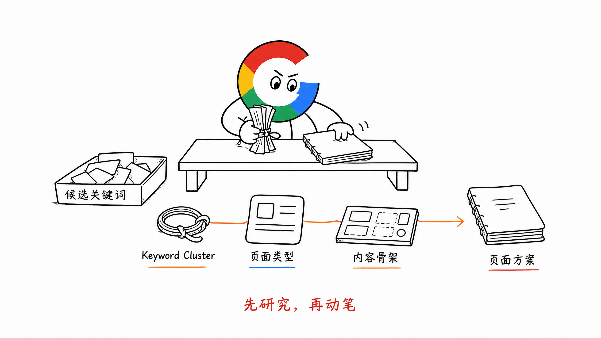
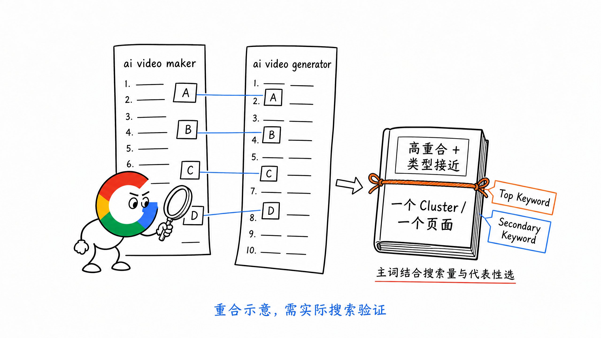
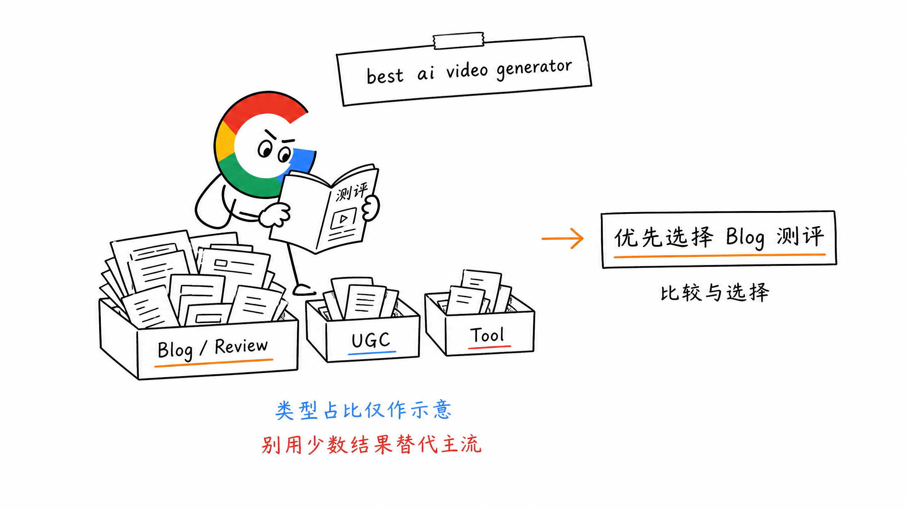
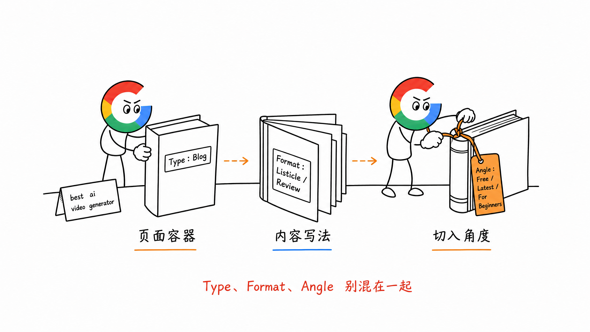
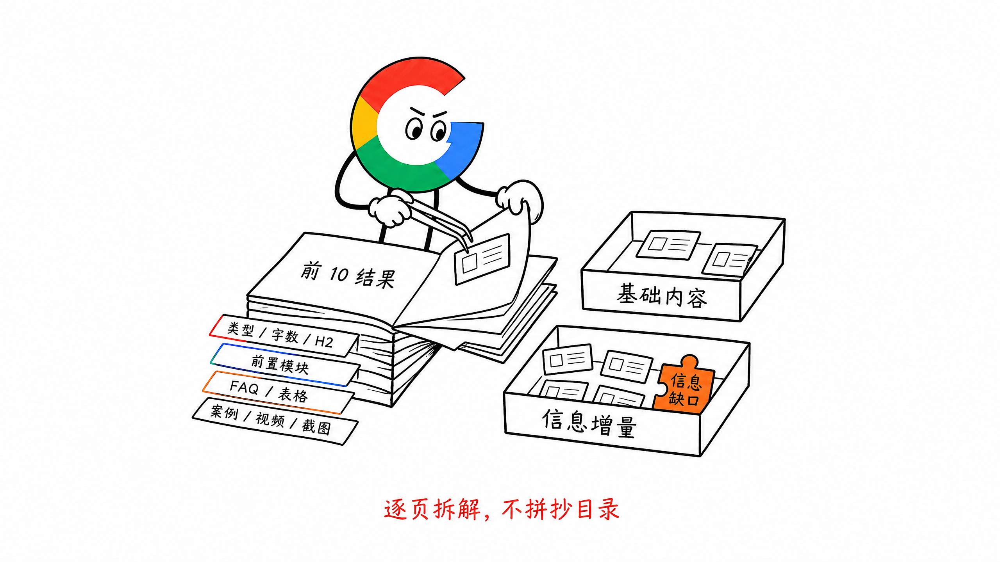
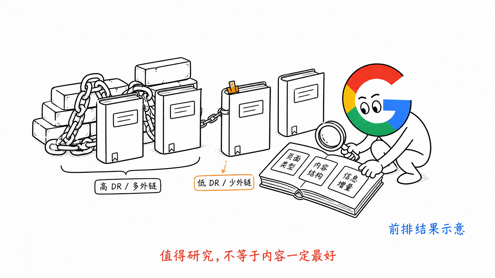

# 第 13 章 SERP Research：先看 Google 已经选了什么

确定关键词优先级以后，先不要急着写页面。

下一步应该去看这个关键词的 SERP（Search Engine Results Page，搜索结果页）。

因为我们自己认为用户想看什么，不一定等于 Google 当前选择展示什么。

SERP Research 主要解决三个问题：

1. 几个相近关键词，是由一个页面承接，还是分别做页面
2. 这个关键词应该做成什么页面类型
3. 页面里应该包含哪些内容模块

**不要自己脑补页面结构，先看 Google 已经选了什么。**

## 一、先看相近关键词是不是同一个需求

有些关键词写法不同，但 Google 可能把它们理解成同一个需求。

比如：

- `ai video maker`
- `ai video generator`

分别搜索这两个词。如果美区 Google 前排结果大部分都是同一批 URL，而且页面类型也接近，我一般会把它们放进同一个 Keyword Cluster，只做一个页面。

然后选择搜索量更高、也最能代表这组需求的词作为 Top Keyword。

另一个词作为 Secondary Keyword，由同一个页面自然覆盖。

这不是简单看两个关键词长得像不像。

重点是看：**Google 是否反复用同一批页面回答这两个搜索。**

如果前排 URL 大量重合，通常说明两个词背后的主要需求接近。

如果结果明显不同，就应该回到第 6 章的 Keyword-to-Page，重新判断是不是两个 Keyword Cluster。

## 二、SERP 决定页面 Type

Keyword Cluster 确认以后，继续看前排都是什么页面类型。

常见的类型包括：

- Tool：可以直接完成任务的在线工具页
- Feature：介绍产品核心功能的落地页
- Solution：面向特定客群或场景的解决方案页
- Blog：教程、榜单、测评、对比和 Alternatives 等文章
- UGC：Reddit、论坛和社区讨论

我的判断很直接：

**SERP 里什么页面类型最多，就优先做什么页面类型。**

比如搜索 `best ai video generator`，结果里可能有：

- Reddit 等 UGC 内容
- 少量 `/tools` 页面
- 大部分测评或榜单 Blog

虽然搜索结果不是只有一种页面类型，但 Blog 占多数。

那我会选择写一篇测评博客来承接 `best ai video generator`，而不是因为看到一个 Tool 页面，就硬做一个在线工具页。

因为这个词里的 `best`，代表用户更想比较和选择。

Blog 的测评形式，更适合放评测方法、工具列表、截图、优缺点和选择建议。

SERP 里的少量结果也要看，但不能拿少数页面替代主流结果。

## 三、再看 Type、Format 和 Angle

页面类型确定以后，还要继续看三个层面。

### 1. Content Type

先判断装内容的页面容器是什么。

比如：

- Blog
- Tool
- Feature
- Solution
- 集合页

### 2. Content Format

同样是 Blog，写法也可能完全不同。

比如：

- How-to 教程
- Listicle 榜单
- Review 测评
- Comparison 对比
- Alternatives 替代

### 3. Content Angle

最后看前排页面主要从什么角度吸引点击和说服用户。

比如：

- Free
- Online
- No Sign Up
- For Beginners
- Latest
- Batch

这三个层面不要混在一起。

Blog 是 Type，榜单是 Format，免费或最新是 Angle。

先看 SERP 前 10 的共同选择，再决定自己的页面怎么做。

## 四、把前 10 个结果一个个点开

只看搜索结果标题还不够。

前 10 是默认的分析范围。如果结果不够明确，或者页面类型比较分散，自然可以继续看到前 20。

要把前排链接一个个点开，看页面里面到底怎么交付内容。

我一般会记录下面这些东西：

- 页面类型是什么
- 页面大概写了多少内容
- H2、H3 覆盖了哪些话题
- 哪些模块被放在前面
- 有没有 FAQ、表格、对比、案例、视频和截图
- Tool 页面先展示功能，还是先展示大段内容
- Blog 页面有没有评测方法和真实测试过程
- 哪些问题大家都提到了
- 哪些问题大家都没有讲透

这个过程不是为了抄一份竞品目录。

而是为了找出两类内容：

1. 这个关键词下，用户普遍需要的基础内容
2. 现有结果还没有讲透的信息增量

基本原则可以很简单：

- 人家都有的核心内容，我们也要有
- 人家放在前面的核心内容，我们也尽量前置
- 人家没讲透的地方，才是我们真正需要补充的信息增量

## 五、重点看外链少、DR 低的前排页面

看 SERP 时，我还会特别关注两类页面：

- Referring Domains 很少
- 网站 DR 比其他前排竞争者低

因为这些页面没有很强的域名权重和外链加持，却仍然进入了前排。

这通常说明，它的内容与搜索需求匹配得不错，页面本身很值得研究。

重点可以继续拆：

- 它选择了什么页面类型
- 开头怎么回答用户问题
- 核心功能或结论放在哪里
- H2 覆盖了哪些子问题
- 有没有特别具体的案例、截图、数据或工具能力
- 它提供了哪些高 DR 页面没有提供的内容

这里不是说 DR 低、外链少，就一定代表内容最好。

但相比一个依靠大量外链和高权重进入前排的页面，这类结果更能帮助新站看懂：**在没有太多权重加持时，内容本身要做到什么程度。**

## 六、SERP Research 最后要产出什么

SERP Research 不能只停留在我看过前 10。

最后至少要把结论写进页面方案里。

可以保留下面这些字段：

| 字段 | 要记录什么 |
| --- | --- |
| Keyword Cluster | 这一页要承接的关键词簇 |
| Top Keyword | 搜索量更高、最能代表需求的主词 |
| Secondary Keywords | 同一需求下的其他表达 |
| SERP Overlap | 相近关键词的前排 URL 是否大量重合 |
| Search Intent | 用户主要想完成什么 |
| Page Type | Tool、Feature、Solution、Blog 或其他类型 |
| Content Format | 教程、榜单、测评、对比或 Alternatives |
| Content Angle | Free、Latest、Batch 等主要角度 |
| Common Modules | 前排页面普遍都具备的模块 |
| Content Gap | 现有结果没有讲透的内容 |
| Low DR Reference | 值得重点研究的低 DR、少外链页面 |

有了这些信息，下一步才开始做页面骨架。

正确顺序是：

**Top Keyword → SERP 重合判断 → 页面类型 → 内容格式与角度 → 共同模块 → 信息增量 → 页面骨架**

不要先写完整页面，再回头硬塞关键词和模块。

## 七、SERP Research 的执行步骤

实际执行时，可以按照下面的顺序：

1. 确认本周准备执行的 Keyword Cluster
2. 用美区 Google 分别搜索 Top Keyword 和重要 Secondary Keywords
3. 对比前排 URL，判断相近关键词是否属于同一个 Cluster
4. 统计 SERP 中占多数的页面类型
5. 判断主要的 Content Format 和 Content Angle
6. 把前排页面一个个点开，记录 H2、模块顺序和内容组件
7. 找出所有页面都有的基础内容
8. 找出大家没有讲透的信息缺口
9. 特别拆解外链少、DR 低但排名靠前的页面
10. 把结论整理成页面骨架，再进入内容创作

## 八、小结

SERP Research 不是看竞品写了什么，然后照着再写一遍。

它先帮助我们判断相近关键词是不是同一个需求，再决定应该做什么页面，以及页面需要交付什么内容。

如果压缩成一句话：

**先看 Google 已经用哪些页面满足这个搜索，再决定我们应该做一个什么页面，以及怎样比现有结果多交付一点。**

> 本章节完毕，谢谢大家，欢迎随时讨论。
