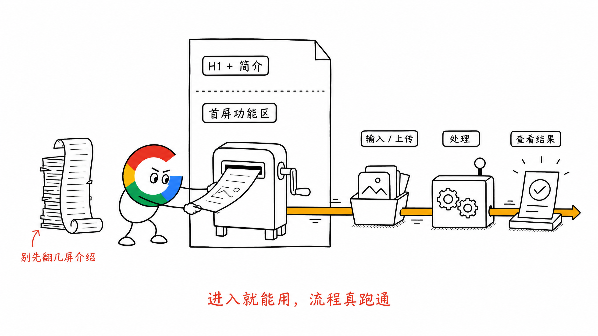
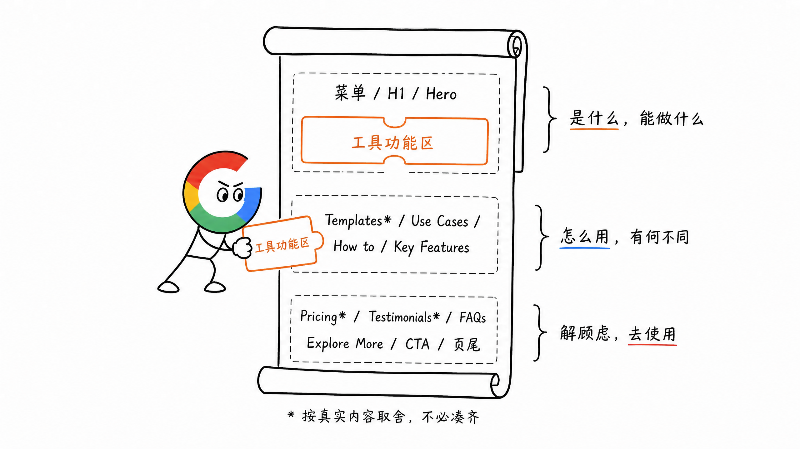
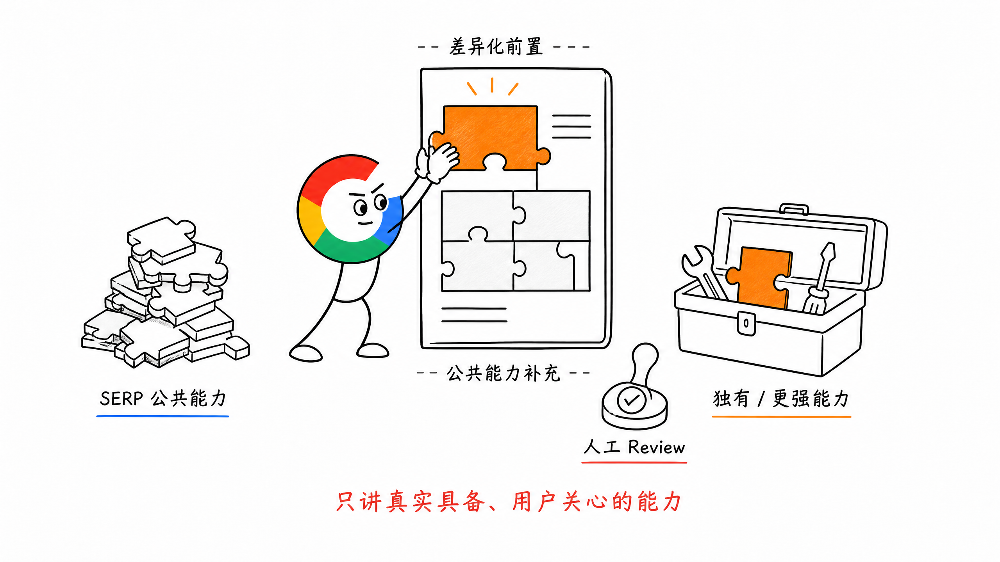
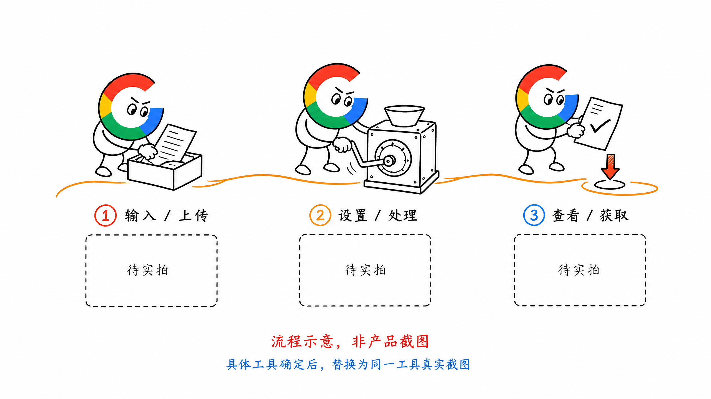
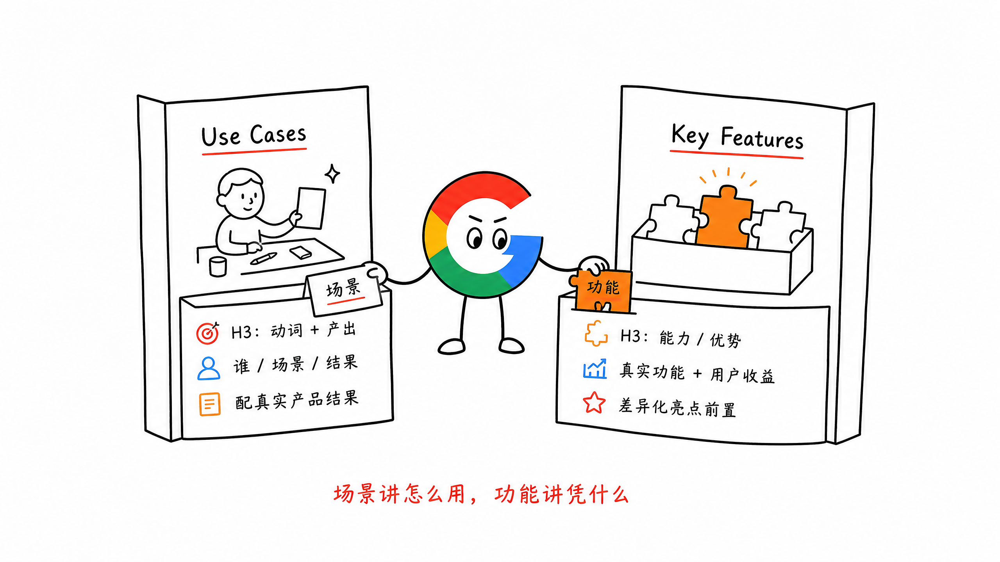

# 第 14 章 工具页 SEO 内容规范

工具页最重要的部分，是用户能直接使用的小工具。

用户搜一个工具词，点击进入页面，通常想马上输入或上传素材，完成处理，拿到结果。

所以做工具页，先把这件事做好：**功能区放在页面前面，而且整个流程要真的跑得通。**

下面的文字、图片、视频和其他模块，再围绕这个工具展开。

## 一、为什么叫工具页

一篇博客，最重要的是文字、图片、视频等内容表达是否有价值，能不能回答用户的问题。

一个工具页，最重要的是功能区：

- 工具能不能用
- 功能是否完善，操作是否顺畅
- 输入以后，能不能真正得到结果

功能区本身就在告诉用户：这个工具能帮你做什么，以及你能拿到什么。

所以 Hero 里应该直接放工具功能区。用户一进来就能开始操作，不用先翻过几屏介绍，再去找工具在哪里。

页面内容做得再丰富，如果工具不能用，用户的搜索需求仍然没有被解决。



## 二、我推荐的工具页模板

我一般会用下面这套结构作为起点，再根据工具实际具备的能力取舍。

```text
菜单
H1：Intro / Hero
    简短介绍 + 工具功能区
H2：Templates / Styles
    模板、风格等，没有可以略过
H2：Use Cases
    用户场景 + 预期结果
H2：How to
    3 steps 真实教程 + 实操截图
H2：Key Features
    亮点功能、核心优势
H2：Pricing
    价格与使用额度，没有可以略过
H2：Testimonials
    相关用户的真实反馈，有了再放
H2：FAQs
    常见问题
H2：Explore More
    同类工具或集合内链
H2：CTA
    再次强调价值，引导使用
页尾
```

这里写的是模块名称。真正放到页面上时，H1、H2 要写成与当前工具相关、用户能看懂的标题。

这套模板不要求每页凑齐所有模块。Hero 里的工具功能区最重要，其余模块根据真实内容安排。

整页也可以按三个部分理解：

- 上半部分：这是什么，能帮用户做什么
- 中腰部分：用户怎么用，我有什么不同
- 下半部分：通过价格、真实口碑、FAQ、内链和 CTA，回答顾虑并引导下一步

上半部分和中腰部分相对更重要，用户最需要知道的内容要前置。

整体采用总分总结构：H1 和 Hero 总述，中间模块展开，最后 CTA 再次强调价值。



## 三、先对齐 SERP，再把差异化排前面

写模块之前，先看 SERP 前排竞品的内容。

重点看前 3，以及 DR 相对低、排名却靠前的页面。

逐个模块拆：大家讲了哪些能力，用什么名称表达，哪些内容是这一类工具的标配。

与当前工具相关、产品也确实具备的基础能力，页面里要讲到。常见功能名称和表达可以对齐，方便用户理解这是同一类工具。

接下来排差异化。

**自己独有或做得更好的功能，放在前面单独讲；公共能力放在后面补充。**

这一步首先要了解自己的产品，再结合用户画像和应用场景，才能判断什么是真正值得讲的区别。

AI 帮忙拓展出来的内容，也要人工 Review：产品是否具备，这是不是新的信息，用户是否真的关心。

整页的 H2、H3 和段落，都围绕当前页面的 Top Keyword 展开。英文文案尽量保持短句短段，可以按一句不超过 20 个单词、一段不超过 3 行的方向精简。



## 四、每个模块具体放什么

### 1. Intro / Hero：直接开始使用

H1 包含 Top Keyword，可以用主词加简单修饰，写得像一个清楚的产品标题。

下面的介绍一般 1～2 句话，第一句自然出现主词，讲清楚：做什么、给谁用、有什么不同。

可以点出 2～3 个典型场景或用户关心的卖点，紧接着就是工具功能区和明确的操作入口。

输入、上传、处理和结果展示，都应该与这一个工具对应。

Hero 最有说服力的内容，是用户自己操作以后拿到的结果。

### 2. Templates / Styles：展示可以选择的结果

如果工具有模板、风格或其他可选效果，就在这里展示。

让用户知道有哪些选择，以及不同选择会得到什么结果。

比如 AI 视频工具可以展示 Prompt 模板或视频效果模板。模板对应独立工具页时，也可以链接过去。

没有这些能力，就略过这个模块。

### 3. Use Cases：什么人，在什么场景下使用

这一段要同时讲清楚场景和预期结果。

只罗列适合创作者、营销人员、设计师，信息还不够。要继续说明：ta 在什么情况下会用这个工具，用完以后能得到什么。

H3 可以用动词加产出的方式写，直接表达能干什么。描述再交代对应人群或场景，配图使用对应的产品截图或实际结果。

内容越贴近真实使用过程，用户越容易判断这个工具是否适合自己。

### 4. How to：用这个工具的真实截图讲步骤

How to 就是当前工具的使用教程。

H2 可以直接写成 `How to use {Top Keyword} in 3 steps`，让用户知道这里能找到操作方法。

可以用 3 steps 讲清楚：

1. 输入或上传什么
2. 选择什么设置，点击哪个按钮
3. 怎么查看和获取结果

每一步的 H3 用动词开头，写清核心动作，再用 1～2 句话说明操作或结果。

一般控制在 3～4 步，以真实产品路径为准。

截图要来自这个小工具的真实操作界面，而且能与步骤一一对应。

用户照着教程，应该能在上面的功能区完整操作一遍。

**页面展示什么流程，工具就应该能跑通什么流程。**



### 5. Key Features：讲清亮点功能和核心优势

这一段回答：这个工具有哪些值得使用的能力？

H2 围绕核心功能亮点和主词来写，H3 以能力或优势的名称为主。

排序时，第一排先放自己最强的 3 个亮点，再补充同类工具普遍具备的标配功能。

每个亮点都应该能对应到真实功能，并讲清楚它给用户带来什么结果。

如果前面的功能区还不支持某项能力，就不要先写进介绍里。



### 6. Pricing：说清楚使用成本

如果工具涉及付费、额度或不同套餐，在这里讲清楚。

让用户知道当前能用多少、继续使用需要什么条件。

没有对应定价内容，可以略过。

### 7. Testimonials：有真实反馈以后再放

这个模块不要 YY。

刚上线，没有用户反馈，就先不放。等有流量以后，可以增加反馈入口，收集真实用户的使用感受。

优先展示与当前工具相关的反馈：用户用它做了什么、结果怎么样、解决了什么问题。

这些才是其他用户有参考价值的内容。

### 8. FAQs：回答当前工具的常见问题

FAQ 围绕用户使用这个工具时真正会问的问题来写。

问题可以从这些地方找：

- SERP 前排竞品的 FAQ
- Ahrefs 相关关键词
- Google People Also Ask
- Reddit、Quora 中高投票的相关问题

收集以后，按用户关心的方向筛选：

| 问题方向 | 主要回答什么 |
| --- | --- |
| 认知 | 这是什么，怎么工作 |
| 比较 | 应该选哪一种，有什么不同 |
| 顾虑 | 内容是否公开，使用有什么限制 |
| 使用 | 怎么操作，结果能否继续编辑 |
| 价格 | 是否免费，能否试用 |

问题标题可以自然使用主词或同义词。

答案要与当前功能保持一致。如果某种情况不支持，直接说明限制。

后续有了用户反馈，再把反复出现的问题补进来。

### 9. Explore More：连接同类工具和集合

这里放相关工具、同类集合的内链，方便用户继续找需要的能力。

相关性越高越好。优先推荐当前用户接下来可能需要的工具。

链接文字要能说明对应工具是做什么的，让用户知道点过去能获得什么。

### 10. CTA：再次强调价值，引导操作

页面底部再次说清楚这个工具能帮用户得到什么，并给出明确的使用入口。

H2 包含当前工具的 Top Keyword，让结尾仍然围绕这一页的核心价值。

用户读完教程、场景和 FAQ 后，可以方便地回到功能区开始使用。

## 五、先把功能跑通，再补齐内容

这套模板落地时，我会先做 Hero 和工具功能区。

自己完整走一遍输入、处理和获取结果的过程，确认工具能用，再截取真实操作过程，完成 How to。

然后根据已经具备的能力，补充模板、场景、功能亮点、定价和 FAQ。

Testimonials 可以等真实反馈积累以后再加。

这样每个模块都有实际依据，页面介绍也能与工具能力对上。

## 六、小结

工具页最核心的内容，就是那个能用、好用、流程完整的小工具。

把它放在页面前面，让用户直接开始操作、拿到结果。

下面再用真实模板、场景、教程截图、功能说明和用户反馈，帮助用户理解和使用这个工具。

**工具能交付什么结果，页面就围绕这个结果讲清楚。**

> 本章节完毕，谢谢大家，欢迎随时讨论。
