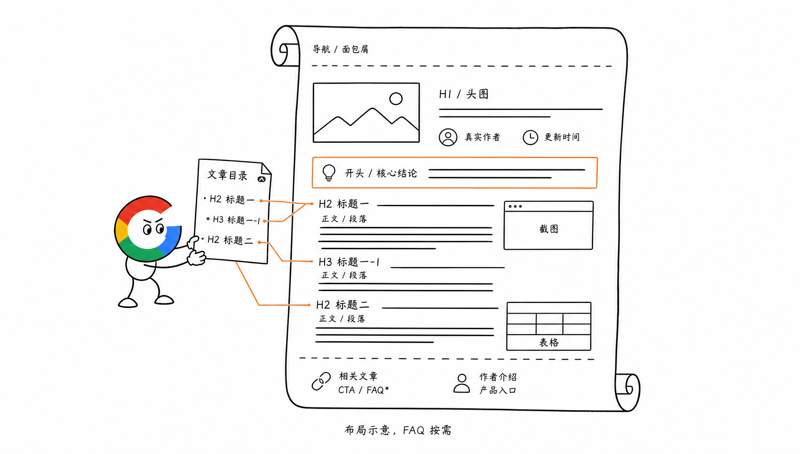
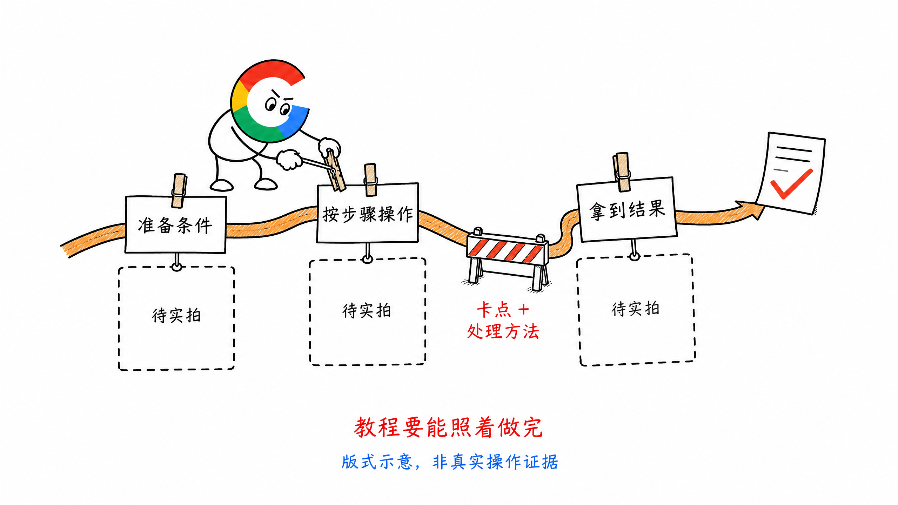
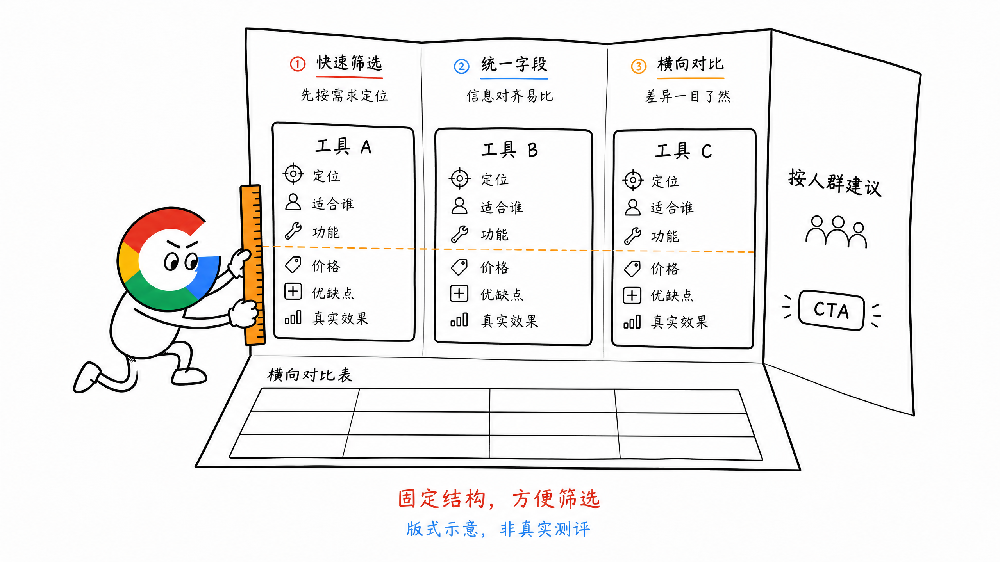
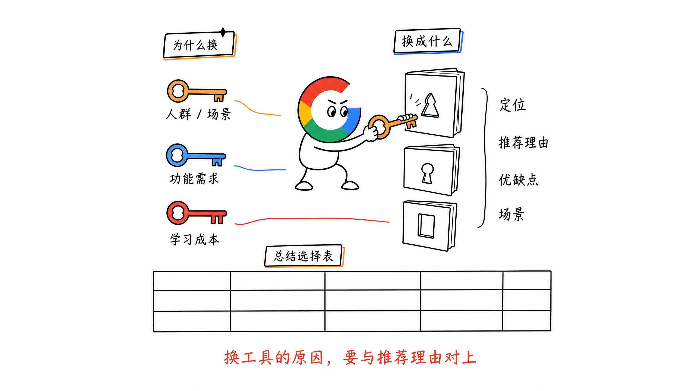
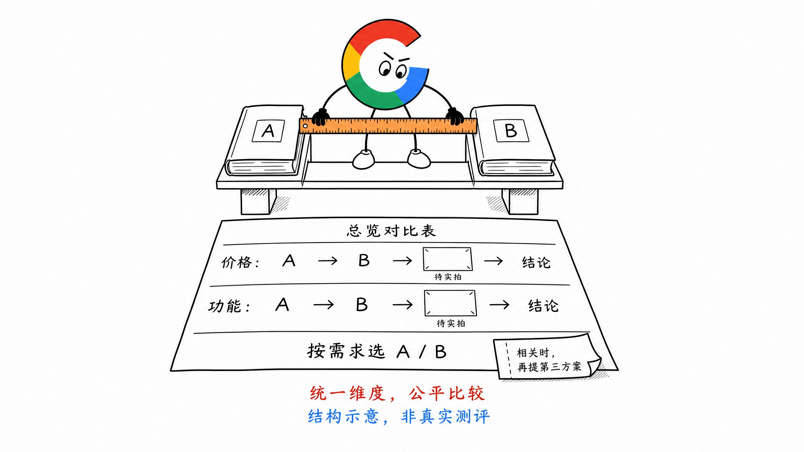
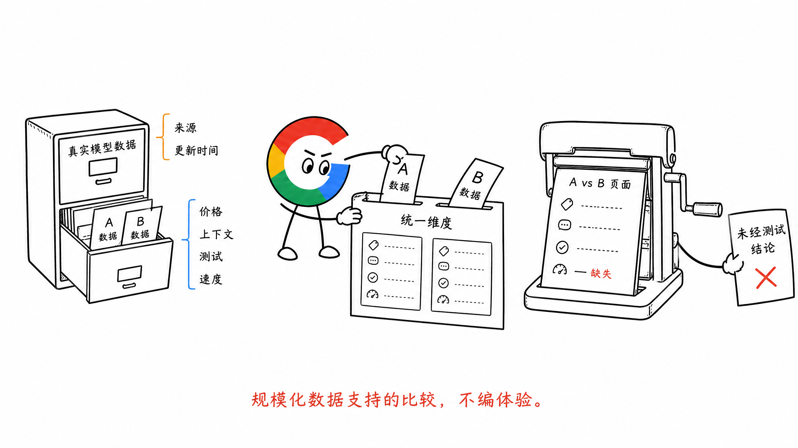

# 第 15 章 博客、教程、榜单、对比与替代页

Blog 是一种页面类型，里面可以放不同的内容范本。

教程、榜单、测评、对比、替代文章，都可以放在 `/blog` 下，但不能共用一套写法。

有人想学会怎么操作，有人想比较两个产品，也有人已经决定换工具，正在找替代品。

先知道这篇文章要帮助用户做什么，再决定大纲。

## 一、博客页应该有哪些基础模块

工具页把功能区放在前面，让用户直接操作、拿到结果。博客页则要围绕阅读来设计，帮助用户找到重点，也知道内容是谁写的。

除了正文，我建议在 Blog 模板里准备这些模块：

| 模块 | 放什么、有什么用 |
| --- | --- |
| 面包屑 | 展示首页、Blog 分类到当前文章的路径，方便返回所属频道 |
| 标题与头图 | H1 说明文章主题，头图对应当前内容 |
| 作者与更新时间 | 标题附近展示真实作者、头像和更新时间，让读者知道谁写的、内容更新到什么时候 |
| 文章目录 | 根据 H2、H3 生成大纲，点击可跳到对应段落；长文章可以使用固定目录，方便阅读时随时跳转 |
| 开头与核心结论 | 简短说明适合谁、能得到什么，再用醒目的要点框提前给出主要结论 |
| 正文与媒体 | 按内容层级展开，结合截图、表格、视频和案例说明，段落之间保留阅读空间 |
| 相关文章与 CTA | 推荐相关 Blog、功能页或工具，在合适的位置引导下一步 |
| FAQ | 根据文章实际需要，补充正文没有回答完的常见问题 |
| 文末作者介绍 | 简短介绍作者背景，并提供作者页或社交账号入口 |

其中，**目录帮助用户快速定位，作者信息让内容有明确的负责人。**

作者信息用真实姓名或公开使用的身份、头像和介绍。更新时间跟随实际内容更新。

正文引用数据或外部结论时，也要给出对应来源，方便读者继续核对。

这些属于博客页面的公共结构，可以在模板层统一做好。下面的教程、榜单、对比和替代文章，再分别组织自己的正文大纲。



## 二、现在优先做哪些博客

0 点击时代，做博客需要更注意用户还有没有点击的理由。

有些知识型问题，Google AI Overview 已经在搜索结果里给出了答案。用户看完就走，文章可能有曝光，却没有获得相应的点击。

因此，我会优先关注这些内容：

- Listicle：列表盘点，尤其是 Best 类工具榜单
- Review：产品测评
- Comparison：两个产品的比较
- Alternatives：某个产品的替代方案

这些搜索更接近选择和使用。用户通常还需要看真实截图、效果、价格与限制，才能判断哪个产品更适合自己。

这也是为什么这类文章的创作要求更高。

**要帮助用户选择，就要有足够的测评依据。**

指南、策略、分析和趋势类文章，可以结合产品方向继续做。普通的 What、Why、定义和泛知识类内容，我会减少投入。

## 三、教程：让用户照着做完

How-to 和 Tutorial 承接的是操作问题，重点在具体步骤。

如果决定做教程，就要讲清楚怎么开始、每一步怎么操作，以及最后能得到什么结果。

步骤要配对应的真实截图、案例或结果。用户在某一步容易卡住的地方，也应该说明。

选题时还是看：这个问题是否值得用户点击进来，是否需要实际过程才能讲清楚。



## 四、Listicle：用固定结构帮助用户筛选

Listicle 是列表型文章，常见标题包括 `Best XX Tools`，也可以是技巧、方法等盘点。

这里重点讲工具榜单。

### 标题与开头

标题尽量带数字，让读者知道这篇文章整理了多少个选择。

开头简短一点，直接告诉读者：文章比较什么，以及看完能得到什么。

### 中间列表

每个工具使用清楚、具体的 H2，再按固定结构介绍。

比如都介绍定位、适合谁、主要功能、价格、优缺点和真实效果。

同一类信息放在相同位置，用户更容易横向比较。适合表格展示的信息，就用表格。

涉及测评的地方，用真实截图、案例和结果支持判断。

### 结尾

补充 1～2 个选择建议，按不同人群或场景说明适合哪个工具，再给出下一步 CTA。

SEO 字段上，Top Keyword 自然出现在 Title、H1、开头和部分 H2 中。内容上，真实截图、案例和表格比反复描述产品很好更有用。



## 五、Alternatives：先解释为什么要换

Alternatives 文章天然带着寻找替代品的意图，通常比普通盘点更接近转化。

用户已经知道某个品牌，现在想找其他选择。

所以文章开头先回答：**为什么有人要找这个产品的替代品？**

### 标题与开头

标题包含 `Alternatives`，可以使用 `Best X Alternatives in 2026` 这样的形式。

年份可以放标题里，URL 不要带年份，方便后续持续更新。

开头列出用户寻找替代品的常见原因，再说明文章从哪些维度帮助选择。

### Why 模块

这一段承接换工具的原因，比如：

- 是否适合当前人群和场景
- 功能能不能满足要求
- 学习和使用成本是否合适

这些原因也会成为后面筛选替代品的依据。

### Alternatives 列表

可以用 H2 汇总替代方案，每个产品用单独的 H3。

每个产品按同样的结构写：

1. 一句话定位
2. 为什么适合作为替代品
3. 优点和缺点
4. 适用场景

自己的产品可以放在第一位，给更完整的介绍和配图，重点说明它解决了前面哪些问题。涉及限制，也要按真实情况写。

最后补一张总结对比表，让读者一眼筛选。

**换工具的原因，要能和推荐理由对上。**



## 六、Comparison：统一维度，公平比较

Comparison 常见的形式是 `A vs B`。

重点是公平比较，再在相关场景里自然推荐自己的品牌。

### 开头

简单介绍两个产品，以及为什么把它们放在一起比较。

如果自己的产品能提供另一种适合的方案，可以用一句话提到，但正文仍然围绕 A 和 B 展开。

比如写 `CapCut vs Canva`，就要把这两个产品比较清楚。

### 总览对比表

在前面放一张总览表，让用户快速看到主要差别。

表格既方便扫读，也方便搜索引擎理解和提取信息。

### 按统一维度展开

一个维度一个 H2，每个维度都按同样的顺序写。

比如先写 A，再写 B，最后给出这个维度的结论。

比较价格时配真实价格截图，比较功能时配对应界面和效果截图。

两个产品要在相同维度下比较，用户才能看清差别。

### 结尾

按用户关心的条件给建议：看重什么，适合选 A；更需要什么，适合选 B。

如果用户的另一种需求确实适合自己的产品，再推荐自己的品牌作为第三种选择。



## 七、有些对比页可以做 pSEO，前提是有真实数据

对比页也可以通过程序化 SEO 扩展。

比如模型之间的比较，很多页面可以复用相同的维度和模板。

比如 `Claude Opus 4.8 vs 4.7`，OpenRouter 的对应页面展示了模型价格、上下文长度、基准测试和速度等对比信息。

案例地址：https://openrouter.ai/compare/anthropic/claude-opus-4.7/anthropic/claude-opus-4.8

这种页面可以用数据驱动模板：

```text
真实模型数据
    ↓
选择两个需要比较的模型
    ↓
按统一维度生成对比表和内容
    ↓
形成对应的 A vs B 页面
```

但程序化 SEO 首先要有真实、有价值的数据。

比如价格、上下文长度、测试结果和速度，既要能对应到具体模型，也要有来源和更新时间。

能够确认的数据，可以用来生成对比内容。没有测试过的效果，不要让 AI 编出体验和结论。

数据不完整，就如实展示缺失；两个模型在某个维度相同，也不需要硬写一个胜负。

**真正值得规模化的是有价值的数据，以及数据支持的比较。**



## 八、小结

博客要根据搜索意图选择内容范本。

教程帮助用户做完一件事，榜单帮助筛选，对比帮助看清差别，替代文章帮助决定换成什么。

现在我会优先投入更接近选择和使用的内容，用真实截图、案例、数据和明确建议，让用户有理由点击，也有依据做决定。

> 本章节完毕，谢谢大家，欢迎随时讨论。
