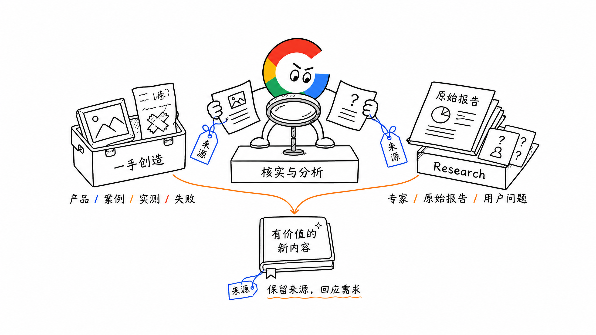
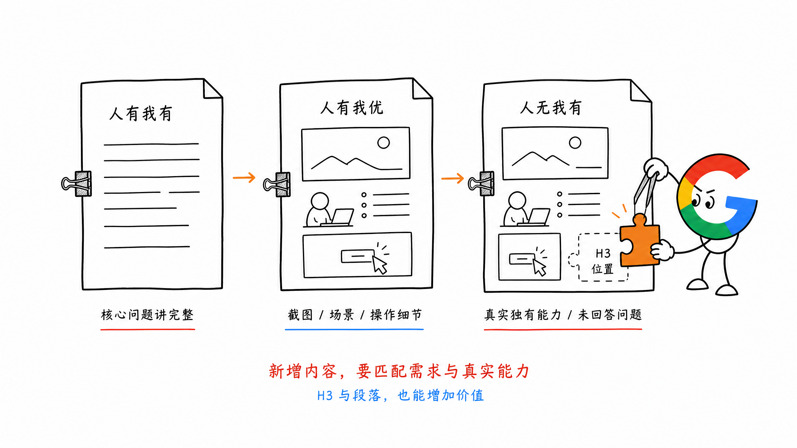
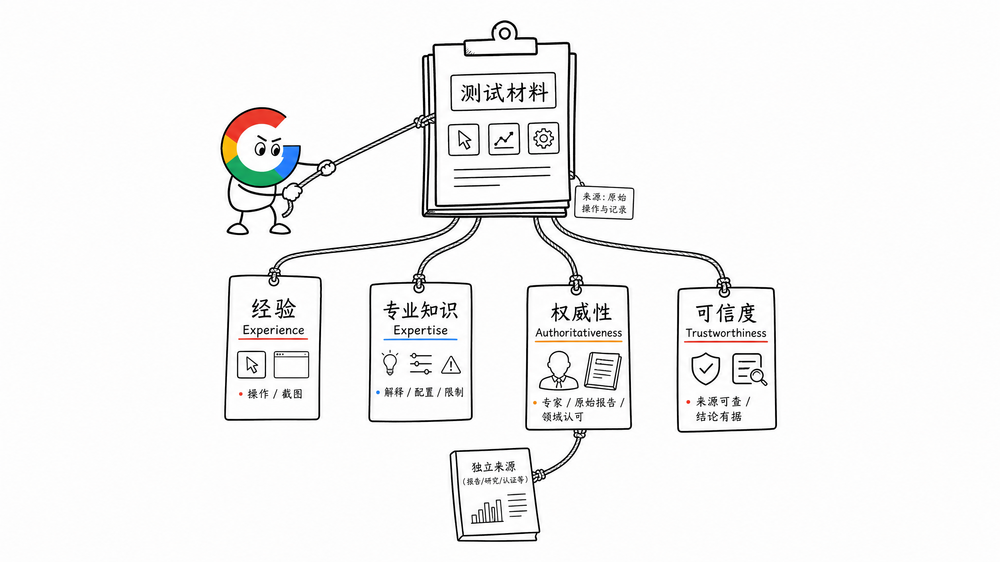
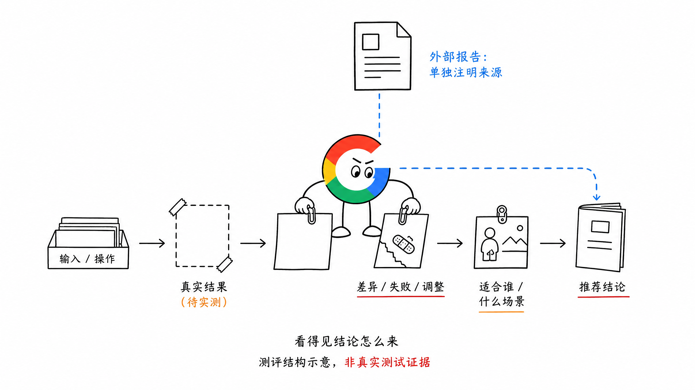
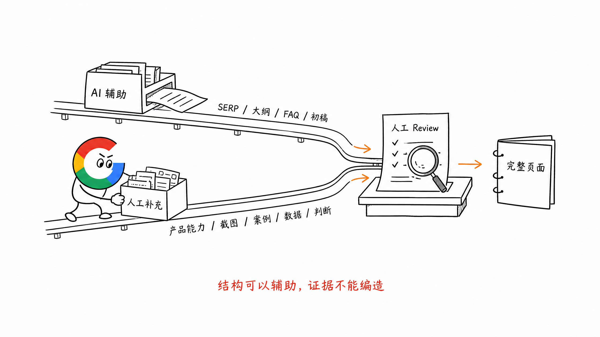

# 第 16 章 信息增量与 E-E-A-T

AI 时代不缺内容。

同一个关键词，大家参考同一批 SERP 页面，让 AI 汇总大纲，再扩写正文，很容易做出一批差不多的页面。

结构可能完整，但用户看完还是没有得到更多东西。

站在 Google 的角度，我们希望提供的是：**新的，而且对搜索用户有价值的内容。**

这就是这一章要讲的信息增量。

它可以来自自己的一手创造，也可以来自 Research 后得到的结论。关键是内容准确、有依据，能帮助用户解决当前问题。

## 一、信息增量从哪里来

我认为主要有两个方向。

### 1. 自己创造的一手内容

比如：

- 真实产品和功能
- 自己操作后截取的界面与结果
- 亲自完成的案例
- 实测数据与效果差异
- 失败原因、报错情况和调整方法
- 不同场景下推荐的参数与配置

这些内容来自实际做过的事情。

尤其是失败经验。哪些输入效果不好，遇到什么问题应该怎么调整，往往比一句生成效果很好更有用。

### 2. Research 后得到的结论

不是所有内容都必须自己做实验。

也可以研究专家观点、报告原始数据和用户讨论，再围绕当前问题整理出有依据的结论。

比如从 Google People Also Ask、Reddit、Quora 中找到用户还在追问的问题，再继续研究：现有结果为什么没有讲清楚？我们能补充什么？

Research 的价值，是把资料变成对用户有用的解释和判断。

引用别人的测试或数据，就说明来源。自己的结论，也要让读者看得出依据在哪里。

## 二、人有我有、人有我优、人无我有

内容创作可以分成这三个层次。

### 人有我有：把基础内容讲完整

先看 SERP，汇总前排页面的 H2、H3 和核心段落，知道用户普遍需要什么。

这里要对齐的是核心问题与内容结构，再结合自己的产品来写。

这一步建立基础，但只做到这里，页面还是很容易和其他结果一样。

### 人有我优：把已有内容讲得更具体

同样讲一个功能，可以补上真实截图、操作过程、具体场景和结果。

比如大家都有 How to，我们的教程能不能直接对应产品真实操作？大家都讲使用场景，我们能不能补一个具体小案例？

同样支持某项能力，也可以讲清楚产品更强在哪里，或者在什么场景下该用什么配置。

这些改进往往发生在 H3 和段落里。

### 人无我有：补上还没有被回答好的问题

继续研究搜索意图，找到现有页面没有覆盖、用户却真正关心的子问题。

比如 `ai video generator` 页面，大家都介绍 Text / Image / Video to Video。

如果产品确实支持 PDF、Audio 或 Music to Video，就可以把这些能力作为新的 H3 展开，说明输入、操作和结果。

这些独有而且有价值的内容，可以前置介绍。

**新内容要与搜索需求有关，也要与真实产品能力对得上。**

## 三、信息增量落在大纲和段落里

补信息增量时，可以分别看两层。

| 层面 | 怎么补 | 可以放什么 |
| --- | --- | --- |
| 大纲 | 增加值得单独讲的 H2、H3 | 未覆盖的子问题、功能、场景和 FAQ |
| 段落 | 把已有问题讲得更具体、更可信 | 实操截图、数据、小案例、配置、失败原因和使用限制 |

有些页面大纲差不多，真正的区别就在段落里。

一段泛泛的功能介绍，和一段带真实效果、操作细节、适用条件的说明，交付给用户的信息不同。

所以补信息增量时，也要看自己是否真正理解这个场景：用户最关心什么、想得到什么结果、什么情况下适合用、什么情况下不适合。

## 四、E-E-A-T：这些内容凭什么可信

信息增量回答的是：我们多提供了什么。

E-E-A-T 继续问：这些内容有什么依据，读者为什么可以相信？

可以从四个方面理解：

| 维度 | 大白话理解 | 内容里怎么体现 |
| --- | --- | --- |
| Experience，经验 | 你是否真的用过、做过 | 真实操作、案例、截图、失败与调整过程 |
| Expertise，专业知识 | 你是否理解这个问题 | 解释差异和原因，给出配置、场景与限制，而不只是下结论 |
| Authoritativeness，权威性 | 作者或来源在这个领域是否有认可和依据 | 相关专家观点、原始报告，以及领域内对作者或团队的认可 |
| Trustworthiness，可信度 | 内容是否真实、准确、可核对 | 数据有来源，结论有证据，引用与亲测分清楚，限制如实说明 |

这几个方面会有重叠。

比如一组真实测试，既能体现经验，也可以通过对结果的分析体现专业知识。把测试过程和来源交代清楚，又能增强可信度。

AI 可以写出看起来很专业的句子，但实际经验、测试过程和证据，需要有人真正完成。

## 五、放到上一篇的测评博客里怎么做

比如写 `best ai video generator`。

如果每个产品下面都只有功能介绍，再写一句效果很好，用户还是很难选择。

做真实测评时，可以把这些内容写进去：

- 实际用了什么输入素材，怎么操作
- 生成的结果是什么，配对应截图或视频
- 几个工具在效果上有什么差别
- 哪些情况失败了，后来怎么调整
- 根据测试结果，分别适合什么人和场景

这些就是一手经验和信息增量。

如果再引用报告或其他人的测试，要和自己的实测分开交代。

自己测到的，就说明测试过程；引用的，就给出原始来源。最后再根据这些材料给出选择建议。

用户看到的不只有推荐结论，也能看到结论怎么来的。

## 六、AI 可以帮忙，证据还要人来补

AI 很适合先做这些工作：

- 抓取和整理 SERP 页面结构
- 汇总 H2、H3 初稿
- 归纳 FAQ 和竞品共同内容
- 改写表达、补全结构、生成初稿

接下来要由人补上产品独有能力、实操截图、真实案例、数据和判断。

AI 也可以帮助 Research 和整理材料，但结果仍然需要人工 Review。

尤其要避免几种看起来高效、实际没有增加多少价值的做法：

- 把视频或文章改写、拼贴成另一篇博客
- 把 Chatbot 对话记录直接拼成页面
- 同一个模板只替换关键词、数字或地区

这些内容即使增加了字数，也未必增加了用户真正需要的信息。

人工写作同样要回答这个问题：这页到底提供了什么价值？

## 七、小结

信息增量可以来自一手创造，也可以来自 Research 后形成的有依据的结论。

先把基础内容讲完整，再用真实功能、案例、截图、数据和经验，把已有内容讲得更具体，并补上没有回答好的问题。

E-E-A-T 则要落实在这些内容背后的经验、专业知识、权威与可信依据上。

**多交付一点对用户有价值的新信息，也让读者知道这些信息为什么可信。**

> 本章节完毕，谢谢大家，欢迎随时讨论。
