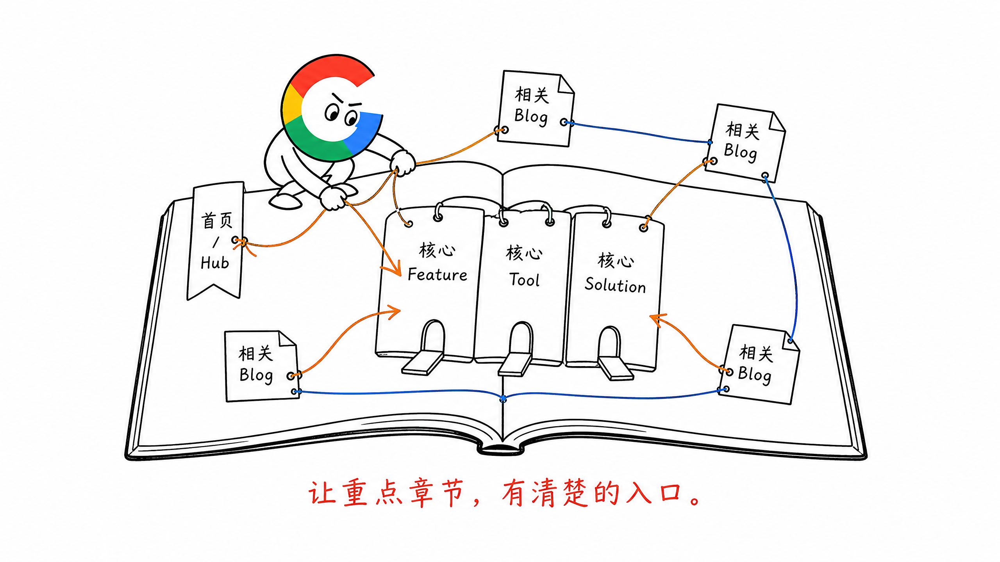
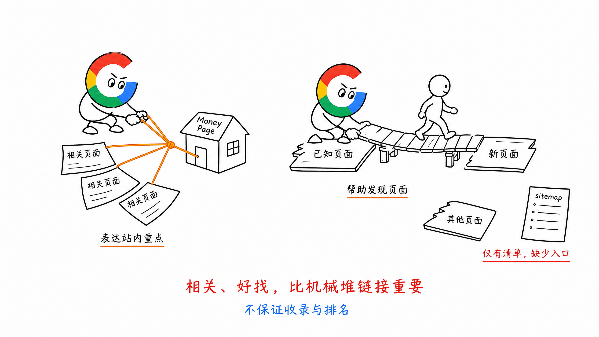
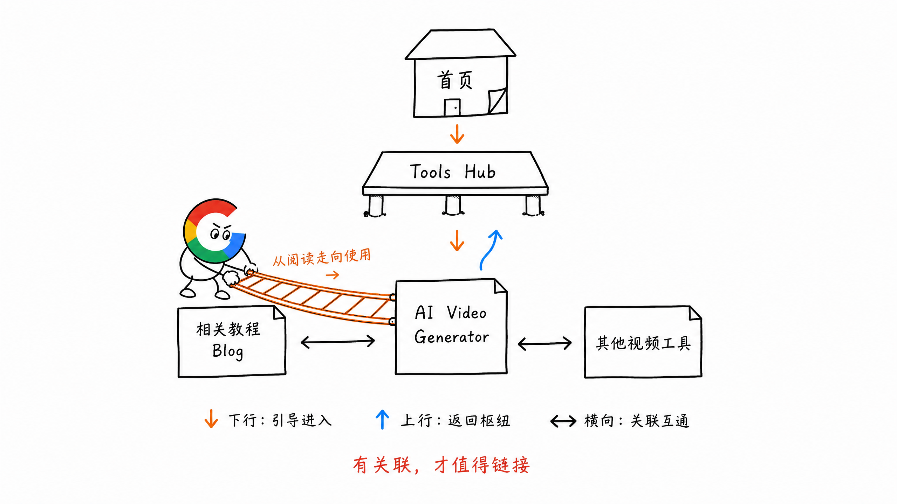
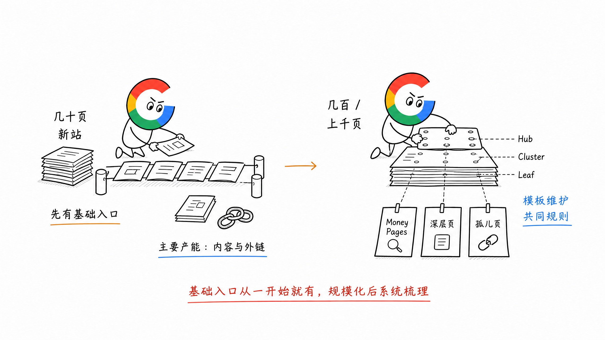

# 第 17 章 内链：给 Google 和用户一张阅读地图

网站页面少的时候，内链看起来很简单：在相关文章里放几个链接就行。

但页面越来越多，问题就来了：哪些页面最重要？新页面从哪里被发现？用户读完一篇 Blog，下一步该去哪里？

我认为，**内链不是往正文里塞关键词的 SEO 技巧，而是网站的权重引导系统。**

它既告诉 Google 网站的重点在哪里，也带着用户从当前页面走向更需要的内容和功能。

## 一、先决定哪些页面最重要

假设一个网站有 1 万个页面，Google 不可能把这 1 万个页面都当成同等重要。

网站自己也要表达判断：

- 哪些是核心章节
- 哪些是重点章节
- 哪些是支撑内容

还是用一本书来理解。目录会让读者先看到整本书的结构，核心章节会被反复提到，辅助章节则帮助读者理解某个具体问题。

网站也一样。首页、核心 Feature、重要 Tool 或 Solution 页面，以及围绕它们展开的 Blog，不应该是一堆平铺的 URL。

前面做 Topic Map、Keyword-to-Page 和 URL Structure，是先确定书的大纲与章节。内链再把这些章节真正连起来，并让重点页面获得更清楚的入口。



## 二、内链主要做两件事

### 1. 引导网站自己的“投票”

一个页面从首页、频道页和多篇相关内容获得清楚的内链，说明网站自己认为它重要。

这也是内链最值得花心思的地方：**把站内的链接入口，优先给真正希望排名、也能带来业务结果的页面。**

这些页面通常是转化好的 Money Pages，也就是能把自然流量带向使用、注册或付费的高价值页面。

比如某个 Tool 页转化很好，网站就不该只在 sitemap 里放着它。主导航、对应的工具集合页，以及讲同一需求的 Blog，都可以在合适的位置链接过去。

这里也别机械地数链接。一个页面被更多相关页面指向，重要性会更清楚；但链接是否相关、入口是否容易找到，同样重要。把所有页面的页脚都塞满同一批链接，不等于这些页面就一定能排上去。

### 2. 让 Google 和用户发现更多页面

搜索引擎会沿着页面上的链接继续抓取。

如果一个新页面没有任何站内链接指向它，即使进了 sitemap，Google 和用户也不容易从网站结构里找到它。

所以新页面上线时，至少要有一个合理入口：从所属频道页、相关页面，或其他用户确实会经过的位置链接进来。

内链可以帮助新页面被发现和理解，但不保证它一定被收录，更不能代替页面本身的质量。



## 三、上行、横向、下行怎么连

不用把内链想得太玄。按照网站原有结构，可以先看三个方向。

| 方向 | 从哪里到哪里 | 解决什么问题 |
| --- | --- | --- |
| 下行 | 首页或 Hub → 分类和具体页面 | 让重要页面有入口，方便继续浏览 |
| 上行 | 具体页面 → 所属 Hub 或核心页面 | 告诉用户这页属于哪个主题，下一步能去哪里 |
| 横向 | 同一主题下的相关页面之间 | 让相近需求互相连接，补齐阅读和使用路径 |

比如一个 AI 视频工具站：

```text
首页
  ↓
/tools/ 频道
  ↓
AI Video Generator 工具页 ← 相关教程 Blog
  ↔
相关的其他视频工具页
```

这不是要求每页都把三个方向塞满。

用户读完一篇教程，下一步想实际生成视频，就链接到对应工具页。用户正在使用工具，想看操作方法，就链接到教程。两页确实有关联，横向链接才有价值。

面包屑、频道页、正文推荐和相关内容模块，都可以承担这些链接。关键是用户能看懂为什么要点过去。



## 四、让 Money Pages 在产品路径里更突出

如果某个页面转化好，而且正是产品想推广的能力，就值得持续争取更靠前的排名。

内链规划要跟着这个目标走，也要符合产品设计。

我会先问三个问题：

1. 哪些页面是当前最重要的 Money Pages？
2. 哪些现有页面的用户，接下来确实需要它们？
3. 这些链接应该放在导航、频道页、正文，还是 CTA 附近，用户才容易发现？

例如一篇 `best ai video generator` 测评博客，读者看完比较，可能想直接试用某个工具。文章里就可以链接到对应的工具页，而不只是放一个笼统的首页按钮。

反过来，工具页的用户可能需要教程、价格或其他相关功能，也应该能顺着页面继续找到。

**内链的重点，不只是让 Google 看见某个页面重要，还要让用户自然走到那个页面。**

但不是所有 Blog 都要导向同一个 Money Page。先看当前内容和产品能力是否相关，再决定链接到哪里。

## 五、锚文本写清楚目的地

锚文本就是用户实际点击的文字。

它要让用户在点击前，大致知道下一个页面讲什么、能做什么。

比如链接到 AI 视频生成工具页，可以写 `AI video generator` 或与当前句子自然衔接的具体说法。只写 `learn more`、`click here`，读者就得猜。

也不要为了匹配关键词，在一篇文章里反复用同一句锚文本。先把句子写顺，再给真正相关的词或短语加链接。

## 六、什么时候重点做结构化内链

早期网站只有几十个页面，整站积累还少。这个阶段，内链的边际收益可能没有新增高质量页面、获得外链那么明显。

但这不等于可以让新页面变成孤儿页。基础的导航、频道入口、面包屑和相关页面链接，仍然应该从一开始就有。

等页面到了几百、上千，再回头逐篇手动补链接就很费劲。这时更值得按 Hub、Cluster、Leaf 和页面类型，统一检查：

- 核心页面是否获得了足够清楚的入口
- 新页面是否能从所属频道和相关页面进入
- 重要页面是否埋在很深的层级里
- 是否有页面只在 sitemap 中出现，却没有站内链接

同类页面可以在模板里设置面包屑、所属频道和相关内容模块，让新增页面自动进入结构。但具体推荐什么页面，还是要看主题和用户下一步需求；不要让模板把一批不相关链接复制到全站。



## 七、小结

内链先回答网站自己认为哪些页面重要，再帮助 Google 和用户沿着合理路径找到它们。

早期先保证基础入口，不用为了多放链接而忙于优化。页面上规模以后，再认真梳理重点页面、上下级关系和孤儿页。

**把最有价值的页面放在读者会经过的位置，也让其他章节能顺着这张地图被发现。**

> 本章节完毕，谢谢大家，欢迎随时讨论。
