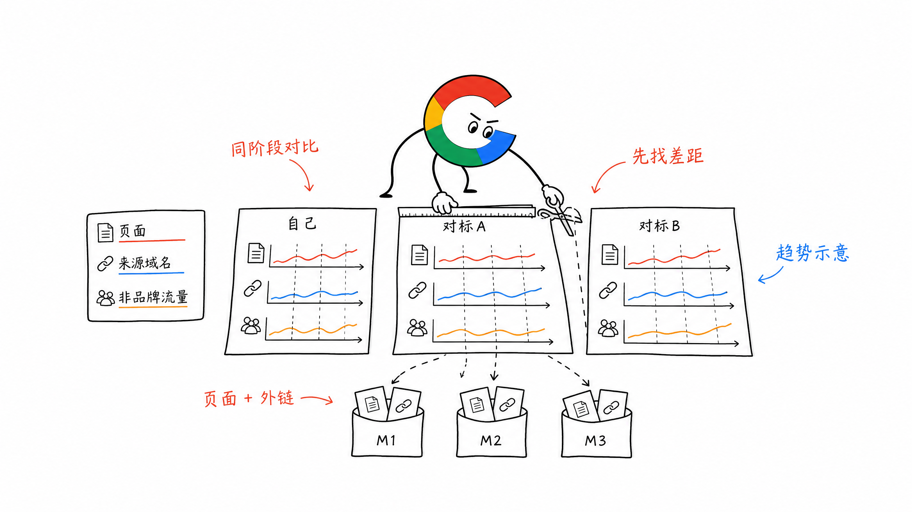
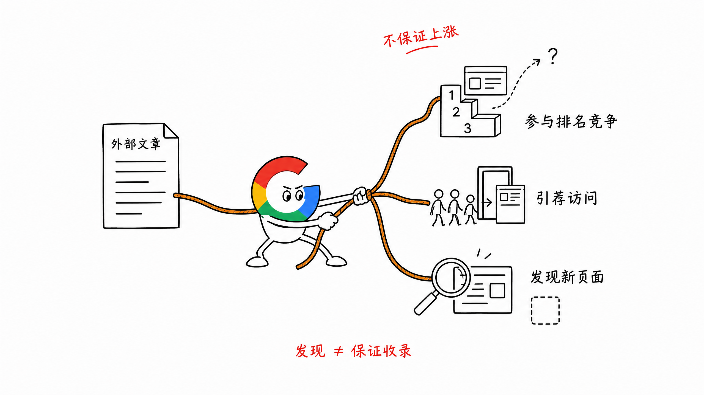
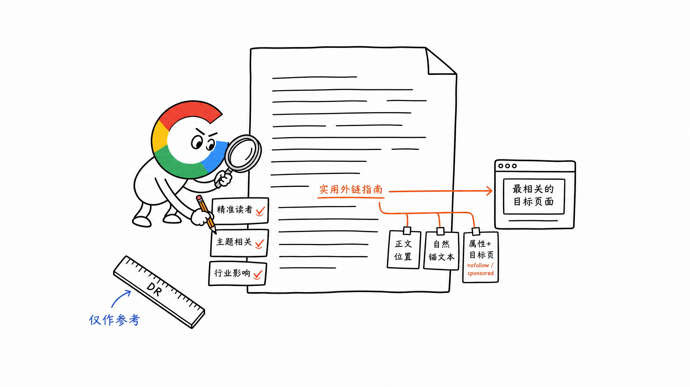
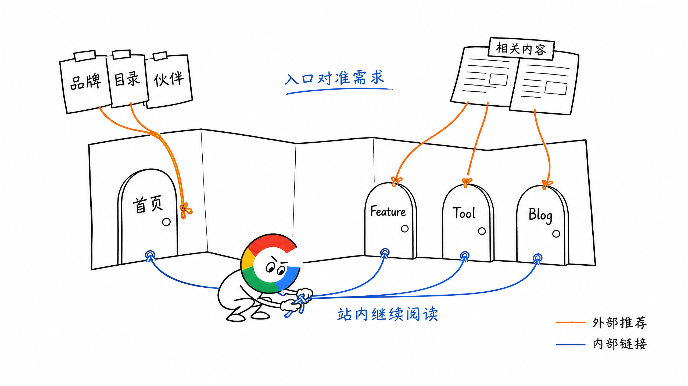
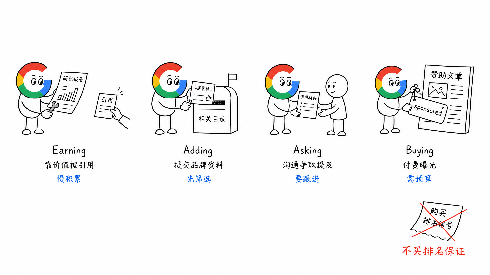
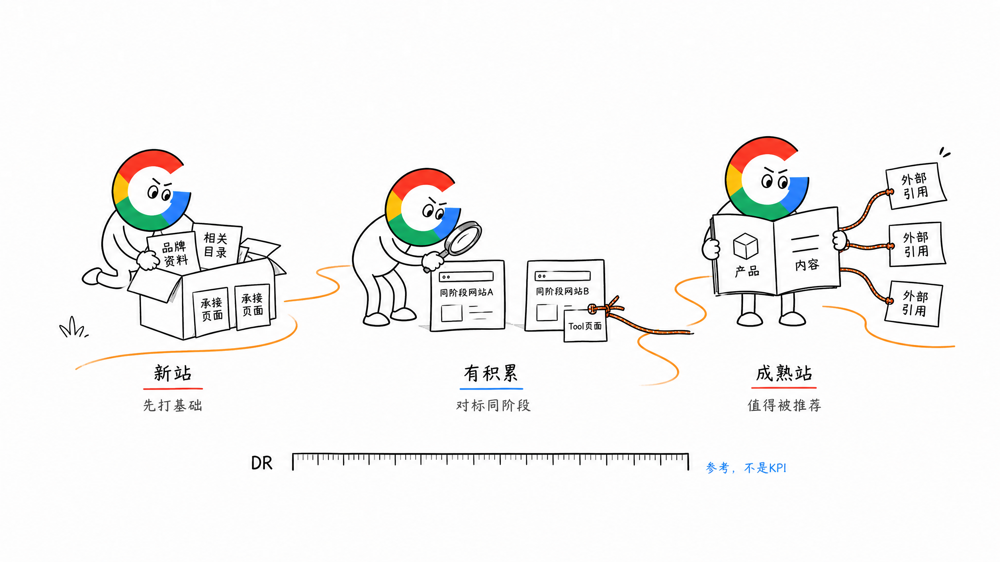

# 第 18 章 外链必知必会

前面讲了站内页面和内链。接下来要看：**站外有没有人愿意推荐你。**

外链（Backlink），就是其他网站上的一个链接，指向你的网站页面。

但做外链之前，我更想先回答一个实际问题：这个月到底要做多少条？

这个数字不能拍脑袋定，也不能看到别人 DR 50，就给自己定一个三个月冲到 DR 50 的目标。

## 一、先用对标站倒推外链目标

找 2 到 3 个产品方向、建站阶段和 SEO 页面类型都相近的对标站。优先看正在起量的新站，不要直接拿经营多年的头部品牌定目标。

接着把自己和对标站最近三个月的数据放在一起看：

| 维度 | 看什么 |
| --- | --- |
| 内容增长 | Organic Pages、Top Pages 增加了多少，哪些页面开始带来流量 |
| 外链增长 | Referring Domains（引荐域名）增加了多少，增长集中在哪些月份 |
| 搜索结果 | 自然流量、非品牌词占比及核心页面排名怎么变化 |

不要把三条曲线拆开看。比如对标站一个月新发了很多 Tool 页面，同时 Referring Domains 上升，后面非品牌流量开始增长。你要继续拆：哪些页面起量，哪些新域名给了链接，链接指向首页还是具体页面。

这一步是为了看对方**用多少页面和外链，换来了什么阶段性结果**。时间对得上，可以帮助我们找到值得研究的动作，但不能只凭两条曲线就认定外链是唯一原因。

再看自己的差距：

- 目前少了多少值得做的页面
- Referring Domains 少了多少，缺的是哪类来源
- 非品牌词覆盖和自然流量差在哪里

最后把差距拆到未来三个月：每个月补多少页面、争取多少个合适的新 Referring Domains、希望哪些页面进入更好的排名区间。

**外链目标要跟页面计划一起定。** 如果这一阶段核心 Tool 页面还没做好，只给首页堆外链，未必能解决页面承接的问题。

这里的 Referring Domains 比单纯的 Backlinks 数更适合做阶段跟踪。一个域名在全站放了 100 条链接，Backlinks 会增加很多，但它仍然只是一个来源域名。

## 二、外链到底能带来什么

外链主要有三种价值。

### 1. 帮助页面参与排名竞争

站内内容和技术做好以后，外链是来自站外的推荐信号。

给首页和重要页面获得相关网站的推荐，可能帮助整站积累信任；给具体 Feature、Tool 或 Blog 页获得链接，则更直接地支持这些页面竞争自己的关键词。

但外链不会让一个页面立刻上涨。页面能不能排上去，还要看它是否满足搜索需求、内容和产品是否真的有价值。

### 2. 带来引荐流量

一条链接所在的页面，若正好有目标用户在看，就可能带来真实点击、试用和转化。

这也是为什么我判断外链时，会把**精准流量**放在前面，而不是只看 DR 数字。

### 3. 帮助发现新站和新页面

Google 可以沿着外部页面的链接发现你的网站。对新站来说，来自真实、常被访问的网站的链接，也给了爬虫一条进入路径。

但被发现不等于保证收录。页面本身仍要可抓取、可索引，也要有值得收录的内容。

## 三、怎么判断一条外链值不值得做

我会先看三个核心标准：

1. **流量精准度**：这张页面的读者是不是潜在客户？有人会点吗？
2. **相关性**：对方网站和具体页面，与你的产品、话题是否相关？
3. **权威性**：对方在这个领域是否有真实影响力？

还是用一本书打比方：如果你写了一本《AI 电商创业》，一个电商领域有影响力、读者也恰好是创业者的人，在自己的文章里推荐其中的具体章节，这种推荐就有价值。

同样的道理，一个高 DR 网站的冷门页面，未必比一个目标客户经常看的垂直网站页面更值得做。

看一条具体链接时，还可以继续检查：

- 链接来自正文、侧边栏，还是全站页脚
- 这篇文章本身有没有真实内容和读者
- 锚文本是否自然说明目标页面
- 链到首页，还是链到最相关的具体页面
- 链接是否标记为 `nofollow` 或 `sponsored`

Ahrefs 的 DR 可以辅助比较网站的外链概况，但它是 Ahrefs 自己的指标，不是 Google 的排名分数。Referring Domains、来源页面质量、实际引荐访问和核心页面排名，要一起看。

**外链不是越多越好。单一类型的链接堆得很高，也不等于来源丰富、用户精准。**

## 四、首页外链和具体页面外链怎么分

很多网站在介绍一个品牌时，会自然链接到官网首页。因此首页通常更容易获得外链。

新站前期先把品牌资料、合作伙伴和基础目录信息做好，首页得到第一批链接很正常。

但到了中后期，不能只盯首页。哪些 Feature、Tool、Solution 或 Blog 页面承担核心排名和转化，也要想办法让相关的外部内容直接引用它们。

比如别人正在讲某项 AI 视频能力，链接到对应功能页，通常比一律指向首页更方便读者继续了解或使用。

这和上一章内链是配合的：站外推荐带用户进入合适页面，站内再通过相关链接帮助他继续完成任务。

## 五、常见外链方式：获得、添加、争取和付费

外链方式可以分成四类：

| 方式 | 大白话理解 | 常见做法 |
| --- | --- | --- |
| Earning | 产品或内容被别人主动引用 | 研究报告、免费工具、真实测评与推荐 |
| Adding | 自己把品牌资料提交到相关平台 | 官方社媒、企业目录、AI 导航站 |
| Asking | 主动联系对方，争取有价值的提及 | 合作伙伴、客座内容、报道线索 |
| Buying | 为内容发布或曝光付费 | 赞助内容、付费刊登 |

Earning 很理想，但不好预测。Adding 适合新站做基础。Asking 需要筛站、沟通和跟进，也更能围绕产品与真实内容建立关系。

付费 Guest Post 里，要把**买曝光**和**买可传递排名信号的链接**分清楚。

付费合作可以是正常推广；如果付款的目的就是让文章放一个可传递排名信号的链接，Google 将其列为链接垃圾行为。付费或赞助链接应标记 `rel="sponsored"`，`nofollow` 也可以。不要把购买 Dofollow 链接当成稳定的排名公式。

接下来第 19 章会讲目录站与导航站怎么筛，第 20 章再展开可以持续做的外链方式。这一章先把判断标准和目标定法说清楚。

## 六、按站点阶段做，不照抄 DR 里程碑

可以用 DR 30 以下、30 到 50、50 以上粗略区分网站阶段。我会把它当成观察对标站的**参考区间**，不当成所有网站都必须按月完成的 KPI。

新站外链基础弱时，先做真实品牌资料、相关目录和第一批合作链接，同时把能承接搜索需求的页面做出来。

有了一定积累后，再研究相近阶段的竞品：它们在起量前新增了哪些 Referring Domains？哪些链接来自相关内容，哪些指向具体排名页面？我们有没有同样值得被推荐的页面或材料？

网站已经很成熟时，很多链接是因为品牌和产品影响力自然获得的。直接复制它现在的外链数量、预算和增长速度，对新站参考价值不大。

不管在哪个阶段，外链增长都应和正常的产品、内容、合作与传播节奏对得上。不要把锚文本比例或每月购买条数当成固定配方。

## 七、怎么记录和复盘

外链做完，不是三天后看一下 DR 有没有涨。

可以每两周看一次外链记录，至少保留：

| 字段 | 记录什么 |
| --- | --- |
| 来源与链接 | 哪个网站的哪张页面，链接是否还在 |
| 目标页面 | 指向首页还是具体 Feature、Tool、Blog |
| 类型与属性 | 自然引用、目录、合作、赞助；`nofollow`、`sponsored` 等 |
| 主题与锚文本 | 来源内容是否相关，链接文字是什么 |
| 结果 | 引荐访问、目标页面排名和非品牌流量的变化 |

重点看两件事：来源质量有没有改善，核心页面的排名和自然流量有没有持续进展。

DR 可以记录，但只是过程参考。最终还是看：**外链有没有帮助有价值的 SEO 页面获得更好的搜索表现，也有没有带来真正的用户。**

## 八、小结

外链目标先从 2 到 3 个同阶段对标站倒推，再跟页面建设一起拆到未来三个月。

执行时，先看精准用户、相关性和真实影响力，再看 DR 和链接数量。首页要有基础推荐，核心页面也要争取来自相关内容的直接引用。

**外链不是一张采购清单，而是让外部世界有理由把读者带到你的产品和内容。**

> 本章节完毕，谢谢大家，欢迎随时讨论。
