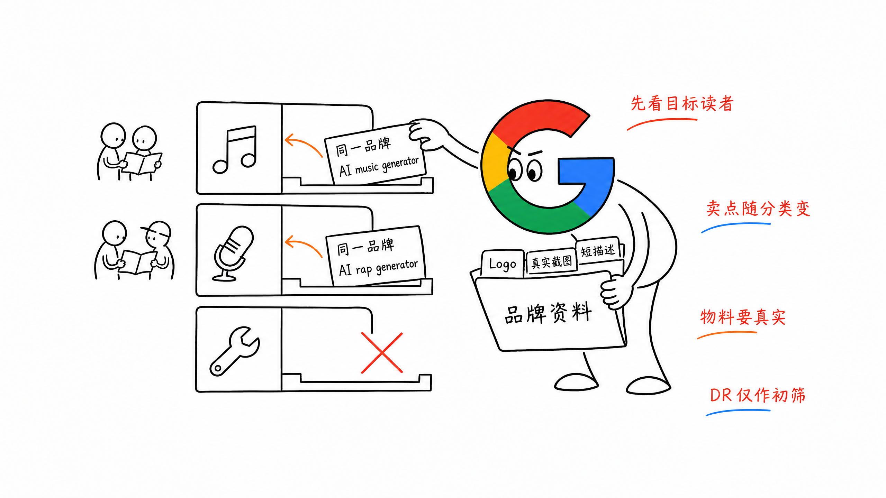
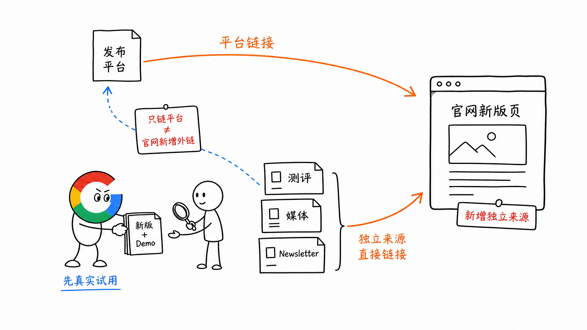
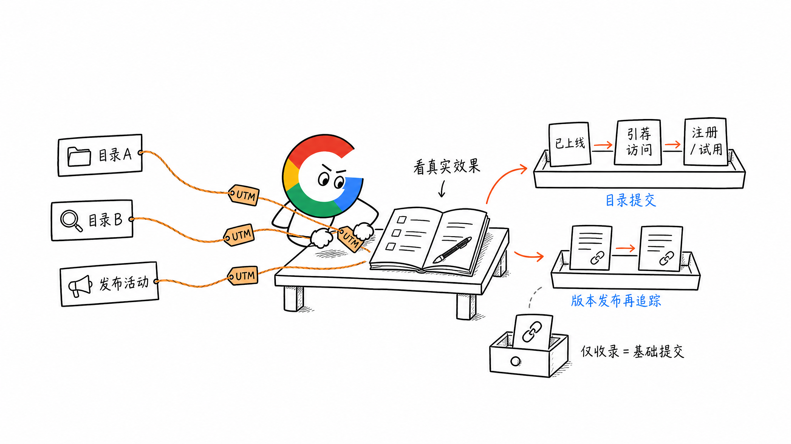

# 第 19 章 AI 导航站、目录站与评测站的 0→1

新站要不要提交 AI 导航站？要。但这类外链已经很常见，我会把它当成基础建设，不指望靠提交几十个站就把排名做起来。

更值得期待的是：产品有了真正的新版本，在 Product Hunt 等平台发布后，引来独立测评、媒体和社区继续介绍，并直接链接到官网。

## 一、新站先做一批有读者的目录站

目录站有两种价值：分类页可能带来精准访问；外部链接也给爬虫一条发现新站的路径。但能否带来流量和排名，仍要看具体页面和展示位置。

我会先挑约 20 个相关平台，不一口气提交 100 个。月访问量超过 10 万、DR 超过 50 可以作初筛，但更要看**目标用户会不会逛这个分类页**，以及产品卡片能否链接到合适的落地页、获得什么展示位置。

提交时有三个实操要点：

1. **标题固定品牌名，调整主词。** 比如同一款 AI 音乐工具，面向普通创作者的目录强调 `AI music generator`，面向 Rap 创作的目录可以强调 `AI rap generator`。新站也可以先选更具体的长尾词。同一个首页链接，在不同目录可以用不同卖点介绍。
2. **描述和配图跟着卖点变。** 描述自然带上 1～2 个相关关键词，配对应的真实截图或 Demo。先备好 Logo、封面、短描述和分类标签。好的物料也更容易争取到编辑精选位置。
3. **上线后记录位置和效果。** 确认资料页已发布、链接可访问，再看它排在分类页哪里，带来了多少引荐点击、注册或试用。

比如 TAAFT 等平台提供付费提交或 CPC，先问清买到的是更快审核、精选位置，还是点击。用 UTM 区分不同平台的流量，费用要和真实访问、试用一起看，不要把付费目录链接当成排名保证。

如果拿到了有分量的编辑推荐或榜单位置，还可以在官网展示这项真实推荐，作为用户判断产品的参考。别把普通收录写成平台背书。

评测站也要分清：自己提交的产品卡片，仍是目录收录；有人实际使用后写出的测评，才是更有价值的内容推荐。

## 二、重大版本发布，争取第二波外链

Product Hunt 不只是拿一条平台链接。产品有了明显的新能力，才值得再次发布，并让这次更新成为别人愿意报道和测评的理由。发布前先准备新版落地页、截图和 Demo；发布当天回答问题；发布后把可试用的产品和材料提供给相关测评者、媒体和 Newsletter 作者。

这里要看清外链落到哪里：别人只链接 Product Hunt 产品页，不算官网新增外链；独立文章直接链接到官网，才算新的 Referring Domain（引荐域名）。二次传播不会自动发生，产品更新和实际体验得站得住。

类似的发布渠道还有 Uneed、Peerlist Launchpad 和 Show HN。选择时先看社区里有没有你的用户，再看产品更新是否值得他们讨论，不要把同一套文案群发到每个平台。

## 三、怎么判断有没有做出效果

目录站看**上线、引荐访问、注册或试用**。版本发布再多看一项：有没有独立网站新增链接到官网，尤其是新版功能页。

如果平台带来了精准用户，即使外链不多，也值得继续用；如果只有一条目录链接，没有点击和后续提及，就把它当成基础提交。

## 四、小结

导航站先挑相关平台，做好新站的第一批基础外链。重大版本发布时，再借发布平台争取真实体验和独立介绍。

**平台给你一条链接是起点；别人愿意把读者直接带到你的产品，才是更值得追踪的增长。**

> 本章节完毕，谢谢大家，欢迎随时讨论。
