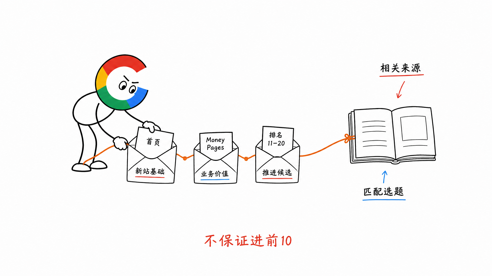
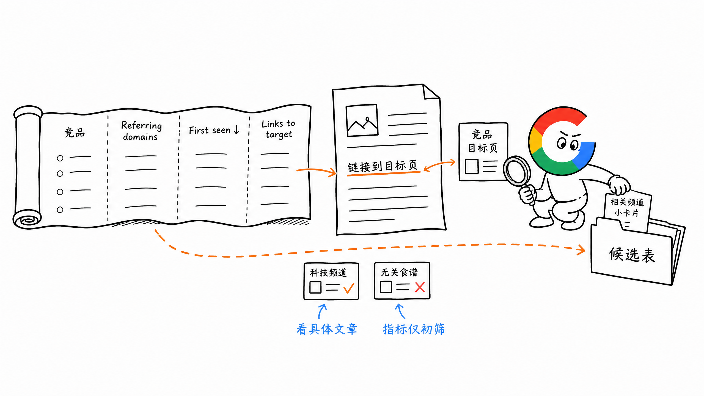
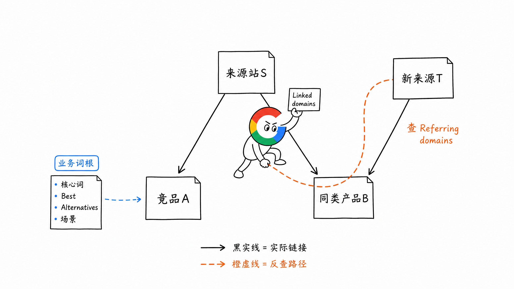
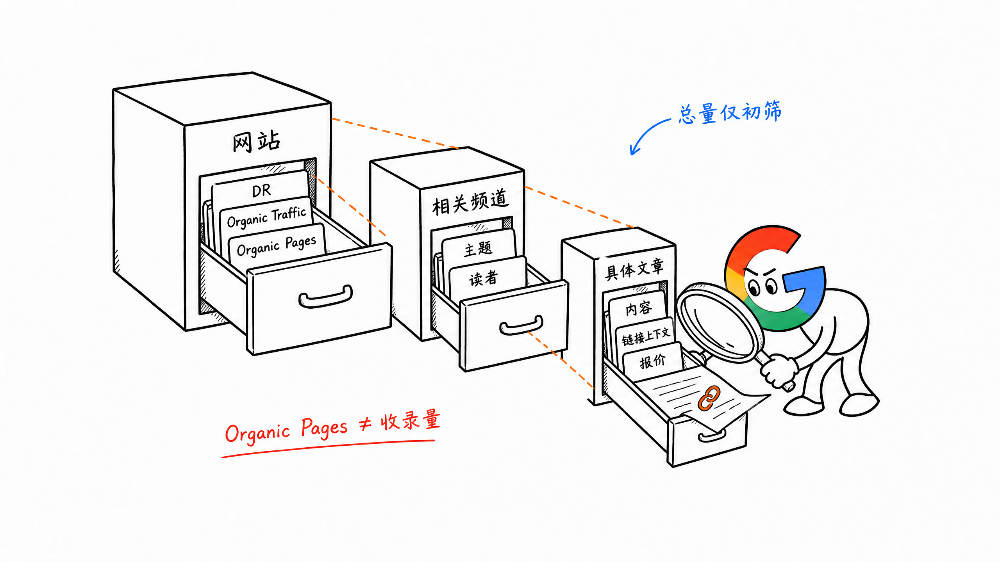
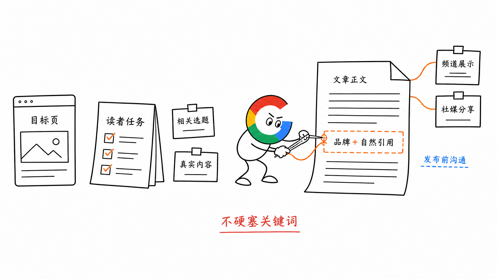
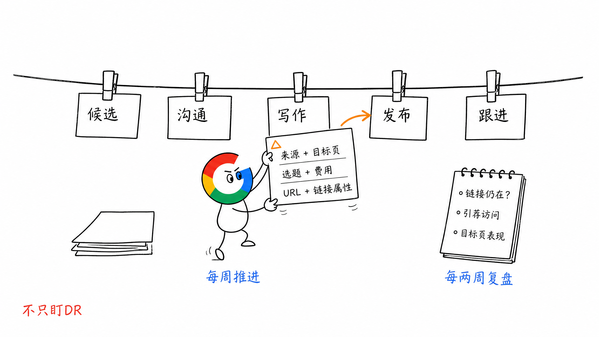

# 第 20 章 可持续外链打法

第 18 章把外链建设分成了 Earning、Adding、Asking 和 Buying 四类。上一章讲的导航站提交，主要属于 Adding，适合新站先把基础外链做起来。

但目录提交一批以后，后面怎么持续增加外链？

Earning 靠产品和内容被主动引用，值得长期投入，但很难控制什么时候发生。相比之下，Guest Post（客座文章，简称 GP）可以通过主动沟通或付费刊登推进，更容易形成持续执行的流程。

**找相关网站 → 筛选资源 → 沟通选题 → 创作文章 → 发布跟进。**

这套流程可以每周重复，也能根据预算和产能调整，并围绕首页、核心功能页或高转化页面分别安排内容。这就是为什么 GP Link 是一种比较可持续的外链建设方式。

## 一、先确定这批外链要支持哪个页面

找站之前，先明确链接要指向哪里。

新站可以先从首页开始。后面再同步关注两类具体页面：

- 转化好的 Money Pages（高转化页面）
- 已经排在 11～20 名，值得继续投入的页面

前者有业务价值，后者可以作为继续推进排名的候选。但不是加一条外链，就一定能进入前 10。

目标页确定以后，后面的选站和选题才有方向。比如要支持一个 AI 视频工具页，就优先找科技、创作或营销相关内容里的合适位置。

## 二、从竞品反查可以合作的网站

不用凭空找外链资源，先看同类网站已经在哪里获得链接。

可以找 DR 30～50 左右的竞品作为起点。这类站已有一定积累，比成熟大品牌更容易看出正在主动推进的外链方式。这个区间只是参考，产品相关性仍然要看。

在 Ahrefs 里按下面的路径操作：

1. 进入竞品的 `Backlink Profile → Referring domains`
2. 按 `First seen` 倒序，先看最近发现的来源
3. 可以先筛 DR 大于 50 的来源，再展开 `Links to target`
4. 点开具体文章，看它为什么提到竞品，链接放在哪里
5. 把主题相关、值得继续沟通的网站记进候选表

不要只导出一堆域名。**真正要看的是：这个网站的哪篇文章，用什么内容链接到了竞品。**

比如一个综合媒体站有科技频道，可以继续研究；如果整个网站只讲食谱，与 AI 工具没有关系，就不必因为 DR 高而选它。

### 没有更多竞品了，怎么继续找

从业务词根扩展搜索。

比如 AI 写作方向，可以搜索核心词、Best 类词、Alternatives 类词，以及具体功能或场景词。沿着这些结果，继续找相近阶段的网站，再重复上面的外链拆解。

也可以从已有来源网站的 `Outgoing links → Linked domains` 找到它最近链接过的同类产品，再反查这些产品的外链来源。

这样资源池就能持续扩展。

## 三、候选站点怎么筛

找到一个域名，先补齐数据，再决定是否投入。

| 要记录什么 | 用来判断什么 |
| --- | --- |
| 网站与具体频道 | 读者、主题是否与目标页相关 |
| DR | 外链概况的参考 |
| Organic Traffic | 有没有自然搜索流量 |
| Organic Pages | 有多少页面正在获得自然搜索流量 |
| 相关文章 | 内容质量、链接位置与上下文 |
| 合作方式与报价 | 预算能否承担，具体提供什么 |

自然流量可以先用月估算流量 5,000 作为初筛参考，再看具体频道和文章。不要只看一个总数，就认定整站所有位置都值得做。

`Organic Pages` 也不等于 Google 的收录数量，不能拿它直接计算收录率。

## 四、文章怎么写，发布前谈什么

### 1. 选题贴近目标页，也让对方读者愿意看

优先选择有搜索和阅读需求的主题。可以是与产品相关的新话题，也可以是更具体的 Best 类文章。

比如目标页是一个具体 AI 写作工具，文章就围绕相关的写作任务、工具选择或实际使用场景展开。

先想清楚文章给读者什么，再把目标页放在适合继续了解或使用的位置。

### 2. 链接放在相关段落里

正文里讲到对应能力时，就可以自然介绍产品，并链接到相应页面。尽量争取在前半部分有合适的位置，方便读者看到和使用。

锚文本说明目标页是什么，附近可以自然出现品牌名。不要在一篇不相关的文章里，突然塞进一个工具关键词。

### 3. 发布以外，再争取一点曝光

沟通时可以一起问：

- 文章能否在首页或对应频道展示几天
- 能否分享到网站或作者的社交账号
- 实际发布位置和费用是否与约定一致

这些资源可能带来直接访问，不要只问能放几条链接。

## 五、已有的业务合作，也顺手争取链接

正常的品牌推广和合作中，也会出现外链机会。

比如合作伙伴有没有 Partner 页面；用了某个服务，能不能提供一个真实客户案例，让对方介绍你是怎么使用它的。

像 ElevenLabs 的 Customer Stories 这类栏目，就值得实际使用其服务的团队研究。是否被选中，要看有没有值得分享的案例，使用了服务不代表一定能获得介绍。

行业报告、研究数据和真实产品体验，也可能让别人主动引用。它们可以长期积累，与持续推进的 GP 工作配合。

## 六、用一张表把工作持续做下去

从候选站点到发布完成，放在同一张表里跟进即可：

| 字段 | 记录什么 |
| --- | --- |
| 来源网站 | 域名、频道及参考文章 |
| 筛选数据 | DR、自然流量、Organic Pages |
| 目标页与选题 | 这次支持哪个页面，准备写什么 |
| 合作与费用 | 沟通结果、发布位置、额外曝光 |
| 状态 | 候选、沟通中、写作中、已发布 |
| 上线文章 | 实际 URL、链接目标与属性 |
| 后续结果 | 链接是否还在、引荐访问及目标页表现 |

每周按预算和产能推进一批，每两周集中看一次记录。发现不相关、没有实际价值的来源，就调整后续选择。

不要发完三天，就用 DR 有没有上涨判断这次工作的价值。持续观察来源质量、引荐用户和核心页面的搜索表现。

## 七、小结

GP Link 比较可持续，因为找资源、筛站、写作、发布和跟进，都可以形成重复执行的流程。

先明确要支持的页面，再从竞品外链里找相关来源。文章有实际内容，链接有合适的上下文，发布后继续跟进效果。

**让资源池持续更新，让每一篇文章都有明确的读者和目标页。**

> 本章节完毕，谢谢大家，欢迎随时讨论。
