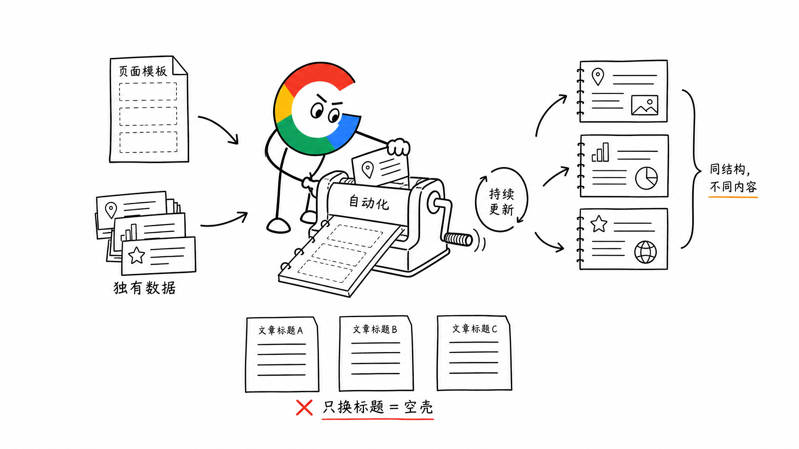
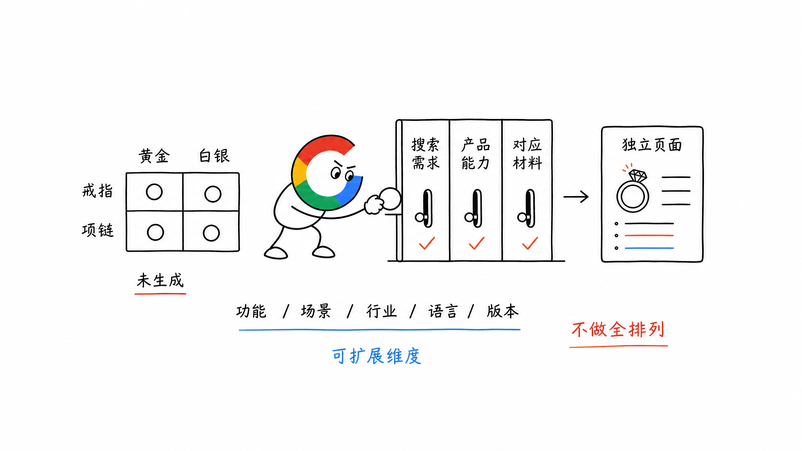
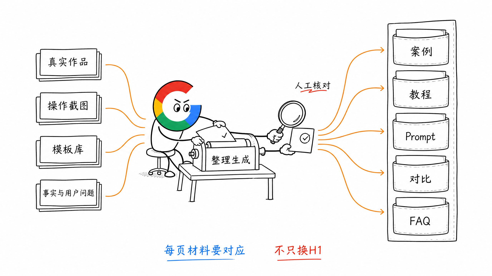
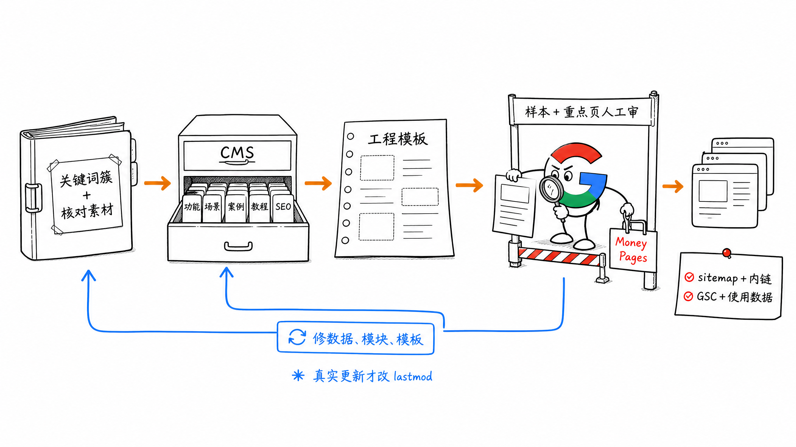
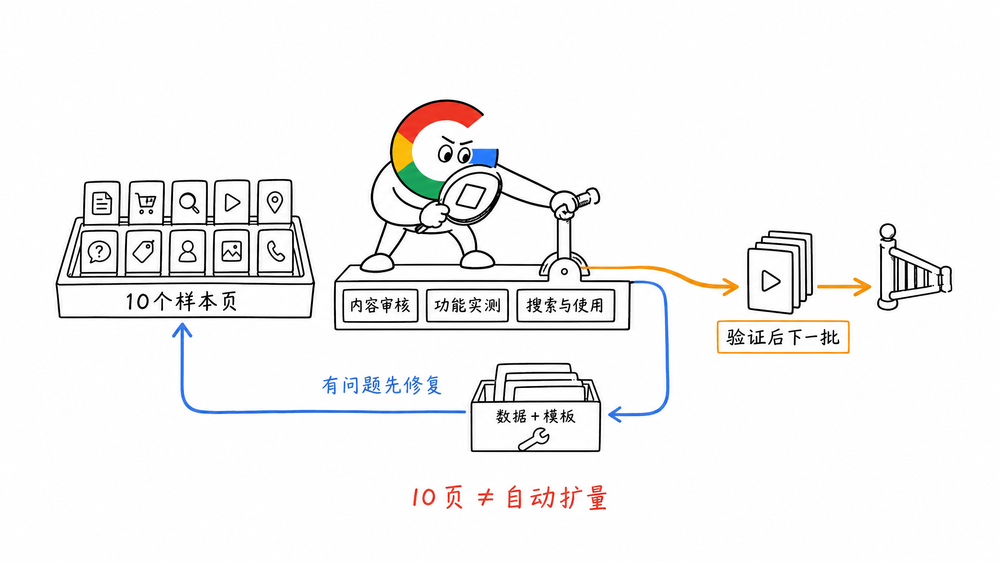

# 第 21 章 pSEO 的双刃剑

AI 和工程工具让批量生成页面越来越容易。

但页面生成出来，只是开始。用户为什么要看这一页？它比其他页面多提供了什么？这些问题不会因为自动化就消失。

我踩过批量堆页面的坑，也看到过真正把产品能力和内容价值规模化的做法。

**pSEO 会放大一套内容方法，也会放大这套方法里的问题。**

## 一、pSEO 到底在规模化什么

pSEO（Programmatic SEO，程序化 SEO），可以用一个公式理解：

**模板 × 结构化内容数据 × 自动化。**

- 模板：页面有哪些模块，每个模块怎么展示
- 结构化内容数据：每一页对应的功能、案例、步骤、参数或其他事实
- 自动化：把数据装进模板，批量生成、发布，并持续更新

这里的结构化内容数据，是能按字段存储和组合的内容，不只是页面里的 Schema 标记。

比如公司信息页可以复用同一套结构，但每家公司的简介、联系方式和人员信息不同。模板一样，每一页仍然有自己的信息。

程序化只是把人工可以完成的内容生产方式，变成一条自动化流水线。内容仍然要解决对应的搜索需求。



## 二、我踩过的坑：页面很多，价值没有跟上

几类做法，看起来都很适合自动化：

- 抓取 YouTube 视频，让 AI 改写成博客
- 把 Chatbot 对话记录聚合成页面，覆盖长尾词
- 复用一个计算器模板，只替换金额、数字或地名

这些方式很容易快速增加页面数量。但如果只是改写、拼贴和换词，用户打开以后没有获得更多有用的信息，规模越大，重复问题也越明显。

其中那个替换数字的计算器，是我 2019 年做过的练手站。回头看，最需要复盘的是：页面除了数字变化，到底有没有把这个搜索问题解决得更好？

还有一些批量站，曝光很高，点击却没有跟上。看到这种数据，要继续检查查询词、排名和页面内容，不能只凭 CTR 低就认定网站受到了处罚。

但只盯曝光和页面总数，很容易忽略一个问题：**用户是否真的愿意选择这些页面，并从中获得结果。**

AI 可以参与生成内容，人工也可能生产低价值页面。需要检查的是每一页的实际交付，而不是写作工具的名字。

## 三、第一步：先规划关键词簇，再拆组合维度

别先写批量生成脚本，先找到可以持续覆盖的需求。

比如包装设计，可以先整理这些关键词簇：

- Packaging Design
- Label Design
- Wine Label Design
- Beer Label Design

再从关键词里找出可以组合的维度。

比如 AI 珠宝设计，可能出现黄金、白银等材质，戒指等品类，以及不同造型。这些都可以继续研究，看看是否形成独立需求，产品能否真正承接。

常见的组合方向是：

**功能 × 场景 × 行业 × 语言 × 版本。**

这是一组规划维度，不是让程序把所有可能的组合都生成一遍。

先看关键词和 SERP，确认哪些组合值得有独立页面。没有真实需求、没有对应内容或产品能力的组合，就先不生成。

找词时，可以从低 DR 竞品的 Top Pages 开始，再沿着对应关键词的 SERP，继续研究其他低 DR 页面，逐步归类成簇。

有些产品没有足够多可复用、又有差异的需求，本来就不适合做大规模 pSEO。



## 四、第二步：为每个内容模块准备真实材料

关键词簇确定以后，先做一页，把页面骨架拆清楚。

接着逐个模块问：这里需要什么材料？能不能持续获得？哪些步骤可以自动完成？

| 模块 | 可以使用的材料 | 自动化时要解决什么 |
| --- | --- | --- |
| 案例 | 真实用户作品、产品生成结果 | 每页有没有对应案例，能否正常展示 |
| 教程 | 实际操作步骤与截图 | 操作路径能否复现，截图是否对应当前功能 |
| Prompt / 模板 | 可使用的提示词与模板 | 是否适合当前任务，使用后能得到什么 |
| 对比 | 有来源的参数、价格或测试数据 | 字段是否一致，数据如何更新 |
| FAQ | 当前功能与用户问题 | 回答是否符合真实能力和限制 |

比如同一套工具页模板，不同场景页里的案例、输入和结果应该对应各自的任务。不能只是把 H1 换掉，下面继续放完全相同的内容。

UGC、自动截图、数据整理和 AI 都可以参与。关键是每个模块都有材料来源，能够交付与这一页相关的信息。

**先把单页做得有价值，再研究这套做法能不能自动化。**



## 五、第三步：接成发布和更新的流水线

模块有了材料，再把它们接到 CMS 和页面模板里。

比如用 Payload、Strapi 这类无头 CMS，把功能、场景、案例、教程和 SEO 字段存成可维护的数据，再由工程读取并渲染页面。

一条流水线可以是：

```text
关键词簇与页面规划
    ↓
收集、核对每页材料
    ↓
写入 CMS 字段
    ↓
模板生成页面，人工审核样本
    ↓
发布、更新 sitemap 与内链
    ↓
观察收录、排名、使用和转化
    ↓
修正数据、模块或模板
```

发布以后还要能更新。功能、价格、模板或操作流程变化时，对应页面的内容也要跟着变，`lastmod` 随真实内容更新。

普通工具页和博客页，做好 sitemap 与站内入口，通过 GSC 观察发现和收录即可。Google 的 Indexing API 目前只适用于符合要求的招聘信息和直播页面，不是普通 pSEO 页面的通用提交接口。

Money Pages 要人工审核。尤其是测评、推荐和具体解决方案，不能让 AI 替代实际体验和判断。



## 六、先做 10 页，跑通以后再扩

我建议先打磨 10 个样本页，再决定怎么扩量。

样本要能覆盖准备生产的不同情况，才能发现模板和数据里的问题。

先确认页面能用、内容对得上，接着观察：

- Google 有没有抓取、收录这些页面
- 出现的查询词是否符合预期
- 用户有没有点击、使用工具或完成下一步
- 每页是否真的有对应的案例、数据或结果
- 数据和功能变化后，页面能否正常更新

没有收录、排名不理想，要回头找原因。可能是抓取和内链，也可能是需求判断、内容或页面重复，不要直接靠增加页面数量解决。

表现好的页面也要人工 Review，把验证有效的模块和做法放回模板，再逐步扩量。

**先验证一组页面有价值，再验证这份价值能不能持续生产。**



## 七、几种值得理解的组合方式

可以用这些例子理解内容维度怎么组合：

| 方向 | 组合方式 | 每页应该交付什么 |
| --- | --- | --- |
| 工作流模板 | 工作流 × 集成 | 对应任务的节点、配置和可使用流程 |
| AI 视频工具 | 功能 × 场景 | 对应场景的功能、案例与实际结果 |
| 网站模板 | 模板 × 组件 | 可预览、可使用的设计与组件 |

这也是理解 n8n 工作流、Pollo AI 场景工具，以及 Framer 模板这类内容结构的角度。

它们值得研究的地方，是相同结构下面装了什么不同的实际内容，以及这些内容如何持续生产和维护。

## 八、小结

pSEO 的核心，是把有信息增量的内容生产方式工程化。

先确定关键词簇，再把页面拆成有真实材料的模块，最后接成可以发布、更新和复盘的流水线。

**先做出 10 个有价值的页面，再让自动化把这份价值规模化。**

> 本章节完毕，谢谢大家，欢迎随时讨论。
