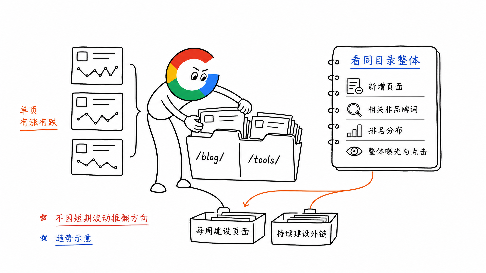
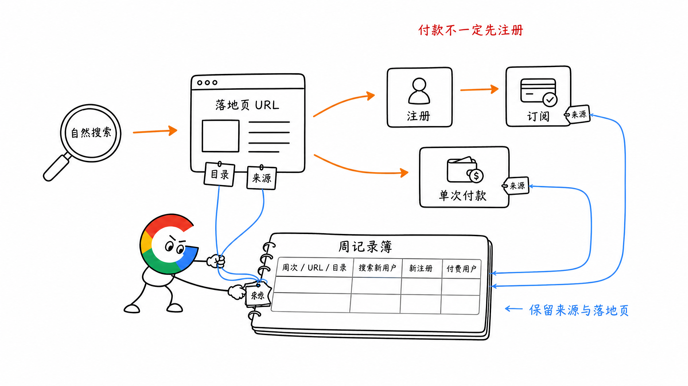
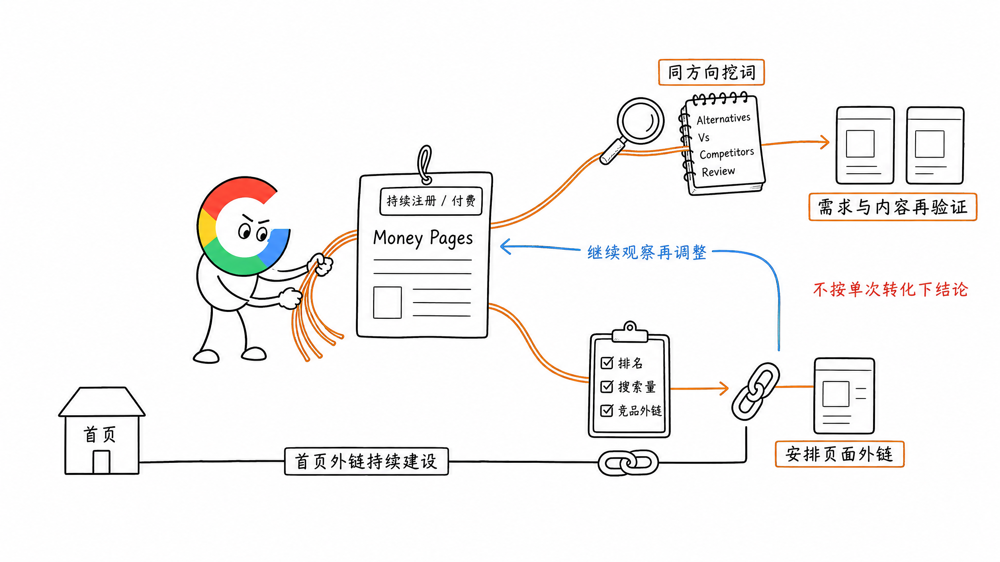

# 第 22 章 从收录到转化：SEO 数据复盘

SEO 数据复盘，最后要落到两个决定：**接下来做哪些页面，外链继续投向哪里。**

但新站没有流量，和网站已经有注册、付费数据时，关注点不一样。

前期先看非品牌词和对应页面有没有持续积累。等有了一定数据，再用转化表现指导内容和外链投入。

## 一、还没流量，先看非品牌词和页面的积累

新站前期，不用每天盯着某个页面今天涨了两名、明天跌了三名。

我更关心的是：

- 有没有持续增加与产品相关的非品牌词页面
- 这些页面对应的词，有没有搜索量，排名到了哪里
- 页面是否真正承接了这些需求，功能和内容是否做好
- 哪个目录开始出现更多关键词和曝光

数量和质量要一起看。

上线 100 个页面，如果没有对应需求，或者都是重复介绍，不能算有效积累。覆盖的词很具体、产品接得住、页面能交付结果，才值得继续做。

这时候看排名和搜索量，是为了判断方向有没有机会，不是每天给单个页面下结论。

## 二、按目录看整体变化，每周持续建设

比如网站有 `/tools/` 和 `/blog/` 两个目录。

某一篇 Blog 排名下降，但整个 `/blog/` 正在覆盖更多相关非品牌词，获得更多曝光，就应该继续看整体趋势。

同样，某个 Tool 突然获得一些点击，也不能直接说明整个工具频道已经跑通。

可以按目录把这些信息放在一起看：

| 看什么 | 要判断什么 |
| --- | --- |
| 新增非品牌词页面 | 这一周有没有按方向持续建设 |
| 已有页面的内容与功能 | 有没有真正完成对应需求 |
| 非品牌词覆盖及排名 | 更多页面是否开始进入搜索竞争 |
| 对应关键词的搜索量 | 这些方向有没有值得争取的搜索空间 |
| 目录整体曝光与点击 | 这一批页面是否在逐步起量 |

前期要保持的动作很直接：**每周新增值得做的非品牌词页面，同时持续做外链建设。**

不要因为一两个页面短期波动，就反复推翻整个方向。先让同一方向形成一批页面，再看这个目录的整体表现。

## 三、有了一定数据，再看用户下一步做了什么

有了搜索访问，就继续看这些用户有没有完成业务动作。

这个动作可能是注册、订阅，也可能是不经过注册，直接单次付款。按产品实际路径统计即可。

按周、按自然搜索落地页记录，再给 URL 标上所属目录：

| 周期 | 落地页 URL | 所属目录 | 自然搜索新用户 | 新注册 | 付费用户 |
| --- | --- | --- | --- | --- | --- |
| 当周 | 具体页面 | `/tools/`、`/blog/` 等 | 对应用户数 | 对应用户数 | 单次付款或订阅用户数 |

注册和付款要能关联回搜索来源与落地页，否则只看全站新增付费，也不知道哪些 SEO 页面真正带来了用户。

每周记录，可以每两周集中比较一次。流量样本太少时，先继续积累，不要因为一个用户付了款，就认定这个方向一定高转化。

这时再把页面区分开：

- 有流量，也有注册或付费：继续研究它为什么能转化
- 有流量，用户没有继续：回去检查页面承诺、功能和操作入口
- 流量还少，但已经出现转化：留作重点观察的候选

比如用户已经在比较产品，页面却只给一个泛泛的了解更多按钮，就可以检查 CTA 是否与当前需求匹配，用户能不能方便地试用或开始使用。

## 四、用 Money Pages 指导挖词和外链

数据积累以后，真正重要的是找出 Money Pages：哪些页面能够持续带来注册或付费。

然后把结果用回两个地方。

### 1. 指导关键词挖掘，建设更多同方向页面

如果产品对比、替代方案这类页面持续带来转化，就继续研究这个方向里还有哪些需求值得做。

比如某类 Alternatives 页面表现好，可以继续找相关的 Alternatives、Vs、Competitors、Review 关键词。

不是把一个标题批量换品牌名，而是沿着已经验证的需求继续挖词，判断是否有独立搜索需求，以及自己能不能提供有价值的比较。

**转化数据告诉我们，哪类搜索用户更容易成为客户。下一轮 Research 就优先往这些方向深入。**

### 2. 指导外链投入，支持已经能转化的页面

首页继续保持稳定的外链建设。后续新增投入，可以逐步分给 Money Pages。

把这几项放在一起看：

- 页面已经带来多少注册或付费
- 主词有多少搜索量，现在排在哪里
- 前排页面的相关外链情况如何
- 如果排名继续提高，有没有更多目标用户可以争取

这样就能从已有转化表现，反推哪些页面值得继续获得外部推荐。

不能只因为一个词搜索量大，就一直投入；也不要因为某个页面转化好，就不看竞争情况无限加外链。

新增投入以后，继续看目标页排名、搜索访问和转化有没有变化，再决定下一步。

## 五、小结

没有流量时，看非品牌词与页面的数量和质量，按目录观察整体变化，每周持续增加页面和外链。

有了一定数据，再看哪些落地页带来注册和付费。用这些 Money Pages 指导下一轮挖词，也指导首页之外的外链投入。

**前期把有价值的页面做起来，后期让转化数据决定继续往哪里投入。**

> 本章节完毕，谢谢大家，欢迎随时讨论。
