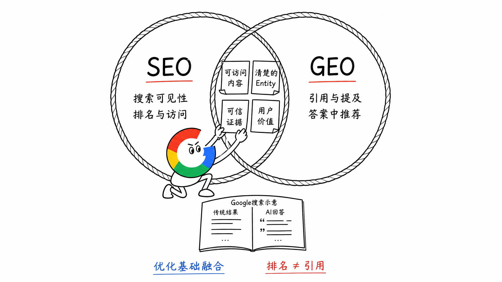
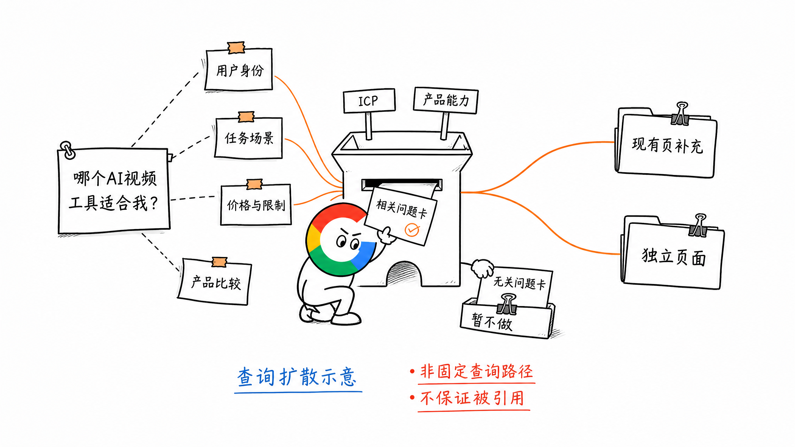

# 第 23 章 AI 搜索时代的 SEO 与 GEO

这本小册子主要讲 SEO。GEO 还在变化，这一章点到为止，讲讲两者融合过程中，哪些基础值得继续做好。

GEO（Generative Engine Optimization，生成式引擎优化）关注的是：用户向 AI 提问时，你的产品和内容能否被理解、引用或推荐。

对应的入口包括 ChatGPT、Google AI Overview、国内的豆包等。入口和回答方式不同，但用户仍然在找信息、比较方案、完成任务。

## 一、SEO 和 GEO，像两个有交集的圈

SEO 关注搜索里的可见性、排名，以及带来的访问和转化。GEO 更关注品牌与内容在生成式答案中的呈现。

可以把它们看成两个有交集的圈：目标有区别，底层能力有不少共通之处。

尤其在 Google 生态里，AI Overview 和 AI Mode 已经是搜索体验的一部分。做 SEO 时，除了传统结果中的位置，也需要考虑内容能否成为 AI 回答的支持材料。

Google 对这些 AI 搜索功能的说明，仍然强调既有的 SEO 基础，并没有要求网站另做一套特殊优化。

所以我更愿意把它理解成：**在 Google 生态里，SEO 与 GEO 正围绕同一套内容质量要求逐渐融合。**

不是谁包含谁，也不代表传统排名与 AI 引用会完全一致。

## 二、前面讲过的这些基础，仍然值得做

用一本书来理解：用户可能自己翻书找答案，也可能先问店员推荐哪本书。

不管哪种方式，书讲什么、适合谁、内容是否可靠，都得说清楚。

| 共同基础 | 继续怎么做 |
| --- | --- |
| Entity 与主题边界 | 说清产品是什么、服务谁，围绕相关主题持续建设 |
| 可发现、可读取 | 核心内容能正常访问，有清楚的站内入口和文字表达 |
| 内容结构 | 结论明确，用标题、步骤、表格和案例把问题讲清楚 |
| 真实证据与来源 | 展示实际操作、截图、测试和可核对的数据，说明限制 |
| 明确的实体关系 | 品牌、产品、功能与场景对应清楚，官网和外部介绍里的事实一致 |

比如你做 AI 营销视频工具，就持续讲清商品视频、广告素材和相关使用场景。不是看到某个 AI 新词有热度，就把所有方向都写进网站。

测评、案例和功能介绍也一样。真实效果、有依据的比较、明确的适用条件，既帮助用户判断，也为回答这些问题提供了可引用的材料。

把一句话写成金句，或者多放几张表，并不会自动获得 AI 引用。先有值得引用的信息，再把它表达清楚。

## 三、Fan-out 的启发：把目标用户的问题研究得更细

AI 搜索可能围绕一个问题，进一步搜索相关子问题。这种方式叫 Query Fan-out（查询扩散）。Google 的 AI 搜索功能也可能使用这种方式。

比如用户问：哪个 AI 视频工具适合我？

为了形成有用的回答，可能需要继续了解：

- 用户是创作者，还是电商品牌
- 要做社媒短视频，还是数字人讲解
- 有没有免费额度，价格和限制是什么
- 两个候选产品在具体任务上有什么区别

这些是子问题示意，不是每次提问都会发生的固定搜索清单。

对我们做内容的启发是：**回到自己的 ICP，找到目标用户真正关心的细分问题。**

可以从客户反馈、社区讨论和竞品内容里继续 Research。与产品相关、能提供实际答案的需求，再放回 Topic Map，判断应该补进现有页面，还是由新页面承接。

开源地址：https://github.com/JeffLi1993/open-growth-skills/tree/main/chatgpt-fanout-queries

这仍然是前面讲的需求研究和 Keyword-to-Page。不是为猜测中的每一条 AI 子查询都建一个页面。

## 四、被提到以后，仍然要看用户结果

AI 提及品牌、引用页面，以及用户点击进入网站，是不同的结果。

被引用是值得观察的信号，但最终还是要看：有没有带来目标用户，他们进入页面后，能不能完成使用、注册或付款。

入口在变，网站交付的价值仍然要接得住。尤其工具页，AI 介绍得再好，用户进来用不了，也很难形成转化。

## 五、小结

GEO 的平台和具体方法还会继续变化。这本小册子先把 SEO 的基础讲清楚。

明确产品身份，围绕真实需求建设主题，用可访问的页面、可信的证据和清楚的表达交付价值。这些工作，在 AI 搜索时代仍然值得持续投入。

**用户找答案的方式在变，我们认真解决的问题仍然来自用户。**

> 本章节完毕，谢谢大家，欢迎随时讨论。
